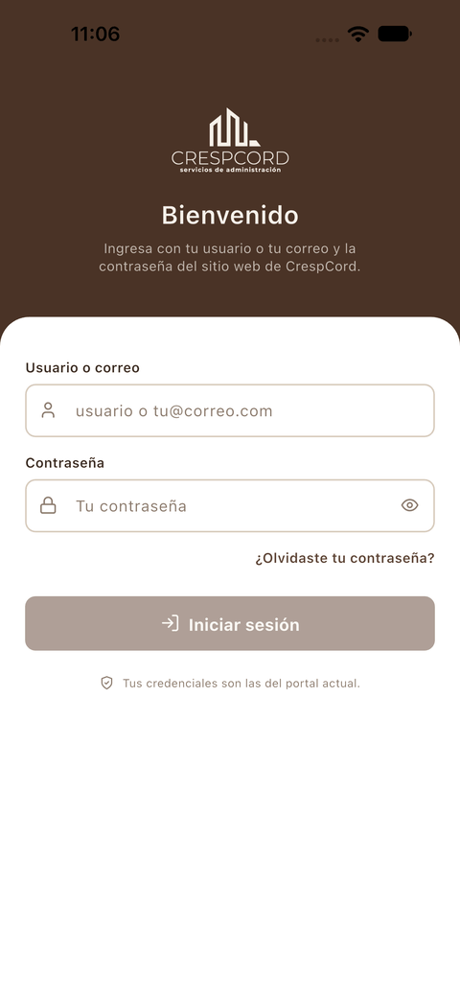
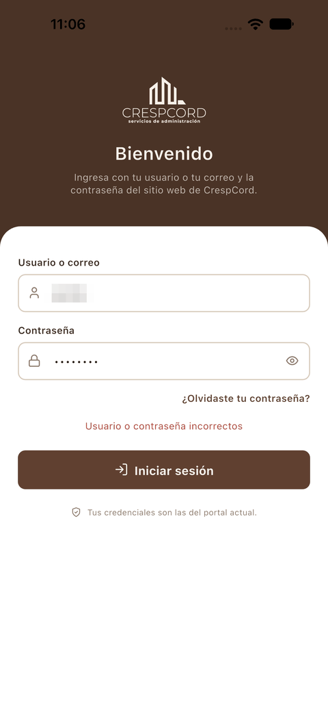
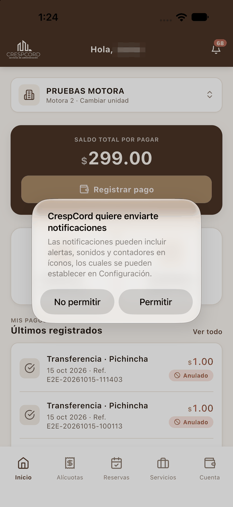
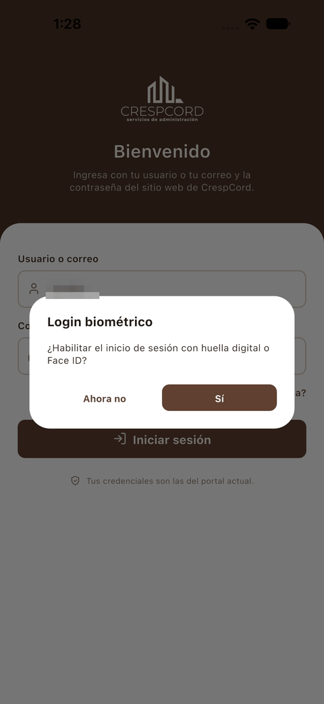
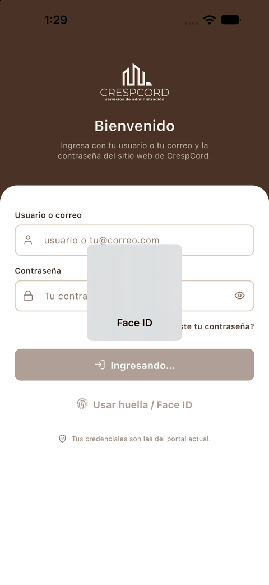
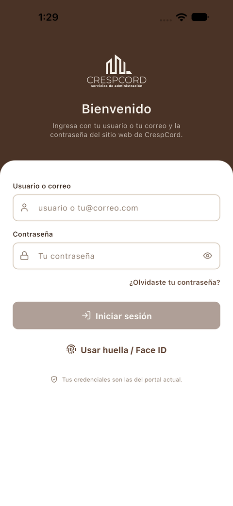
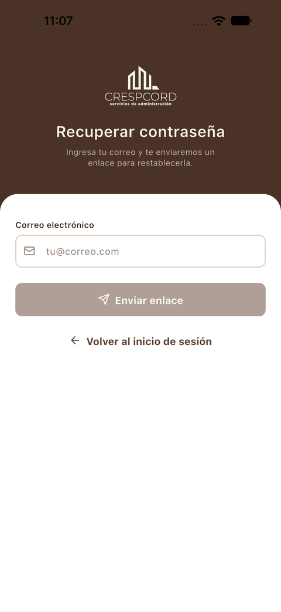
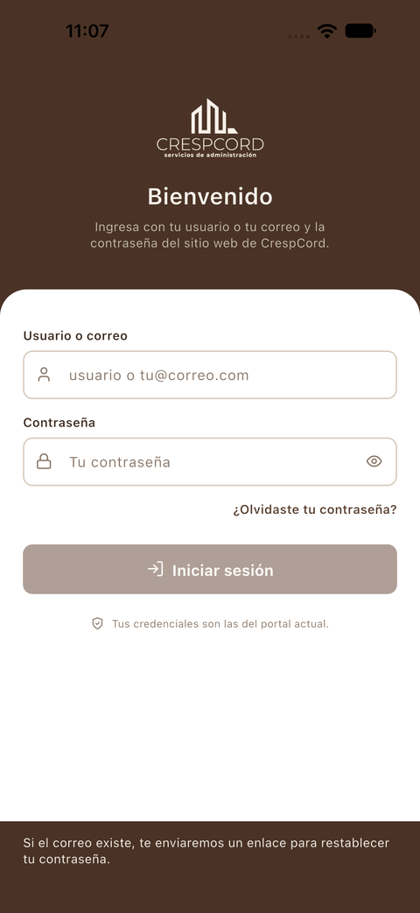
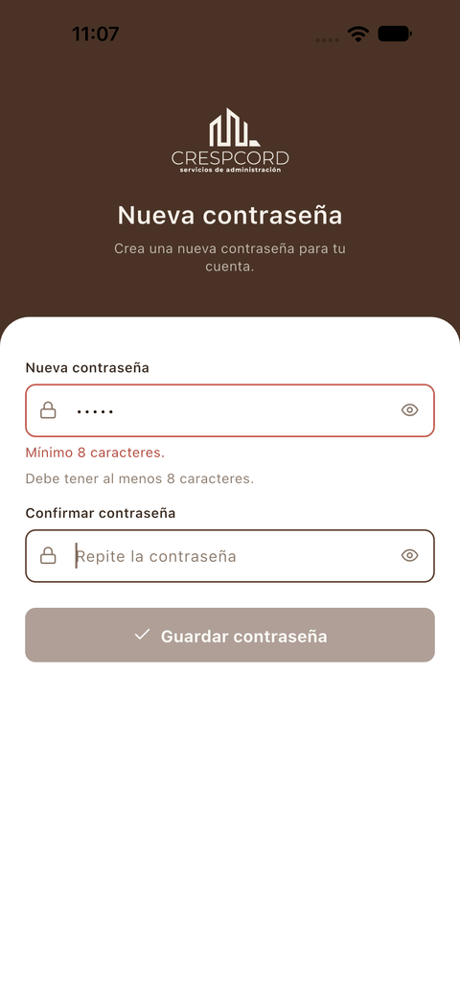
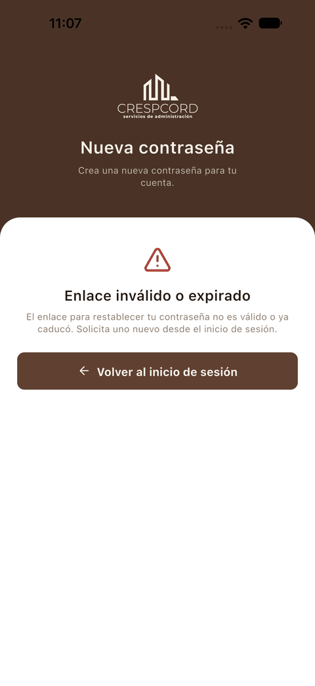

[← Índice](../USER_GUIDE.md) · [Siguiente: Inicio →](02_inicio.md)

# 1. Acceso

## Iniciar sesión

**¿Para qué sirve?**
Para entrar a la app con tu cuenta de CrespCord.

**Cómo acceder**
Es la primera pantalla que ves al abrir la app sin una sesión iniciada.

**Interfaz**

1. **Usuario o correo**: escribe tu nombre de usuario o tu correo electrónico.
2. **Contraseña**: el icono del ojo, a la derecha, muestra u oculta lo que escribes.
3. **¿Olvidaste tu contraseña?**: abre la recuperación de contraseña.
4. **Iniciar sesión**: se activa cuando has rellenado los dos campos.

**Cómo utilizarla**

1. Escribe tu usuario o correo.
2. Escribe tu contraseña.
3. Pulsa **Iniciar sesión**, o la tecla de confirmar del teclado.

**Resultado**
Si los datos son correctos, entras a la pantalla de [Inicio](02_inicio.md). La sesión queda guardada y la próxima vez que abras la app no tendrás que volver a escribirlos.

**Consideraciones**

- Tus credenciales son **las mismas del portal web** de CrespCord.
- Si el usuario o la contraseña no son correctos, aparece el mensaje en rojo **«Usuario o contraseña incorrectos»** y sigues en la misma pantalla:

- La primera vez que entras, el teléfono te pide permiso para mostrar notificaciones. Pulsa **Permitir** si quieres recibir avisos de la app.

  

- Si tu teléfono tiene huella o Face ID, la app te ofrecerá [entrar con biometría](#entrar-con-huella-o-face-id).

## Entrar con huella o Face ID

**¿Para qué sirve?**
Para entrar sin escribir la contraseña, con la huella o el reconocimiento facial del teléfono.

**Cómo activarlo**

1. Inicia sesión con tu usuario y contraseña.
2. Si el teléfono tiene huella o Face ID configurados, aparece el diálogo **Login biométrico**: *«¿Habilitar el inicio de sesión con huella digital o Face ID?»* Pulsa **Sí**. Con **Ahora no** sigues entrando solo con contraseña.
3. El teléfono te pide la huella o la cara para confirmar. Cuando la reconoce, entras a la app.

 

**Cómo entrar después**

1. En la pantalla de inicio de sesión, pulsa **Usar huella / Face ID**.
2. Mira al teléfono o apoya el dedo.

**Resultado**
Entras directamente a [Inicio](02_inicio.md), sin escribir la contraseña.

**Consideraciones**

- El interruptor **Login biométrico** de [Mi cuenta](07_mi_cuenta.md) muestra si la biometría está activa.
- Aunque la tengas activa, puedes seguir entrando con usuario y contraseña.

## Recuperar la contraseña

**¿Para qué sirve?**
Para recibir por correo un enlace con el que crear una contraseña nueva.

**Cómo acceder**
En la pantalla de inicio de sesión, pulsa **¿Olvidaste tu contraseña?**

**Interfaz**

1. **Correo electrónico**: el correo asociado a tu cuenta.
2. **Enviar enlace**: se activa cuando escribes un correo.
3. **Volver al inicio de sesión**: regresa sin enviar nada.

**Cómo utilizarla**

1. Escribe tu correo electrónico.
2. Pulsa **Enviar enlace**.

**Resultado**
La app vuelve a la pantalla de inicio de sesión y muestra abajo el aviso **«Si el correo existe, te enviaremos un enlace para restablecer tu contraseña.»**

**Consideraciones**

- Por seguridad, el mensaje es el mismo exista o no una cuenta con ese correo.
- Revisa tu bandeja de entrada (y la de correo no deseado) y abre el enlace desde el teléfono.

## Restablecer la contraseña

**¿Para qué sirve?**
Para crear la contraseña nueva después de abrir el enlace recibido por correo.

**Cómo acceder**
Abre en el teléfono el enlace del correo de recuperación. La app se abre directamente en la pantalla **Nueva contraseña**.

**Interfaz**

1. **Nueva contraseña**: debe tener al menos 8 caracteres.
2. **Confirmar contraseña**: repite la misma contraseña.
3. **Guardar contraseña**: se activa cuando los dos campos son válidos y coinciden.

**Cómo utilizarla**

1. Escribe la contraseña nueva.
2. Repítela en **Confirmar contraseña**.
3. Pulsa **Guardar contraseña**.

**Consideraciones**

- Mientras la contraseña sea demasiado corta, verás **«Mínimo 8 caracteres.»** debajo del campo. Si las dos contraseñas no coinciden, la app también te avisa.
- El enlace caduca. Si ya no es válido, la app muestra **«Enlace inválido o expirado»**. Pulsa **Volver al inicio de sesión** y pide un enlace nuevo desde **¿Olvidaste tu contraseña?**

