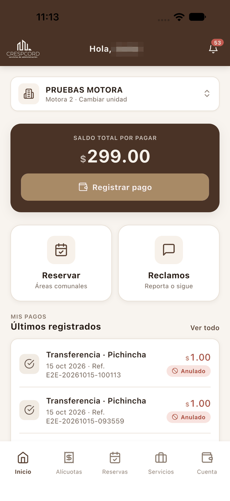
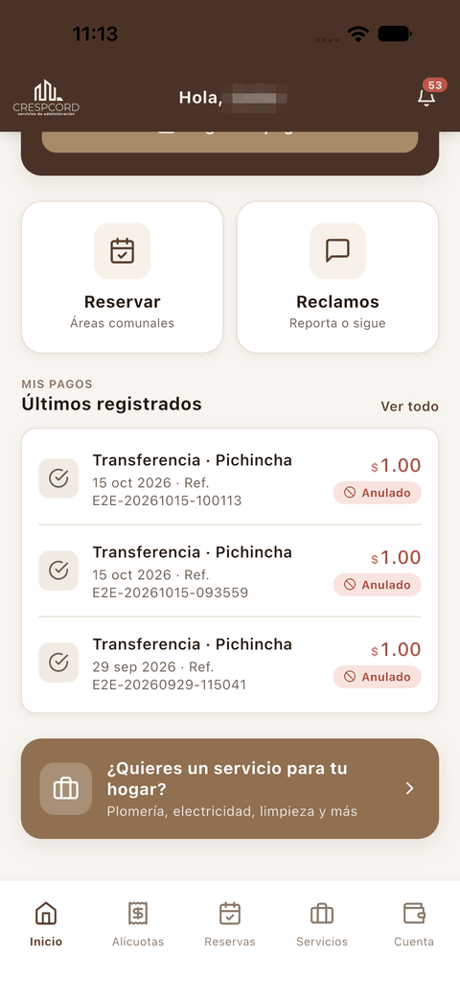
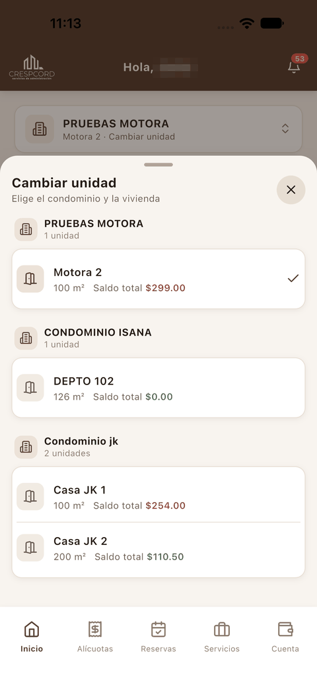
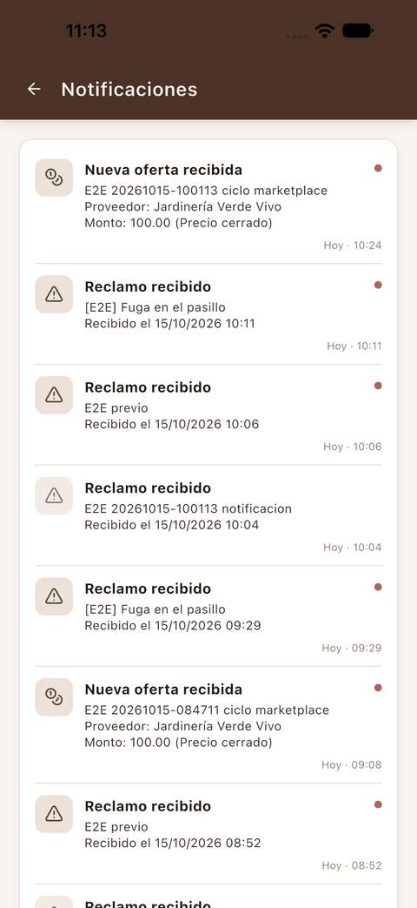
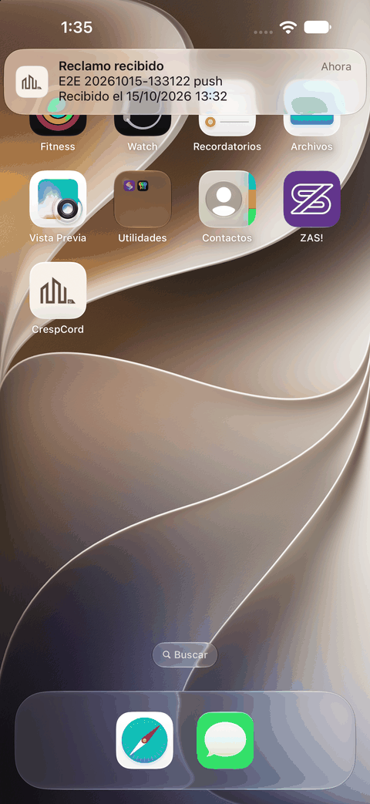
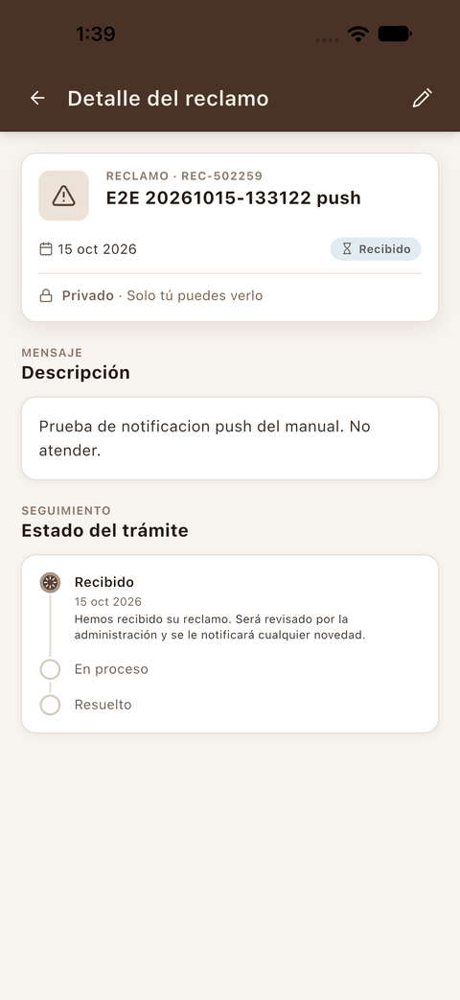

[← Acceso](01_acceso.md) · [Índice](../USER_GUIDE.md) · [Siguiente: Alícuotas y pagos →](03_alicuotas_y_pagos.md)

# 2. Inicio

## Pantalla de inicio

**¿Para qué sirve?**
Reúne lo más importante de tu vivienda: cuánto debes, accesos rápidos a reservas y reclamos, y tus últimos pagos.

**Cómo acceder**
Es la pantalla que aparece al iniciar sesión. Desde cualquier otra sección, pulsa **Inicio** en la barra inferior.

**Interfaz**

 

1. **Campana** (arriba a la derecha): abre tus [notificaciones](#notificaciones). El número rojo indica cuántas tienes pendientes.
2. **Tarjeta de la vivienda**: muestra el condominio y la unidad activa. Púlsala para [cambiar de unidad](#cambiar-de-unidad).
3. **Saldo total por pagar** y botón **Registrar pago**: lleva al [registro de un pago](03_alicuotas_y_pagos.md#registrar-un-pago).
4. **Reservar · Áreas comunales**: abre [Reservas](04_reservas.md).
5. **Reclamos · Reporta o sigue**: abre [Reclamos y requerimientos](05_reclamos.md).
6. **Mis pagos · Últimos registrados**: tus pagos más recientes con su estado (por ejemplo, *En revisión* o *Anulado*). **Ver todo** abre el historial completo.
7. **¿Quieres un servicio para tu hogar?**: acceso directo a [Servicios](06_servicios.md).

## Cambiar de unidad

**¿Para qué sirve?**
Si tienes más de una vivienda, aquí eliges con cuál trabajar. Los saldos, alícuotas, reservas, reclamos y servicios que ves corresponden siempre a la **unidad activa**.

**Cómo acceder**
Pulsa la tarjeta de la vivienda en **Inicio** (donde dice *Cambiar unidad*) o el **icono de edificio** de la cabecera en Alícuotas, Reservas o Cuenta.

**Interfaz**

1. Las viviendas aparecen agrupadas por condominio.
2. Cada vivienda muestra su superficie y su **saldo total**: en rojo si hay deuda y en verde si no la hay.
3. La marca ✓ señala la unidad activa.
4. La **X** cierra el selector sin hacer cambios.

**Cómo utilizarla**

1. Abre el selector.
2. Toca la vivienda que quieres usar.

**Resultado**
El selector se cierra y la cabecera de cada sección muestra la nueva unidad, por ejemplo *«Casa JK 2 · Condominio jk»*.

## Notificaciones

**¿Para qué sirve?**
Reúne los avisos de la app: reclamos recibidos, ofertas nuevas de proveedores y otras novedades.

**Cómo acceder**
Pulsa la **campana** de la cabecera.

**Interfaz**

1. Cada aviso muestra el tipo (por ejemplo *Reclamo recibido* o *Nueva oferta recibida*), un resumen y la fecha y hora.
2. El **punto rojo** de la derecha indica que el aviso no está leído.

**Cómo utilizarla**

1. Toca un aviso para abrir la pantalla relacionada, por ejemplo el detalle del reclamo.
2. Pulsa la flecha de la izquierda para volver.

**Resultado**
Al abrirlo, el aviso se marca como leído y desaparece su punto rojo.

### Avisos en el teléfono

Si diste permiso a la app para enviar notificaciones, los avisos también llegan al teléfono cuando la app está en segundo plano.

 

**Cómo utilizarla**

1. Toca el aviso cuando aparezca en la parte superior de la pantalla.
2. La app se abre directamente en la pantalla relacionada. En el ejemplo, un aviso *Reclamo recibido* abre el **Detalle del reclamo**.
