[← Inicio](02_inicio.md) · [Índice](../USER_GUIDE.md) · [Siguiente: Reservas →](04_reservas.md)

# 3. Alícuotas y pagos

## Mis Alícuotas

**¿Para qué sirve?**
Para consultar lo que debes, el detalle de cada recibo mensual, las alícuotas extraordinarias y los pagos que has registrado.

**Cómo acceder**
Pulsa **Alícuotas** en la barra inferior.

**Interfaz**

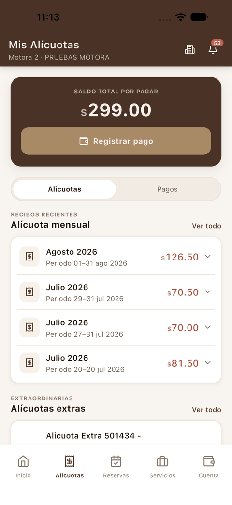 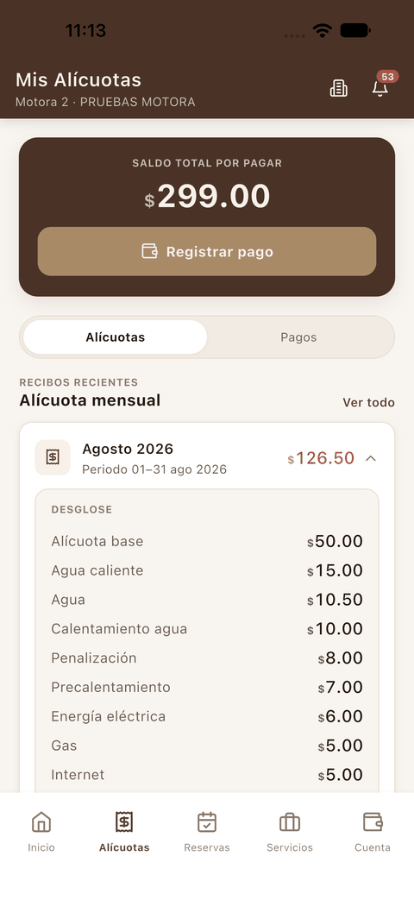

1. **Cabecera**: indica la unidad activa (por ejemplo *Motora 2 · PRUEBAS MOTORA*). El icono de edificio sirve para [cambiar de unidad](02_inicio.md#cambiar-de-unidad).
2. **Saldo total por pagar** y botón **Registrar pago**.
3. Pestañas **Alícuotas** y **Pagos**.
4. **Alícuota mensual · Recibos recientes**: un recibo por periodo con su importe. Toca un recibo para ver su **desglose**: cada concepto (alícuota base, agua, gas, internet…), el *Total del mes*, el *Saldo anterior* y el *Saldo total*.
5. **Ver todo**: abre el historial completo de recibos.

Más abajo está el bloque **Alícuotas extras · Extraordinarias**, con su propio **Ver todo**:

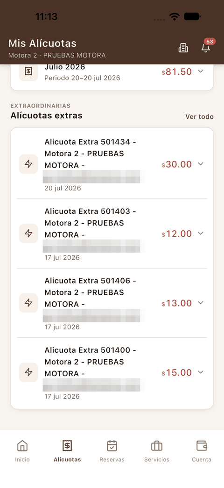

**Consideraciones**

- En el desglose, la nota con asterisco indica si el importe cambia según la fecha de pago (por ejemplo, *«Pago hasta el 15: … Pago después del 15: …»*).

## Historiales de alícuotas

**Cómo acceder**
En **Mis Alícuotas**, pulsa **Ver todo** junto a *Alícuota mensual* o junto a *Alícuotas extras*.

**Interfaz**

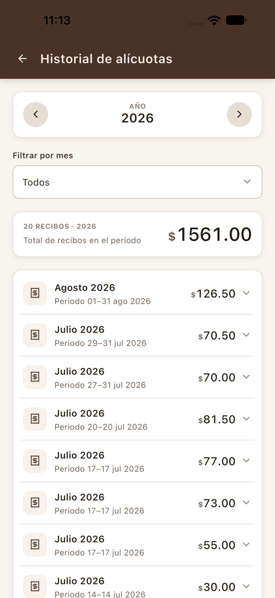 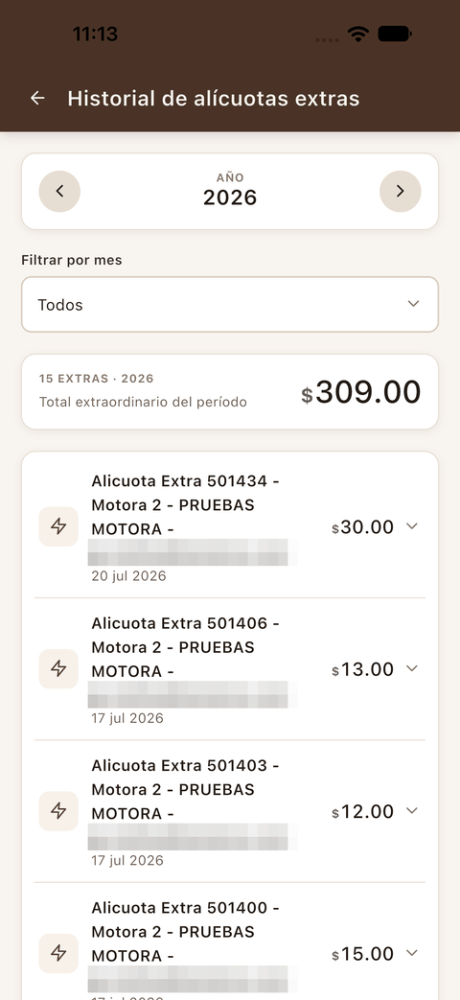

1. **Año**: las flechas cambian de año.
2. **Filtrar por mes**: muestra un solo mes o *Todos*.
3. **Resumen**: cuántos recibos hay en el periodo y la suma total.
4. **Lista de recibos** del periodo elegido.

## Mis pagos

**¿Para qué sirve?**
Para revisar los pagos que has registrado y en qué estado están.

**Cómo acceder**
Tienes tres caminos:

- Pestaña **Pagos** en **Mis Alícuotas**.
- **Ver todo** en *Mis pagos* de la pantalla de Inicio, que abre el **Historial de pagos**.
- **Ver todo** en *Mis pagos* de **Cuenta**.

**Interfaz**

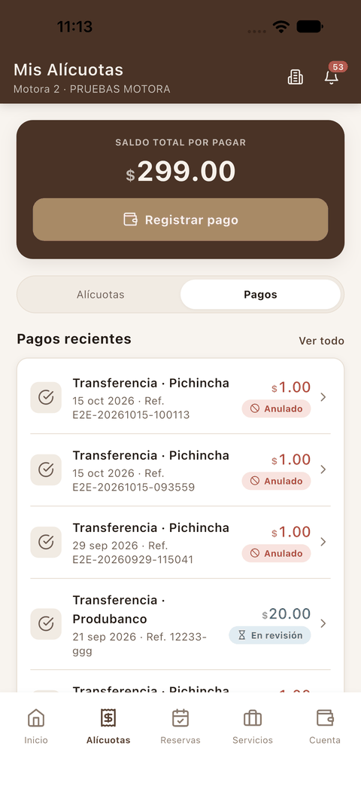 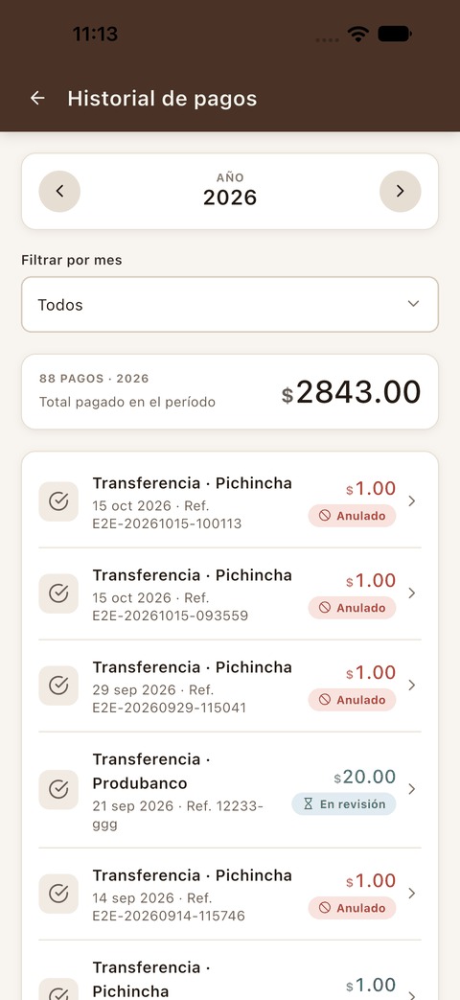

1. Cada pago muestra la forma de pago y el banco, la fecha, la referencia y el importe.
2. La etiqueta indica el estado: **En revisión** (la administración aún no lo ha validado) o **Anulado**.
3. En el historial puedes filtrar por año y por mes, y ves el total pagado en el periodo.

Toca un pago para abrir su **Detalle del pago**:

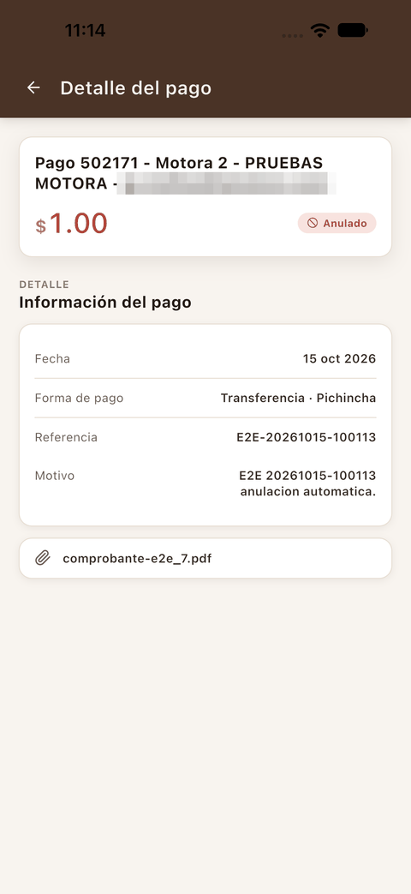

En el detalle aparecen la fecha, la forma de pago, la referencia, el comprobante adjunto y, si el pago se anuló, el motivo.

## Registrar un pago

**¿Para qué sirve?**
Para informar a la administración de una transferencia o un depósito que ya hiciste, adjuntando el comprobante. **La app no cobra con tarjeta**: solo registra el pago para que el operador lo confirme.

**Cómo acceder**
Pulsa **Registrar pago** en la tarjeta *Saldo total por pagar* de **Inicio** o de **Mis Alícuotas**.

**Interfaz**

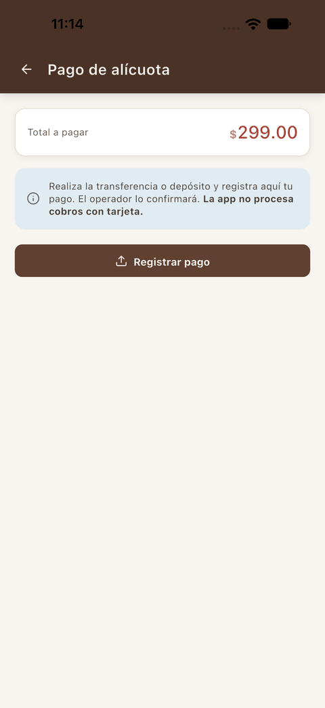 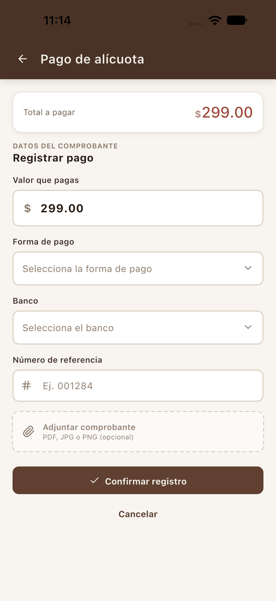

1. **Total a pagar**: tu saldo pendiente.
2. **Aviso informativo**: recuerda que primero debes hacer la transferencia o el depósito.
3. **Registrar pago**: abre el formulario *Datos del comprobante*, con estos campos:
   - **Valor que pagas**: viene relleno con el total, pero puedes cambiarlo.
   - **Forma de pago** y **Banco**.
   - **Número de referencia** del comprobante.
   - **Adjuntar comprobante**: PDF, JPG o PNG (opcional).

**Cómo utilizarla**

1. Pulsa **Registrar pago**.
2. Revisa el **Valor que pagas**. Si pagas menos del total, aparece el aviso amarillo *«Abono parcial: quedará un saldo pendiente de …»*.
3. Elige la **Forma de pago**: Cheque, Depósito, Efectivo o Transferencia.

   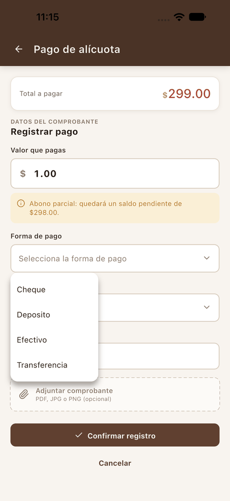

4. Elige el **Banco** y escribe el **Número de referencia**.
5. Pulsa **Adjuntar comprobante** y selecciona el archivo. Su nombre aparece en verde dentro del formulario.

   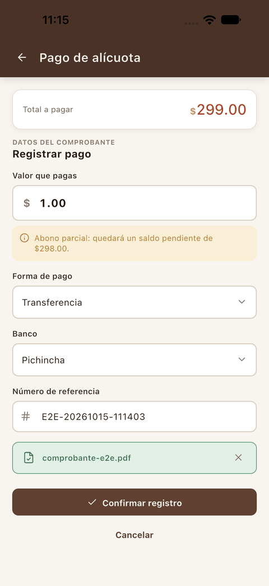

6. Pulsa **Confirmar registro**.

**Resultado**
Aparece la pantalla **¡Pago registrado!** con el seguimiento del pago: *Pago registrado → En revisión → Pago confirmado*. Pulsa **Listo** para volver.

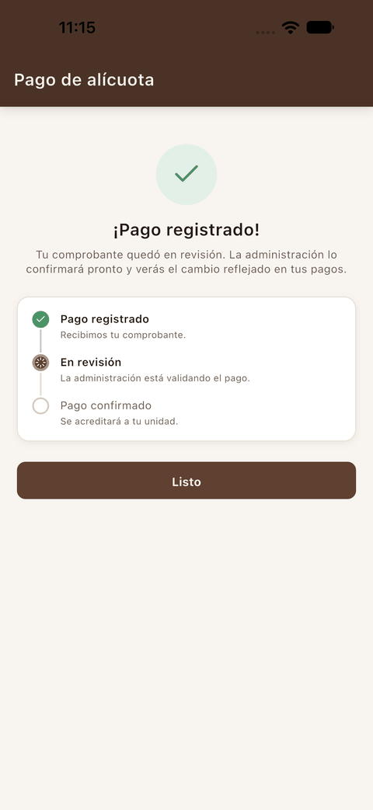

Para comprobarlo, busca el pago en **Mis pagos**: aparece con la etiqueta **En revisión** hasta que la administración lo confirme.

## Anular un pago

**¿Para qué sirve?**
Para retirar un pago que registraste por error mientras sigue en revisión.

**Cómo acceder**
Abre el pago desde **Mis pagos**. Si está **En revisión**, verás el botón rojo **Anular pago**.

**Interfaz**

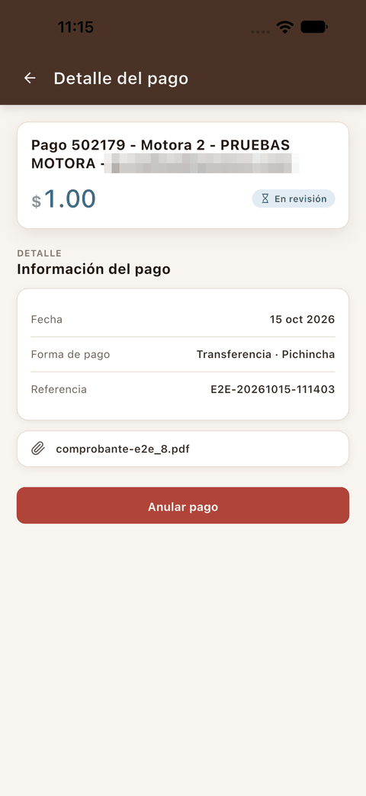 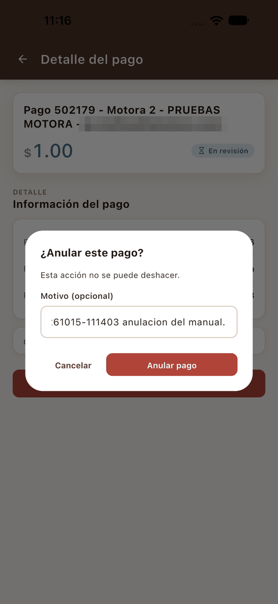

**Cómo utilizarla**

1. Pulsa **Anular pago**.
2. Si quieres, escribe un **Motivo**.
3. Pulsa **Anular pago** en el diálogo, o **Cancelar** para no hacer nada.

**Resultado**
El pago pasa a **Anulado**, el detalle muestra el motivo y el botón **Anular pago** desaparece.

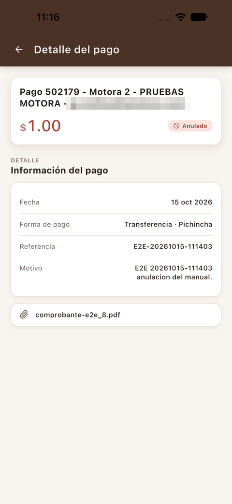

**Consideraciones**

- **La anulación no se puede deshacer.** Si fue un error, registra el pago de nuevo.
