[← Alícuotas y pagos](03_alicuotas_y_pagos.md) · [Índice](../USER_GUIDE.md) · [Siguiente: Reclamos →](05_reclamos.md)

# 4. Reservas de áreas comunes

## Pantalla Reservas

**¿Para qué sirve?**
Para ver tus próximas reservas y elegir un área común (cancha, piscina, gimnasio, casa comunal…) que quieras reservar.

**Cómo acceder**
Pulsa **Reservas** en la barra inferior.

**Interfaz**

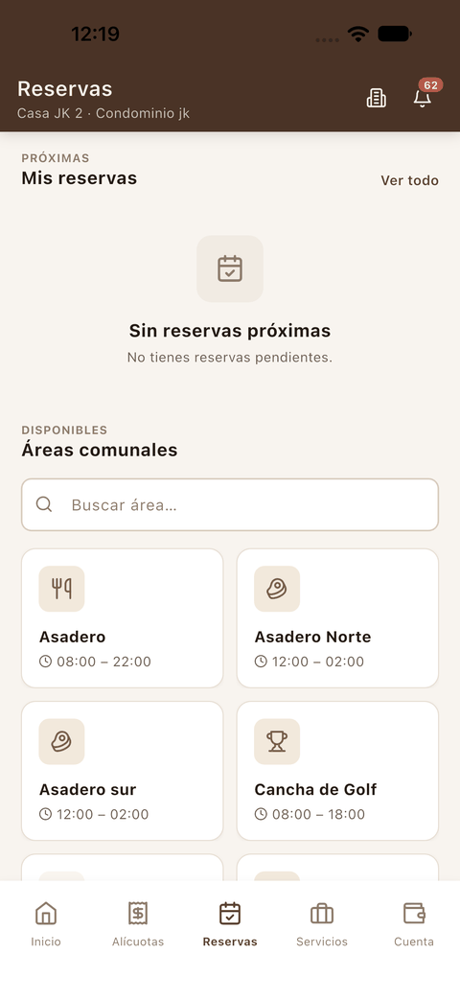 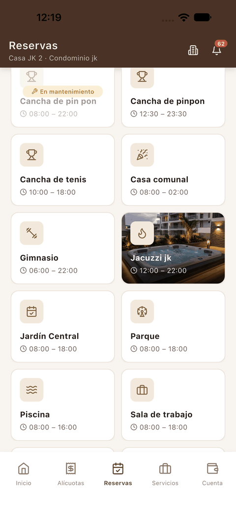

1. **Cabecera**: la unidad activa. Las áreas y las reservas son las del **condominio de esa unidad**.
2. **Mis reservas · Próximas**: tus reservas pendientes. **Ver todo** abre el historial.
3. **Buscar área…**: filtra las áreas por nombre.
4. **Áreas comunales**: cada tarjeta muestra el nombre y el horario de apertura. Las áreas marcadas **En mantenimiento** aparecen atenuadas.

## Hacer una reserva

**Cómo acceder**
En **Reservas**, toca la tarjeta del área que quieres reservar.

**Interfaz**

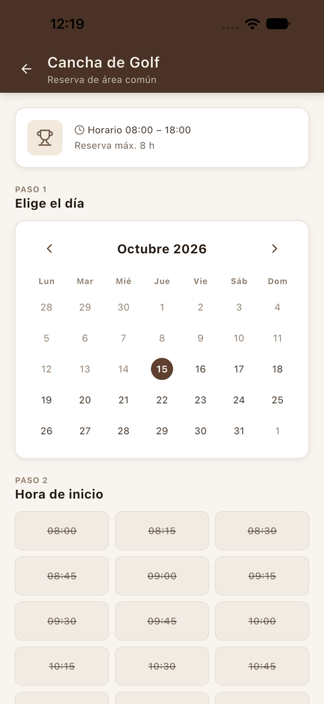 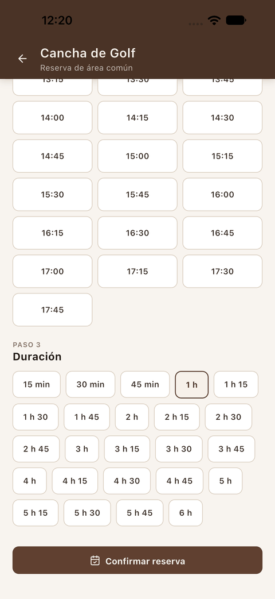

1. **Ficha del área**: horario de apertura y duración máxima de una reserva (por ejemplo, *Reserva máx. 8 h*).
2. **Paso 1 · Elige el día**: calendario con flechas para cambiar de mes.
3. **Paso 2 · Hora de inicio**: los horarios disponibles para ese día. Los **tachados** no se pueden elegir.
4. **Paso 3 · Duración**: las duraciones posibles a partir de la hora elegida.
5. **Confirmar reserva**: se activa cuando has elegido día, hora y duración.

**Cómo utilizarla**

1. Toca el día en el calendario. Queda marcado con un círculo.

   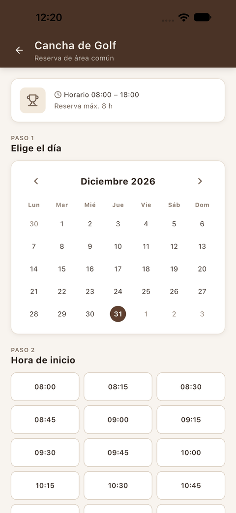

2. Elige la **hora de inicio**.
3. Elige la **duración**.
4. Pulsa **Confirmar reserva**.
5. Revisa el resumen (área, fecha, hora y duración) y pulsa **Confirmar reserva** otra vez. **Volver** te deja corregir.

   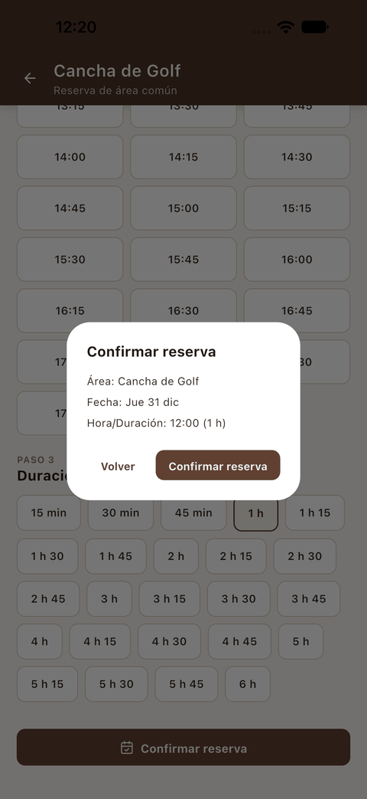

**Resultado**
Aparece **¡Listo, reservaste!** con la reserva en estado **Confirmada**. Pulsa **Ver mis reservas** y la verás en *Mis reservas · Próximas*.

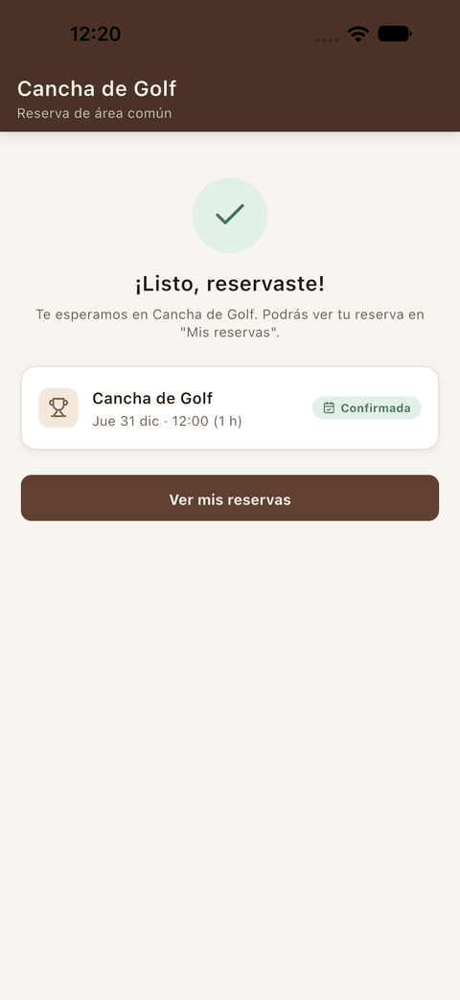 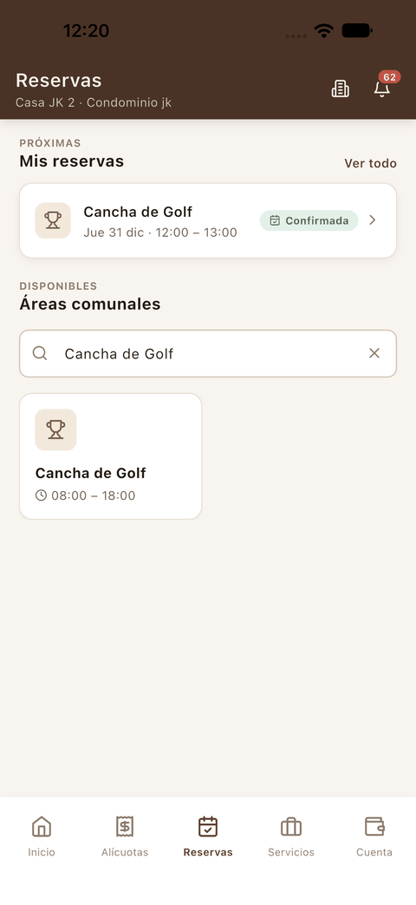

**Consideraciones**

- La reserva se hace **para la unidad activa**. Si tienes varias viviendas, [cambia de unidad](02_inicio.md#cambiar-de-unidad) antes de reservar.
- **Si la unidad tiene saldo pendiente, no puede reservar.** Al confirmar, la reserva no se crea y aparece en rojo el aviso *«Tienes saldo pendiente; regulariza tu cuenta para reservar.»* Primero [registra el pago](03_alicuotas_y_pagos.md#registrar-un-pago) o cambia a una unidad sin deuda.

  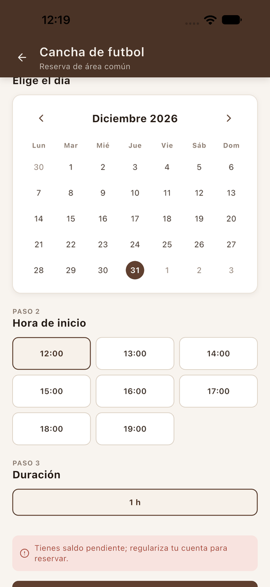

## Historial y detalle de una reserva

**Cómo acceder**
En **Reservas**, pulsa **Ver todo** junto a *Mis reservas*. Toca una reserva para abrir su detalle.

**Interfaz**

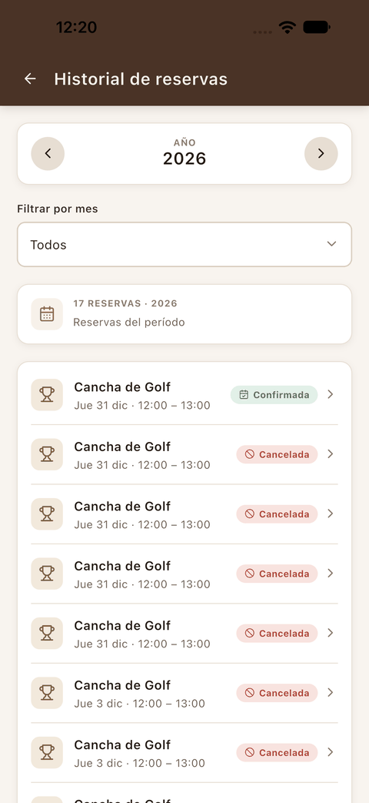 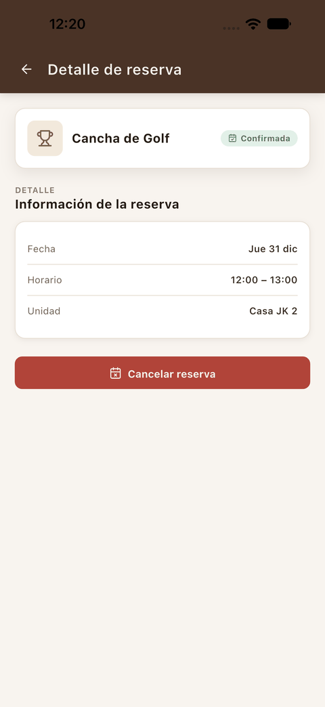

1. **Año** y **Filtrar por mes**, con el número de reservas del periodo.
2. Cada reserva muestra el área, el día, el horario y su estado: **Confirmada** o **Cancelada**.
3. El **Detalle de reserva** muestra la fecha, el horario y la unidad.

## Cancelar una reserva

**Cómo acceder**
Abre una reserva **Confirmada** y pulsa **Cancelar reserva**.

**Cómo utilizarla**

1. Pulsa **Cancelar reserva**. El diálogo avisa de que la acción no se puede deshacer.
2. Si quieres, escribe un **Motivo**.
3. Pulsa **Cancelar reserva** en el diálogo, o **Volver** para mantenerla.

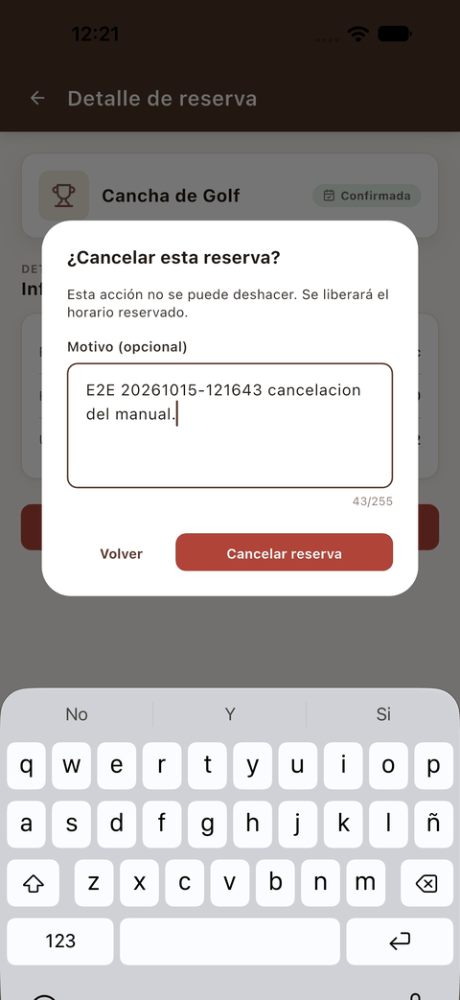

**Resultado**
Aparece el aviso **«Reserva cancelada correctamente.»** El detalle pasa a **Cancelada** y muestra quién la canceló (*El residente*) y el motivo. Como indica el diálogo, el horario reservado queda libre de nuevo.

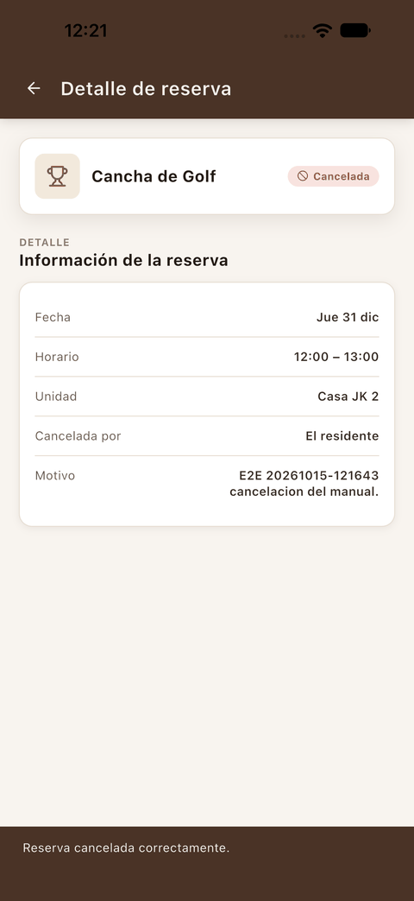

**Consideraciones**

- **La cancelación no se puede deshacer.** Si cambias de opinión, haz una reserva nueva.
