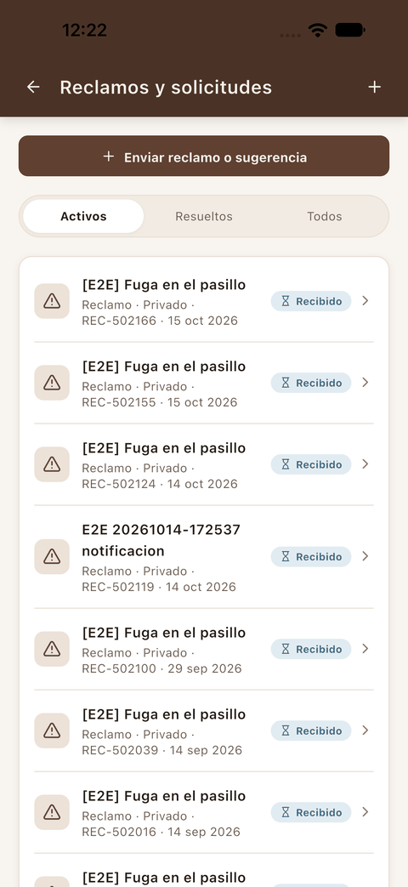
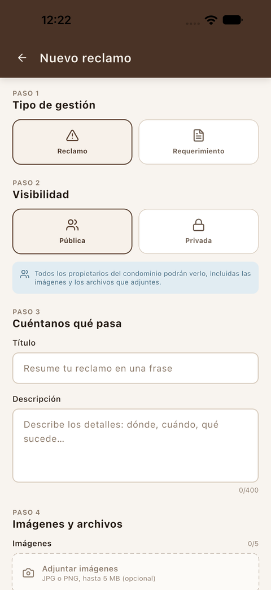
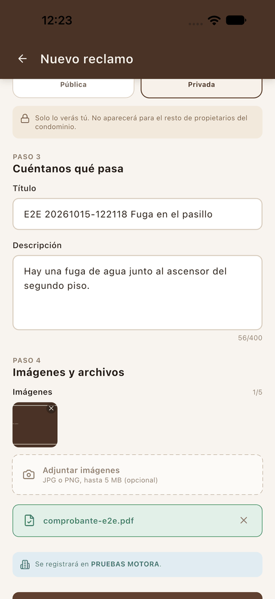
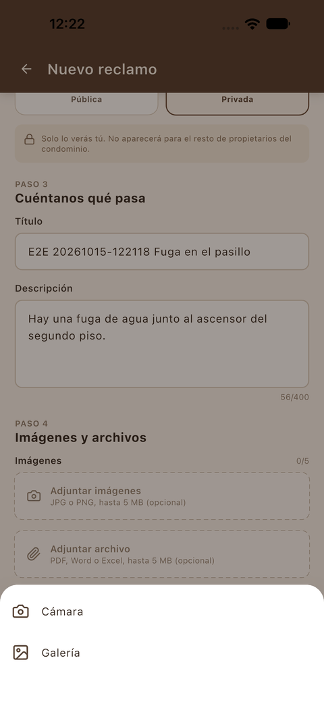
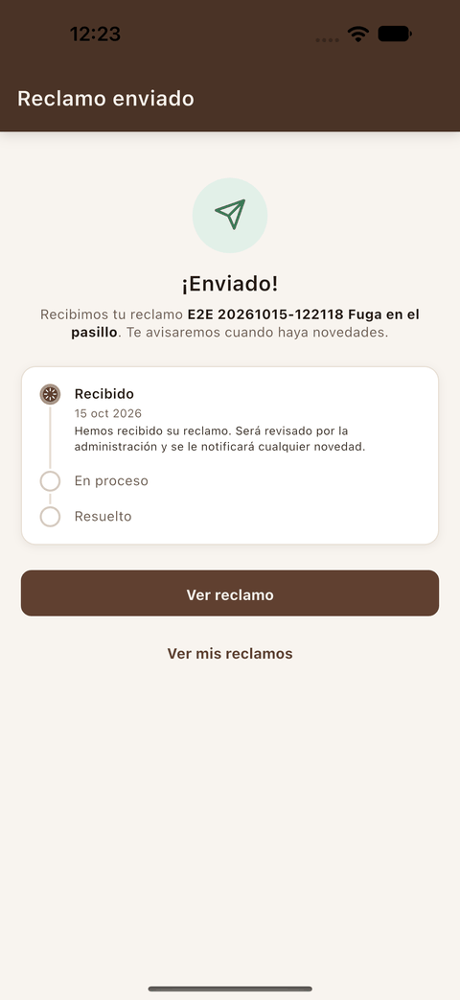
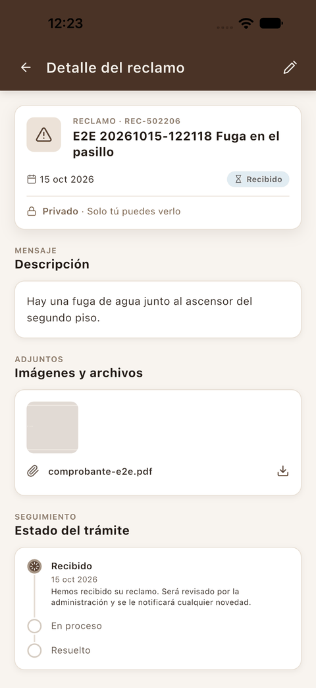
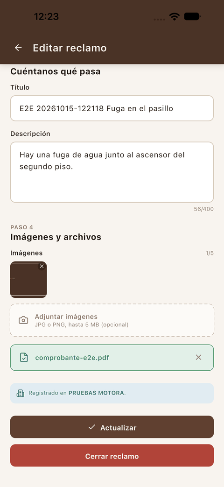
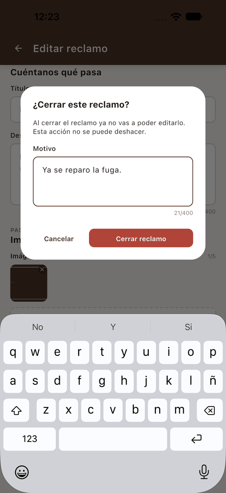
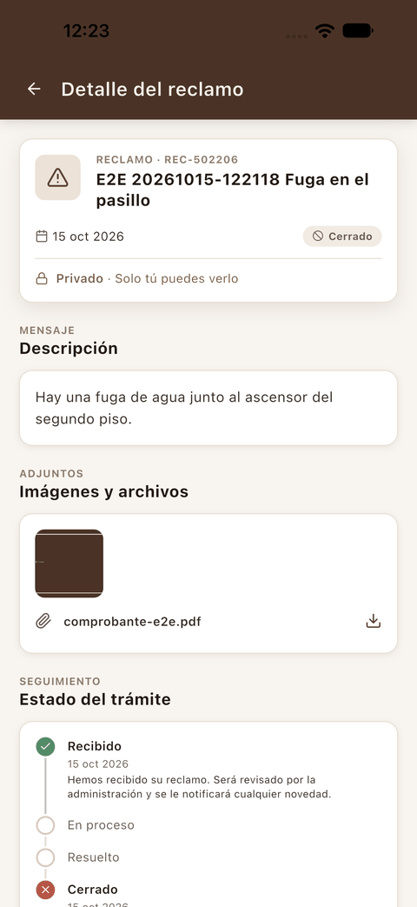

[← Reservas](04_reservas.md) · [Índice](../USER_GUIDE.md) · [Siguiente: Servicios →](06_servicios.md)

# 5. Reclamos y requerimientos

## Lista de reclamos

**¿Para qué sirve?**
Para informar a la administración de un problema (un **reclamo**) o pedirle algo (un **requerimiento**), y seguir en qué estado está cada gestión.

**Cómo acceder**

- Desde **Inicio**, con la tarjeta **Reclamos · Reporta o sigue**.
- Desde **Cuenta**, con **Reclamos y requerimientos**.

**Interfaz**

1. **Enviar reclamo o sugerencia** (o el **+** de la cabecera): crea una gestión nueva.
2. Pestañas **Activos**, **Resueltos** y **Todos**.
3. Cada gestión muestra el título, el tipo (*Reclamo* o *Requerimiento*), la visibilidad (*Privado* o *Público*), el código (*REC-…*), la fecha y el estado (por ejemplo, **Recibido**).

## Enviar un reclamo

**Cómo acceder**
En la lista de reclamos, pulsa **Enviar reclamo o sugerencia**.

**Interfaz**

 

1. **Paso 1 · Tipo de gestión**: *Reclamo* o *Requerimiento*.
2. **Paso 2 · Visibilidad**:
   - **Pública**: todos los propietarios del condominio podrán verla, incluidas las imágenes y los archivos adjuntos.
   - **Privada**: solo la verás tú; no aparecerá para el resto de propietarios.
3. **Paso 3 · Cuéntanos qué pasa**: **Título** y **Descripción** (hasta 400 caracteres).
4. **Paso 4 · Imágenes y archivos**: hasta 5 imágenes JPG o PNG de hasta 5 MB y archivos PDF, Word o Excel de hasta 5 MB. Todo es opcional.
5. La franja azul indica en qué condominio se registrará la gestión.

**Cómo utilizarla**

1. Elige el **tipo** y la **visibilidad**.
2. Escribe el **título** y la **descripción**.
3. Si quieres añadir fotos, pulsa **Adjuntar imágenes** y elige **Cámara** o **Galería**.

   

4. Las imágenes elegidas aparecen como miniaturas, con una **x** para quitarlas, y el contador sube (por ejemplo, *1/5*).
5. Para adjuntar un documento, pulsa **Adjuntar archivo** y elígelo en el selector de archivos del teléfono. Aparece en una franja verde con su nombre y una **x** para quitarlo.
6. Pulsa **Enviar**.

**Resultado**
Aparece **¡Enviado!** con el seguimiento del trámite: *Recibido → En proceso → Resuelto*. Pulsa **Ver reclamo** para abrirlo o **Ver mis reclamos** para volver a la lista.

## Detalle de un reclamo

**Cómo acceder**
Toca cualquier gestión de la lista.

**Interfaz**

1. **Cabecera de la ficha**: tipo, código, título, fecha, estado y visibilidad (*Privado · Solo tú puedes verlo*).
2. **Descripción** y **adjuntos**: las imágenes y los archivos. Los archivos aparecen con su nombre y un icono de descarga.
3. **Estado del trámite**: en qué paso está la gestión.
4. **Lápiz** (arriba a la derecha): abre la edición.

## Editar o cerrar un reclamo

**Cómo acceder**
En el detalle, pulsa el **lápiz** de la cabecera.

**Interfaz**

 

**Cómo utilizarla**

- Para **corregirlo**: cambia el título, la descripción o los adjuntos y pulsa **Actualizar**.
- Para **cerrarlo**, por ejemplo porque el problema ya se resolvió:
  1. Pulsa **Cerrar reclamo**.
  2. Escribe el **Motivo**.
  3. Pulsa **Cerrar reclamo** en el diálogo, o **Cancelar** para no cerrarlo.

**Resultado**
Al cerrarlo, el reclamo pasa a **Cerrado** y el *Estado del trámite* muestra el paso **Cerrado** con la fecha y el motivo. El lápiz de edición desaparece.

**Consideraciones**

- **Un reclamo cerrado ya no se puede editar y el cierre no se puede deshacer.**
