[← Reclamos](05_reclamos.md) · [Índice](../USER_GUIDE.md) · [Siguiente: Mi cuenta →](07_mi_cuenta.md)

# 6. Servicios para tu hogar

En esta sección pides trabajos a proveedores, como jardinería, carpintería, limpieza o cerrajería. El recorrido completo es:

1. **Pides** el servicio (una *solicitud*).
2. Los proveedores de esa categoría te envían **ofertas**.
3. **Aceptas** la que prefieras y coordinas el trabajo por **chat**.
4. Al terminar, **finalizas y calificas** al proveedor.

## Pantalla Proveedores

**Cómo acceder**
Pulsa **Servicios** en la barra inferior, o la franja **¿Quieres un servicio para tu hogar?** de Inicio.

**Interfaz**

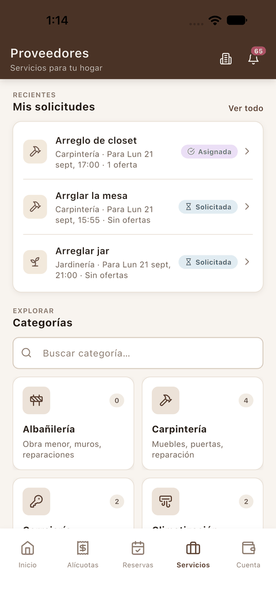 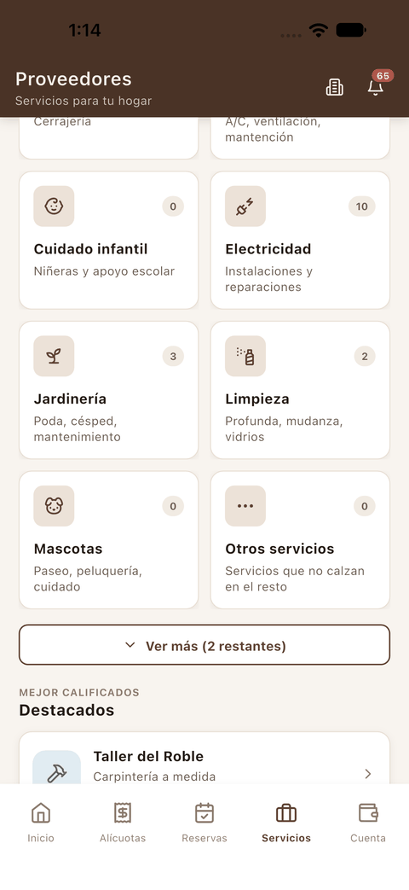

1. **Mis solicitudes · Recientes**: tus últimas solicitudes con su estado (*Solicitada*, *Asignada*…). **Ver todo** abre el historial.
2. **Categorías**: buscador y tarjetas de categoría. El número de cada tarjeta indica cuántos proveedores activos tiene.
3. **Destacados · Mejor calificados**: proveedores con mejor valoración.

**Ver más categorías**

Al principio se muestran 10 categorías. Si hay más, al final del grupo aparece **Ver más**, con el número de categorías que faltan (por ejemplo, *Ver más (2 restantes)*). Cada vez que lo pulsas se añaden hasta 10 más. Cuando ya se ven todas, el botón cambia a **Ver menos**, que vuelve a mostrar solo las 10 primeras.

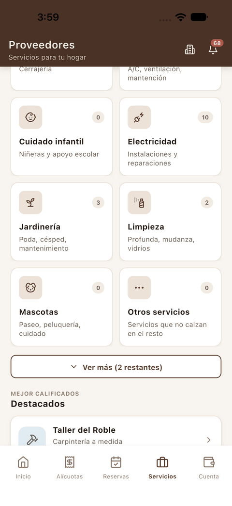 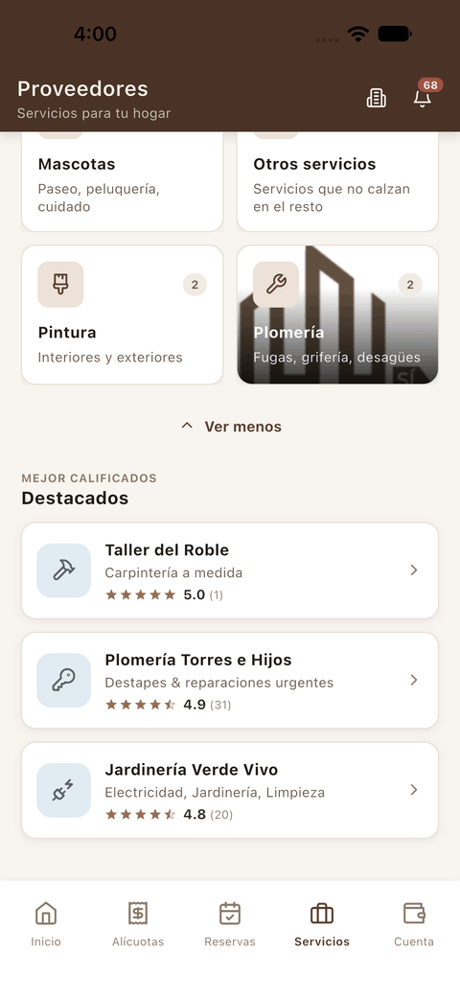

Si buscas una categoría concreta, es más rápido escribirla en el buscador.

## Elegir un proveedor

**Cómo acceder**
Toca una categoría.

**Interfaz**

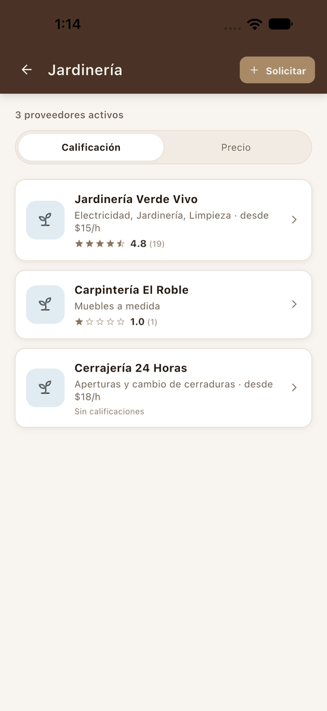 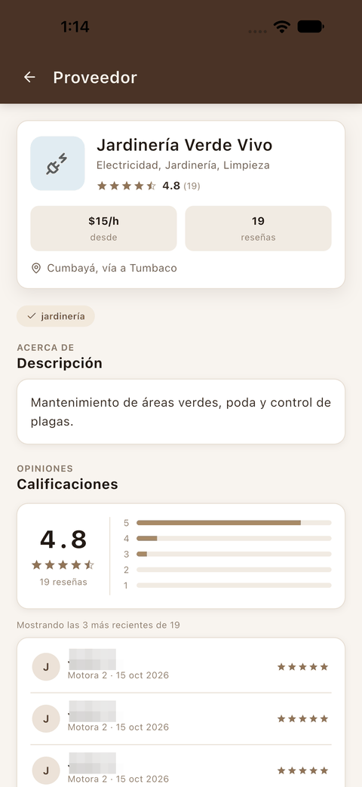

1. Arriba se indica cuántos proveedores activos hay. Con **Calificación** y **Precio** eliges el orden: por mejor valoración o por precio *desde*, de menor a mayor. Los proveedores sin precio publicado quedan al final.
2. Cada proveedor muestra sus especialidades, su precio *desde* y sus estrellas.
3. Toca un proveedor para ver su **ficha**: precio desde, número de reseñas, zona, descripción, calificaciones y las reseñas más recientes.
4. **Solicitar** (en la cabecera de la categoría) o **Solicitar este servicio** (al final de la ficha) abre el formulario de solicitud.

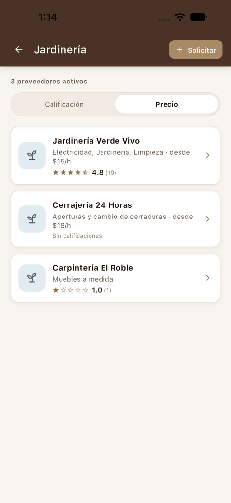 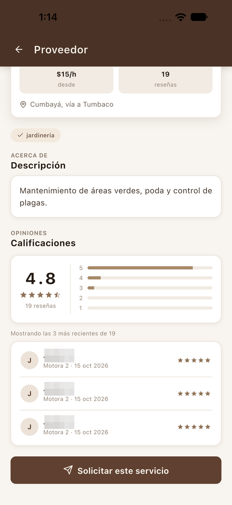

## Pedir un servicio

**Interfaz**

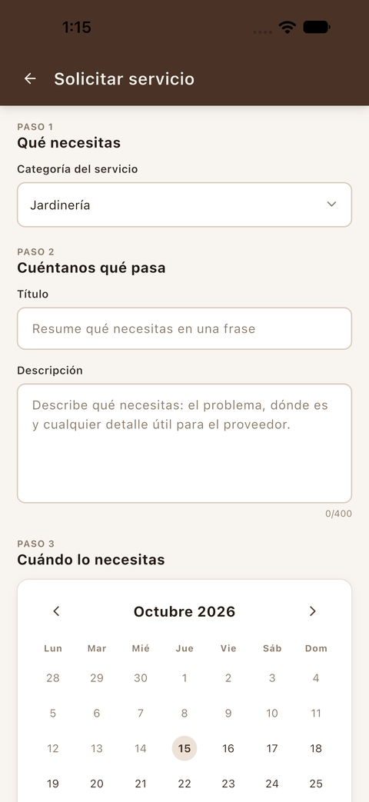 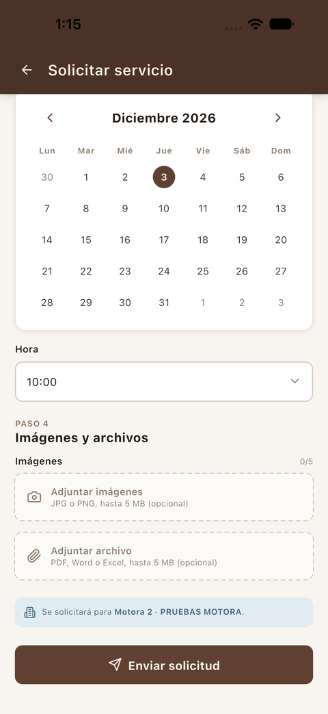

1. **Paso 1 · Qué necesitas**: la categoría del servicio.
2. **Paso 2 · Cuéntanos qué pasa**: **Título** y **Descripción** (hasta 400 caracteres).
3. **Paso 3 · Cuándo lo necesitas**: el día en el calendario y la **Hora**.
4. **Paso 4 · Imágenes y archivos**: fotos o documentos opcionales.
5. La franja azul indica para qué unidad se hace la solicitud (*Se solicitará para …*).

**Cómo utilizarla**

1. Comprueba la categoría.
2. Escribe un título breve y describe lo que necesitas.
3. Elige el día y pulsa **Elige una hora** para indicar la hora.
4. Si quieres, adjunta imágenes o archivos.
5. Pulsa **Enviar solicitud**.

**Resultado**
Aparece **¡Solicitud enviada!** con el seguimiento: *Solicitud recibida → Ofertas de proveedores → Asignación de proveedor → Servicio completado*. Puedes ir a **Ver solicitud**, **Ver mis solicitudes** o **Volver a proveedores**.

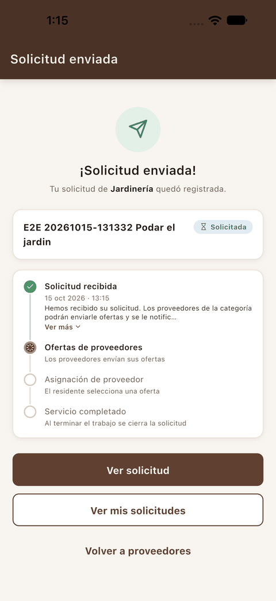 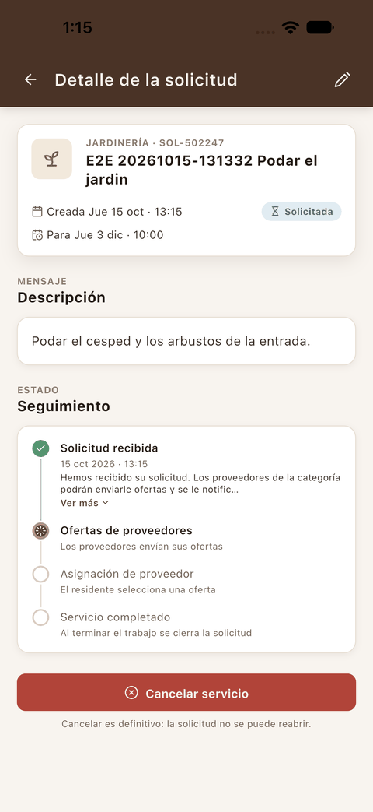

**Consideraciones**

- Mientras nadie haya ofertado, la solicitud está en **Solicitada**.
- Con el **lápiz** del detalle puedes corregir la solicitud (pantalla **Actualizar solicitud**). La categoría no se puede cambiar: si te equivocaste, cancela la solicitud y crea otra.

  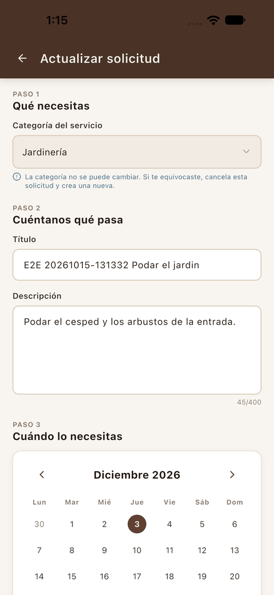

- Si ya no necesitas el servicio, puedes [cancelar la solicitud](#cancelar-una-solicitud).

## Cancelar una solicitud

**Cómo acceder**
Abre la solicitud desde *Mis solicitudes* y pulsa **Cancelar servicio**, al final del detalle.

**Cómo utilizarla**

1. Pulsa **Cancelar servicio**.
2. Si quieres, escribe el **Motivo**.
3. Pulsa **Cancelar servicio** en el diálogo, o **Volver** para mantener la solicitud.

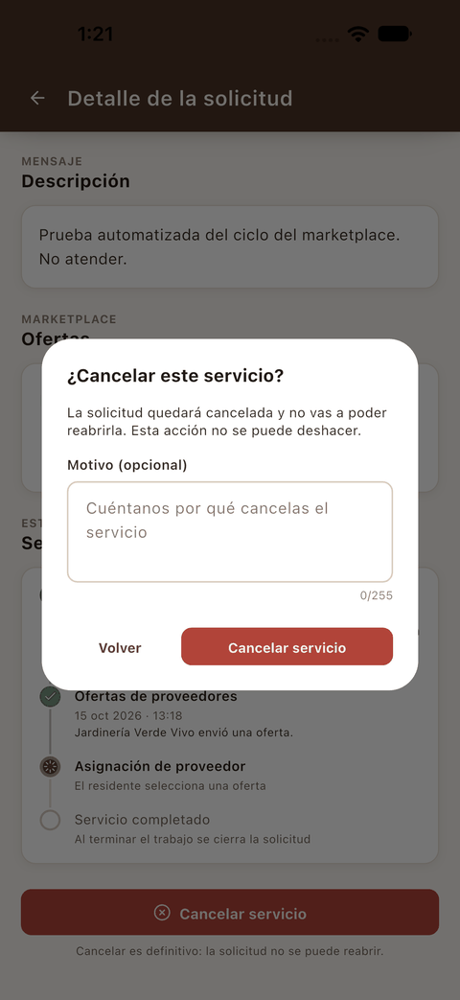

**Resultado**
Aparece el aviso **«Solicitud cancelada.»** La solicitud pasa a **Cancelada** y el seguimiento termina en *Solicitud cancelada*.

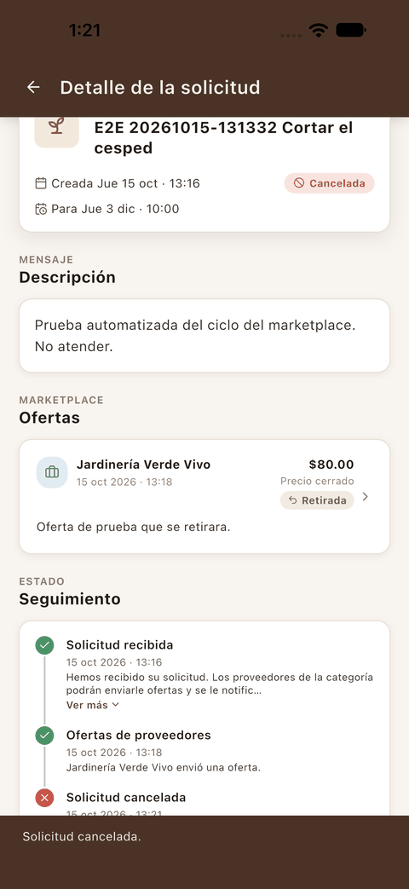

**Consideraciones**

- **Cancelar es definitivo: la solicitud no se puede reabrir.** Si la necesitas otra vez, crea una nueva.
- Si un proveedor retiró su oferta, en el bloque *Ofertas* aparece marcada como **Retirada**.

## Historial de solicitudes

**Cómo acceder**
En **Servicios**, pulsa **Ver todo** junto a *Mis solicitudes*.

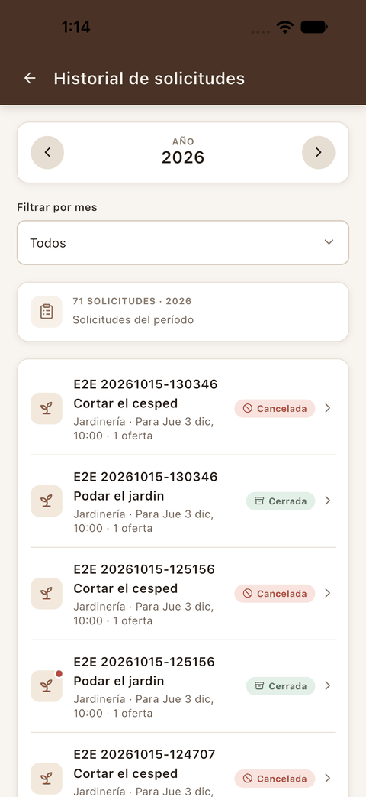

Puedes filtrar por año y por mes. Cada solicitud muestra la categoría, la fecha pedida, el número de ofertas y el estado: *Solicitada*, *Con ofertas*, *Asignada*, *Cerrada* o *Cancelada*.

## Revisar y aceptar una oferta

**Cómo acceder**
Cuando un proveedor oferta, recibes una notificación *Nueva oferta recibida* y la solicitud pasa a **Con ofertas**. Ábrela desde *Mis solicitudes* y toca la oferta en el bloque **Ofertas**.

**Interfaz**

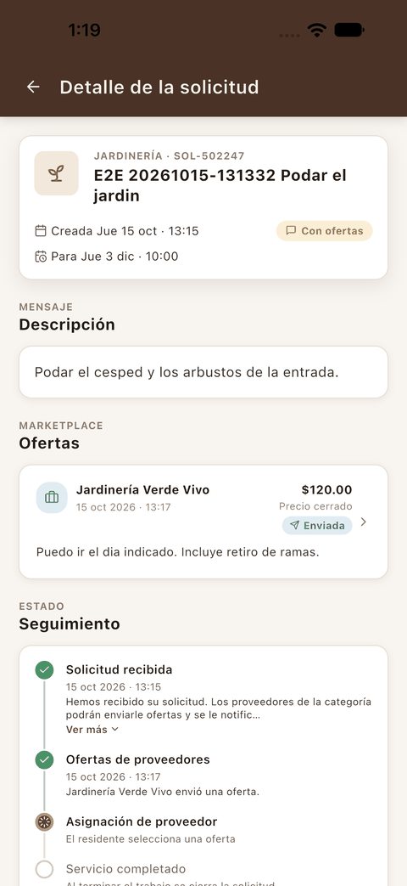 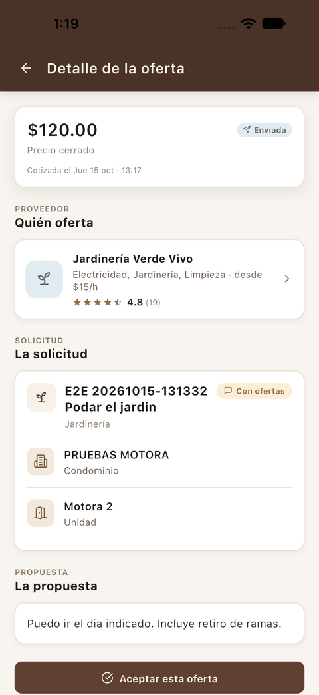

1. **Precio** y tipo de precio (por ejemplo, *Precio cerrado*).
2. **Quién oferta**: el proveedor, con su valoración.
3. **La solicitud** a la que responde y para qué unidad.
4. **La propuesta**: el mensaje del proveedor.
5. **Aceptar esta oferta**.

**Cómo utilizarla**

1. Pulsa **Aceptar esta oferta**.
2. Lee el aviso y pulsa **Aceptar oferta**, o **Volver** si aún no lo tienes claro.

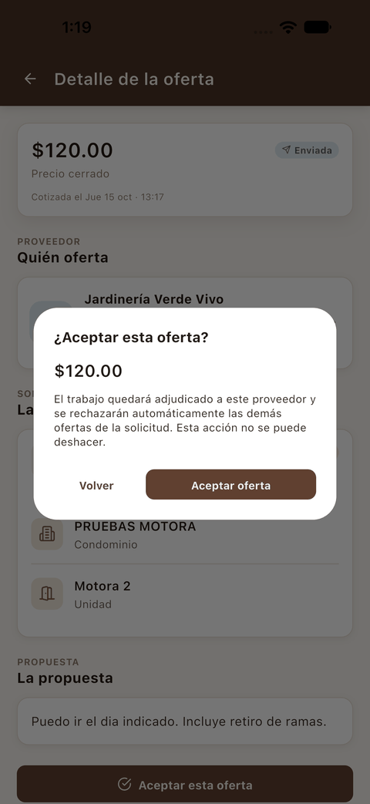

**Resultado**
Aparece el aviso **«Oferta aceptada.»** La solicitud pasa a **Asignada**, muestra el **Proveedor asignado** y la oferta queda marcada como **Elegida**.

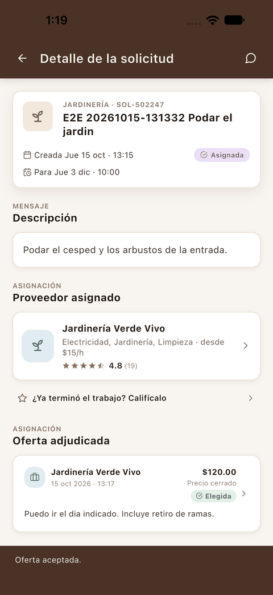

**Consideraciones**

- **Al aceptar, el trabajo se adjudica a ese proveedor y las demás ofertas de la solicitud se rechazan automáticamente. No se puede deshacer.**

## Chat con el proveedor

**¿Para qué sirve?**
Para coordinar con el proveedor asignado el día, la hora y los detalles del trabajo. Solo admite mensajes de texto.

**Cómo acceder**
En una solicitud **Asignada**, pulsa el **globo de conversación** de la cabecera.

**Interfaz**

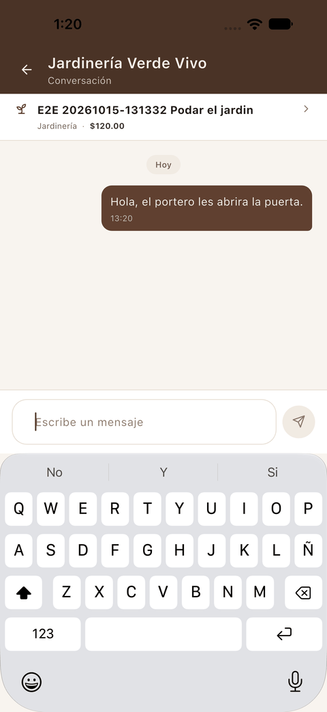

1. **Cabecera**: el nombre del proveedor.
2. **Franja superior**: la solicitud y el precio acordado.
3. **Mensajes**: agrupados por día. Los que envías aparecen a la derecha y los que recibes, a la izquierda.
4. **Escribe un mensaje** y el botón de enviar.

**Cómo utilizarla**

1. Toca **Escribe un mensaje** y escribe.
2. Pulsa el botón de enviar.

**Resultado**
Tu mensaje aparece en la conversación con la hora de envío.

## Finalizar y calificar

**Cómo acceder**
En una solicitud **Asignada**, pulsa **¿Ya terminó el trabajo? Califícalo**.

**Interfaz**

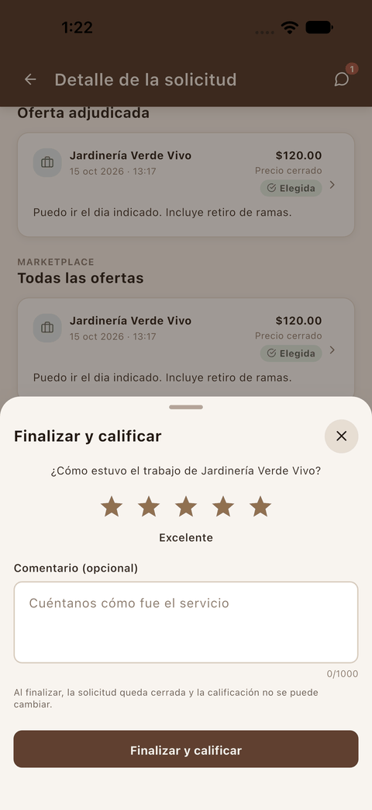

**Cómo utilizarla**

1. Toca las estrellas para valorar el trabajo, de 1 a 5. Debajo aparece una palabra que resume tu valoración (por ejemplo, *Excelente*).
2. Si quieres, escribe un **Comentario**.
3. Pulsa **Finalizar y calificar**.

**Resultado**
Aparece el aviso **«Servicio finalizado y calificado.»** y la solicitud pasa a **Cerrada**.

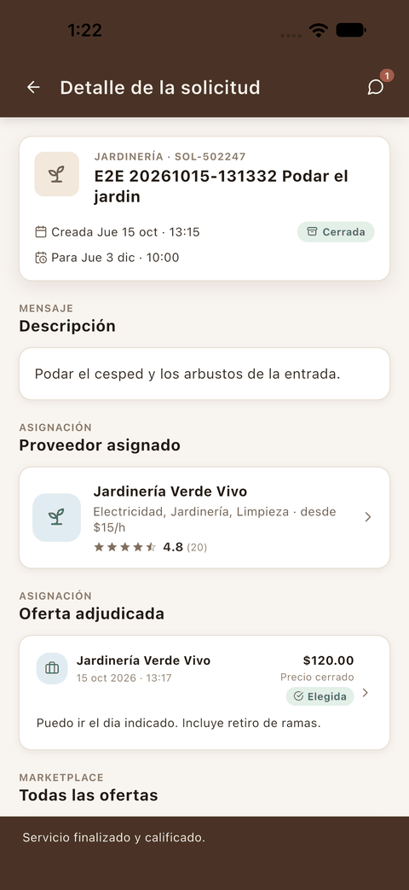

**Consideraciones**

- **Al finalizar, la solicitud queda cerrada y la calificación ya no se puede cambiar.**
