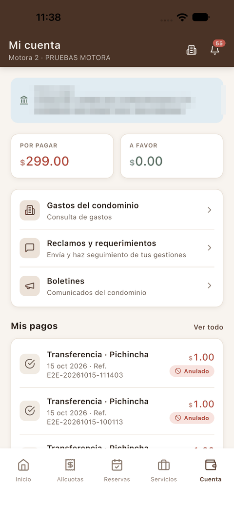
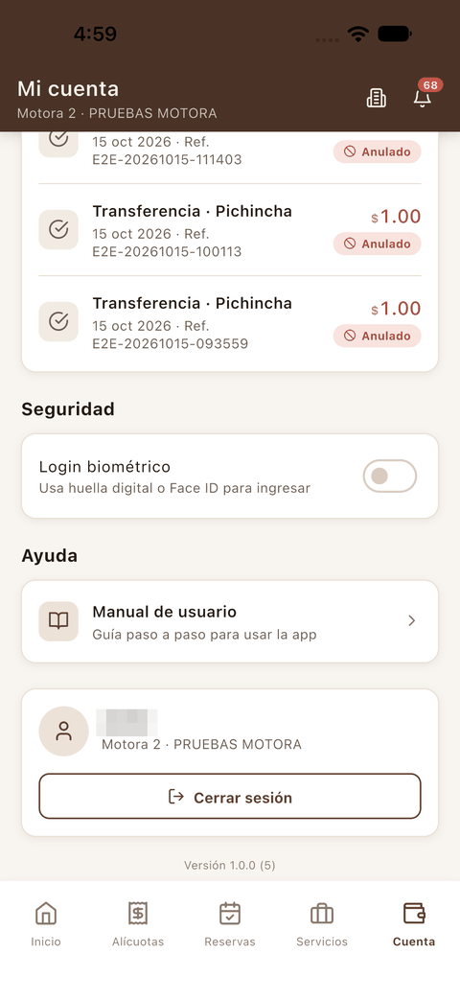
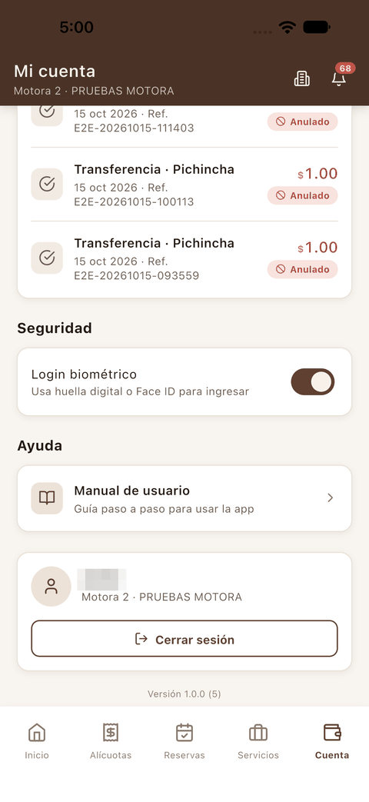
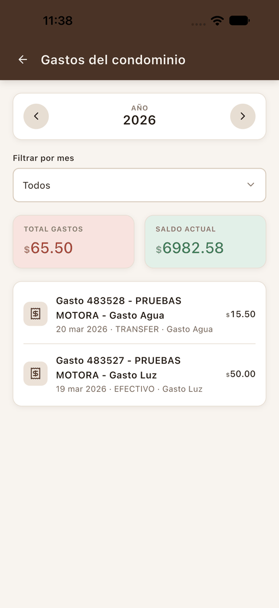
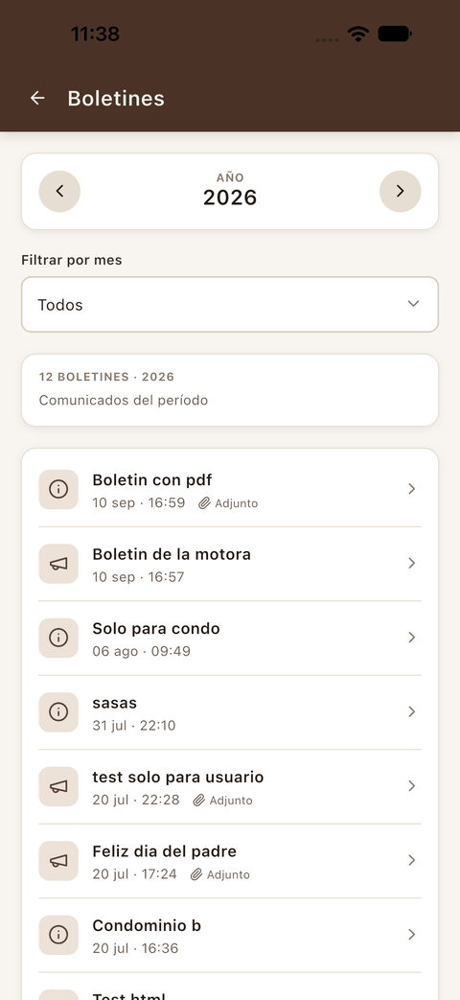
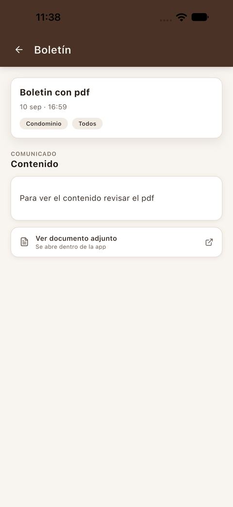
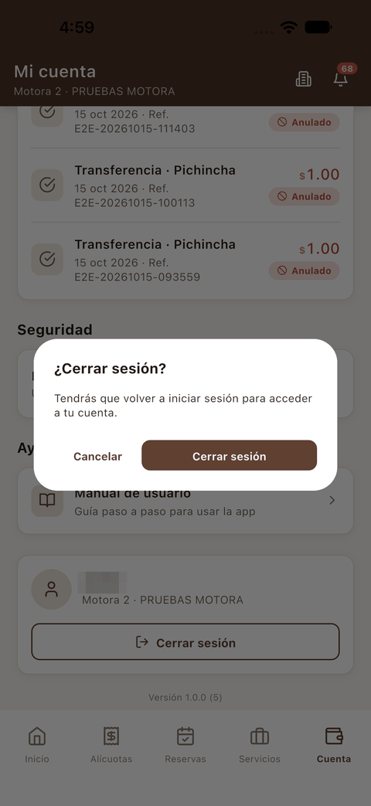

[← Servicios](06_servicios.md) · [Índice](../USER_GUIDE.md) · [Siguiente: Modo proveedor →](08_modo_proveedor.md)

# 7. Mi cuenta

## Pantalla Mi cuenta

**¿Para qué sirve?**
Reúne tu saldo, los datos para pagar, la información del condominio, tus pagos, la seguridad de la cuenta y el cierre de sesión.

**Cómo acceder**
Pulsa **Cuenta** en la barra inferior.

**Interfaz**

 

1. **Datos pago** (franja azul): los datos de la cuenta bancaria del condominio a la que puedes transferir. En la captura están difuminados.
2. **Por pagar** y **A favor**: lo que debes y el saldo a tu favor.
3. **Gastos del condominio**, **Reclamos y requerimientos** y **Boletines**: accesos a cada sección (ver más abajo y [Reclamos](05_reclamos.md)).
4. **Mis pagos**: tus últimos pagos. **Ver todo** abre el historial (ver [Mis pagos](03_alicuotas_y_pagos.md#mis-pagos)).
5. **Seguridad · Login biométrico**: interruptor para entrar con huella o Face ID (ver [Acceso](01_acceso.md#entrar-con-huella-o-face-id)). Cuando está activo se ve en color:

   

6. **Ayuda · Manual de usuario**: abre este manual en el navegador del teléfono.
7. **Tu perfil**, con tu nombre y la unidad activa, y el botón **Cerrar sesión**.
8. **Versión** (al pie, por ejemplo *Versión 1.0.0 (5)*): la versión de la app que tienes instalada. Indícala si contactas con soporte.

## Gastos del condominio

**¿Para qué sirve?**
Para consultar en qué gasta el condominio y su saldo actual.

**Cómo acceder**
En **Mi cuenta**, pulsa **Gastos del condominio**.

**Interfaz**

1. **Año** y **Filtrar por mes**.
2. **Total gastos** del periodo y **Saldo actual** del condominio.
3. Lista de gastos con su descripción, fecha, forma de pago e importe.

## Boletines

**¿Para qué sirve?**
Para leer los comunicados que publica la administración del condominio.

**Cómo acceder**
En **Mi cuenta**, pulsa **Boletines**.

**Interfaz**

 

1. **Año** y **Filtrar por mes**, con el número de comunicados del periodo.
2. Cada boletín muestra el título, la fecha y, si lo tiene, la marca **Adjunto**.
3. Toca un boletín para leerlo. Si tiene un documento, pulsa **Ver documento adjunto**: se abre dentro de la app.

## Cerrar sesión

**Cómo acceder**
En **Mi cuenta**, baja hasta el final y pulsa **Cerrar sesión**.

**Interfaz**

**Cómo utilizarla**

1. Pulsa **Cerrar sesión**.
2. Confirma con **Cerrar sesión** en el diálogo, o pulsa **Cancelar**.

**Resultado**
Vuelves a la pantalla de [inicio de sesión](01_acceso.md). Para entrar otra vez tendrás que escribir tu usuario y tu contraseña.
