[← Mi cuenta](07_mi_cuenta.md) · [Índice](../USER_GUIDE.md)

# 8. Modo proveedor

Esta sección es solo para las personas que, además de residentes, ofrecen servicios en la app como **proveedores**. Si tu cuenta no es de proveedor, no verás el selector de modo.

## Cambiar entre Residente y Proveedor

**¿Para qué sirve?**
Una misma cuenta puede usar la app de dos formas: como **Residente** (alícuotas, reservas y reclamos de tu unidad) o como **Proveedor** (solicitudes de servicio y tus ofertas).

**Cómo acceder**
En **Inicio**, pulsa la etiqueta **Viendo como Residente** que aparece bajo el saludo.

**Interfaz**

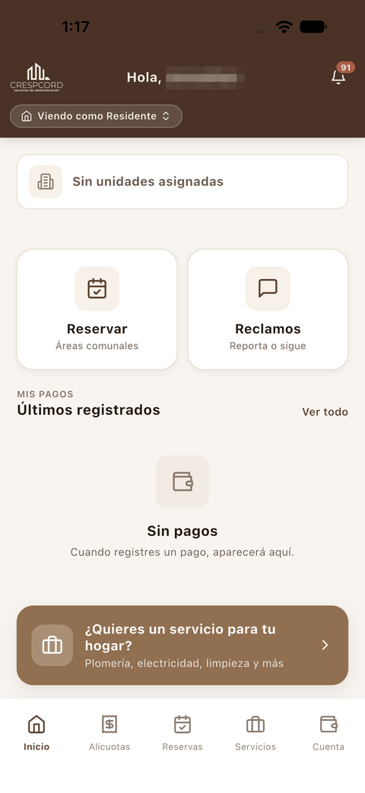 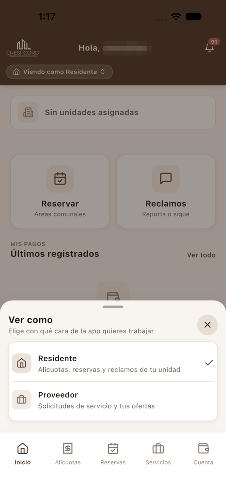

**Cómo utilizarla**

1. Pulsa **Viendo como Residente**.
2. En **Ver como**, elige **Proveedor**.

**Resultado**
La etiqueta cambia a **Viendo como Proveedor** y la barra inferior pasa a tener cuatro botones: **Inicio**, **Solicitudes**, **Ofertas** y **Cuenta**. Para volver, repite los pasos y elige **Residente**.

## Inicio del proveedor

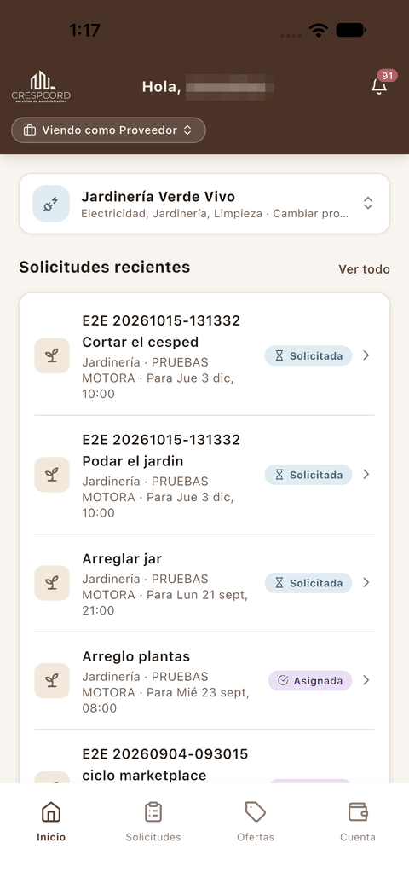

1. **Tarjeta del proveedor**: el negocio con el que trabajas y sus especialidades. Desde ella puedes cambiar de proveedor.
2. **Solicitudes recientes**: las últimas solicitudes de residentes de tus categorías, con su estado. **Ver todo** abre **Solicitudes**.

## Solicitudes

**¿Para qué sirve?**
Para ver los trabajos que piden los residentes y responder con una oferta.

**Cómo acceder**
Pulsa **Solicitudes** en la barra inferior, o **Ver todo** en el inicio del proveedor.

**Interfaz**

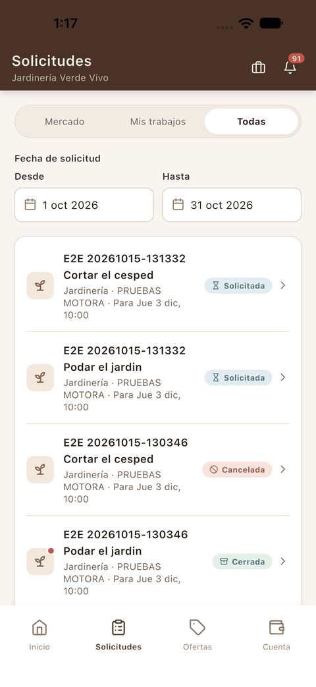 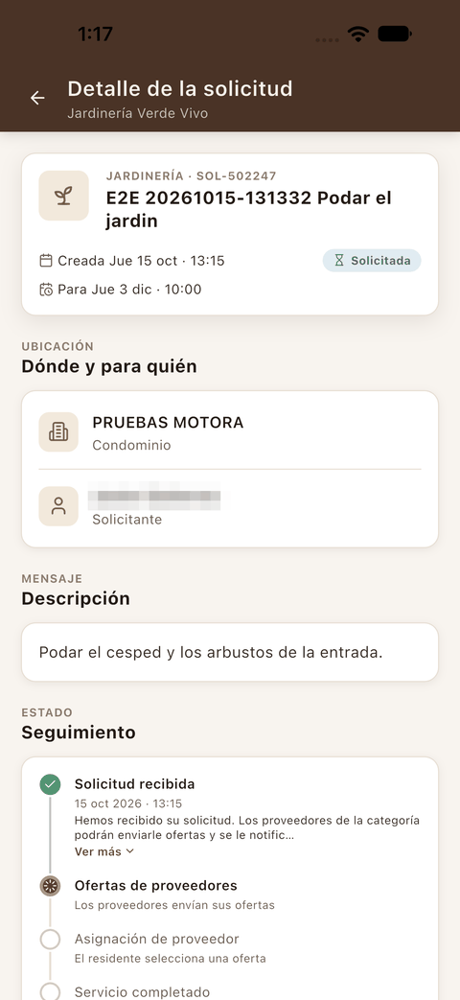

1. Pestañas **Mercado**, **Mis trabajos** y **Todas**.
2. **Fecha de solicitud**: el rango **Desde** / **Hasta** de las solicitudes que se muestran.
3. Cada solicitud muestra el título, la categoría, el condominio, la fecha pedida y el estado.
4. En el **detalle** ves dónde y para quién es el trabajo (condominio y solicitante), la descripción, el seguimiento y, al final, el botón **Ofertar**.

En la pestaña **Mis trabajos** aparecen los trabajos que se te han adjudicado (estado **Asignada**):

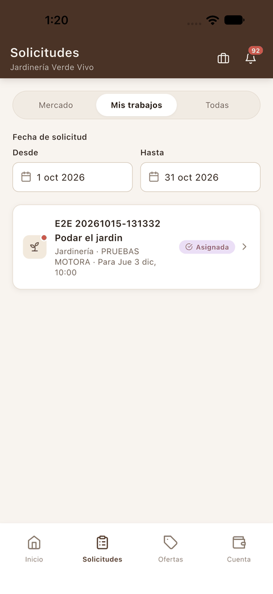

## Enviar una oferta

**Cómo acceder**
En el detalle de una solicitud, pulsa **Ofertar**.

**Interfaz**

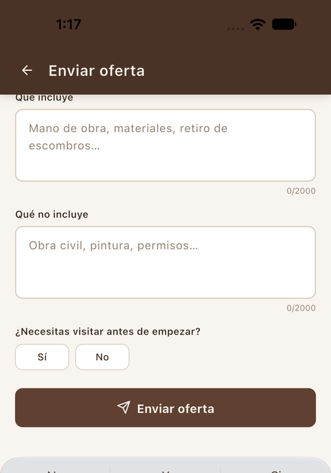

El formulario **Enviar oferta** pide:

- **Mensaje al residente**: tu propuesta.
- **Cómo cobras** (por ejemplo, precio cerrado o *Presupuesto en sitio*) y el **Monto**.
- **¿El monto incluye impuestos?**
- **Alcance**: **Qué incluye** y **Qué no incluye**.
- **¿Necesitas visitar antes de empezar?** (Sí / No).

**Cómo utilizarla**

1. Escribe el mensaje y el monto, y completa el resto de campos.
2. Pulsa **Enviar oferta**.
3. Revisa el resumen y pulsa **Enviar oferta** otra vez, o **Revisar** para volver al formulario.

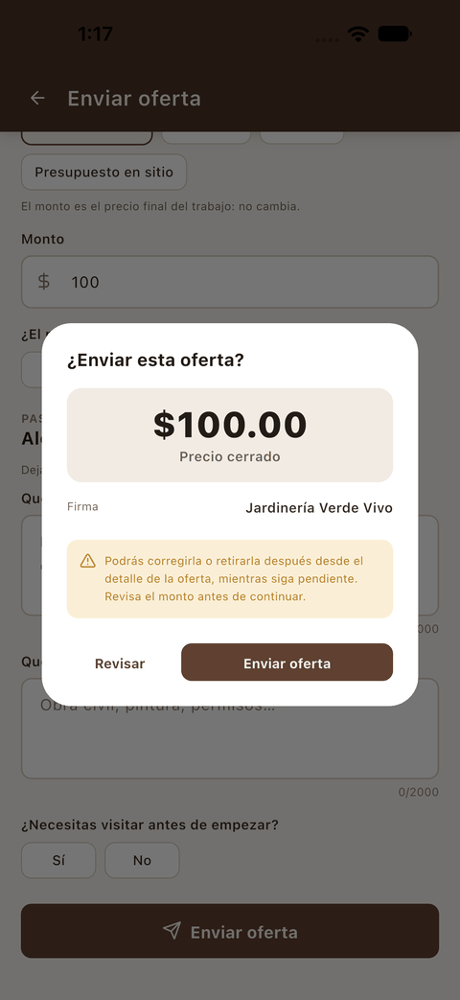

**Resultado**
Aparece el aviso **«Oferta enviada. El residente ya puede verla.»** La solicitud muestra tu oferta en **Mis ofertas** con el estado **Enviada**, y el residente recibe la notificación *Nueva oferta recibida*.

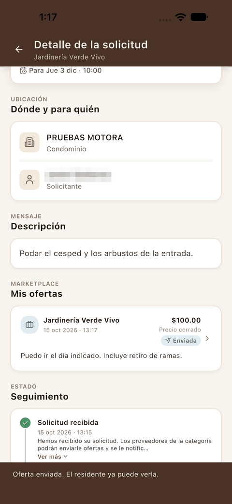

**Consideraciones**

- Como avisa el diálogo, puedes [corregir](#corregir-una-oferta) o [retirar](#retirar-una-oferta) la oferta después, desde su detalle, mientras siga pendiente.

## Mis ofertas

**Cómo acceder**
Pulsa **Ofertas** en la barra inferior.

**Interfaz**

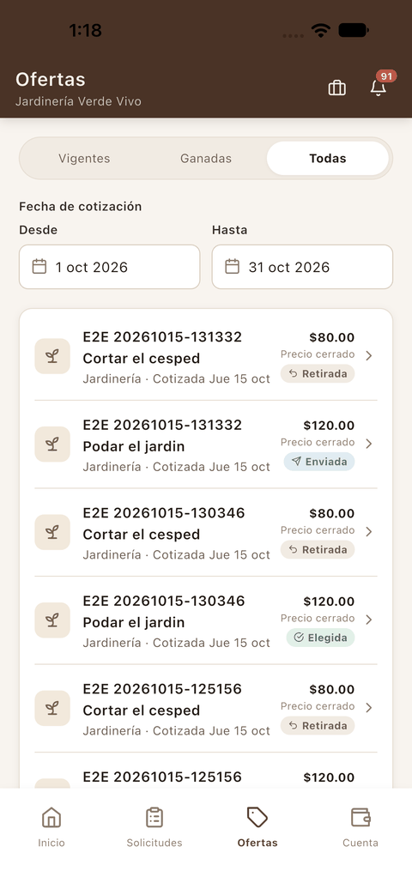 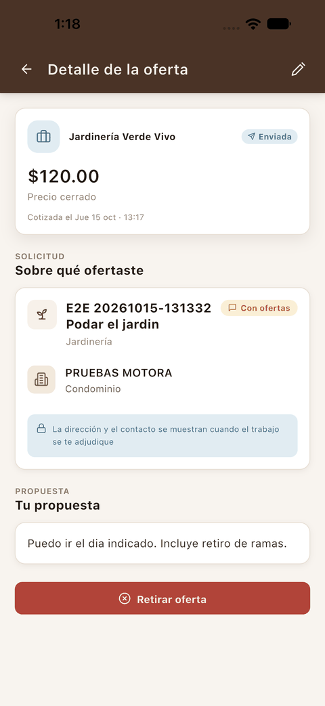

1. Pestañas **Vigentes**, **Ganadas** y **Todas**, y el rango de **Fecha de cotización**.
2. Cada oferta muestra la solicitud, el importe y su estado: **Enviada** si está pendiente y **Elegida** si el residente la aceptó.
3. En el **detalle de la oferta** están el importe, la solicitud a la que responde y tu propuesta. Mientras está pendiente, tiene el **lápiz** de la cabecera para corregirla y el botón **Retirar oferta**.

**Consideraciones**

- La dirección y el contacto del residente se muestran cuando el trabajo se te adjudica.
- Cuando el residente acepta tu oferta, el trabajo queda **Asignado** y pueden coordinarlo por el [chat](#chat-con-el-residente).

## Corregir una oferta

**Cómo acceder**
Abre la oferta (desde **Ofertas** o desde el detalle de la solicitud) y pulsa el **lápiz** de la cabecera.

**Interfaz**

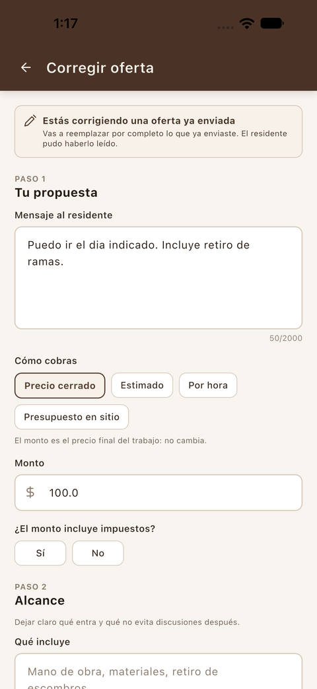 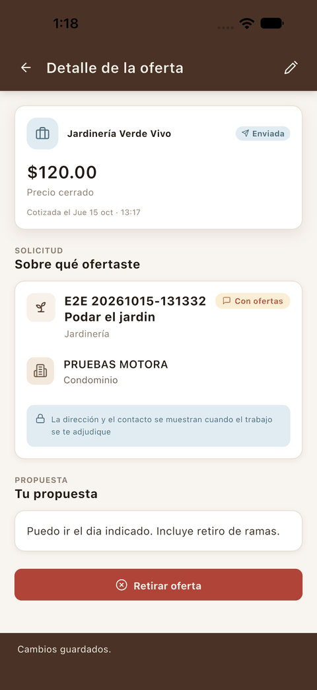

El formulario **Corregir oferta** es el mismo que el de enviar una oferta, ya relleno con tus datos. El aviso de arriba recuerda que **vas a reemplazar por completo lo que ya enviaste** y que el residente pudo haberlo leído.

**Cómo utilizarla**

1. Cambia lo que necesites, por ejemplo el **Monto**.
2. Pulsa el botón de enviar al final del formulario y confirma en el diálogo.

**Resultado**
Aparece el aviso **«Cambios guardados.»** y el detalle de la oferta muestra los datos nuevos. El residente ve la oferta con el importe corregido.

## Retirar una oferta

**Cómo acceder**
Abre la oferta y pulsa **Retirar oferta**, al final del detalle.

**Cómo utilizarla**

1. Pulsa **Retirar oferta**.
2. Confirma con **Retirar oferta** en el diálogo, o pulsa **Volver**.

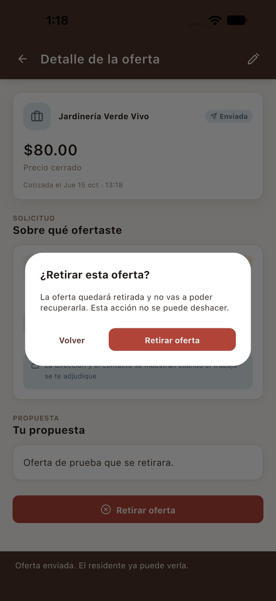 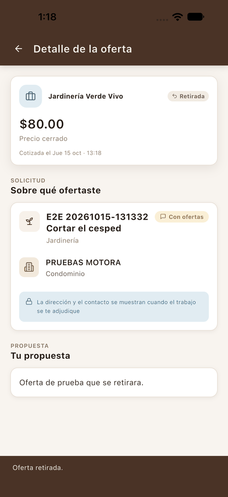

**Resultado**
Aparece el aviso **«Oferta retirada.»** y la oferta pasa a **Retirada**. El residente la ve también como *Retirada* en su solicitud.

**Consideraciones**

- **La oferta retirada no se puede recuperar.** Si cambias de idea, tendrás que enviar una nueva.

## Chat con el residente

**Cómo acceder**
En **Solicitudes → Mis trabajos**, abre el trabajo asignado y pulsa el **globo de conversación** de la cabecera.

**Interfaz**

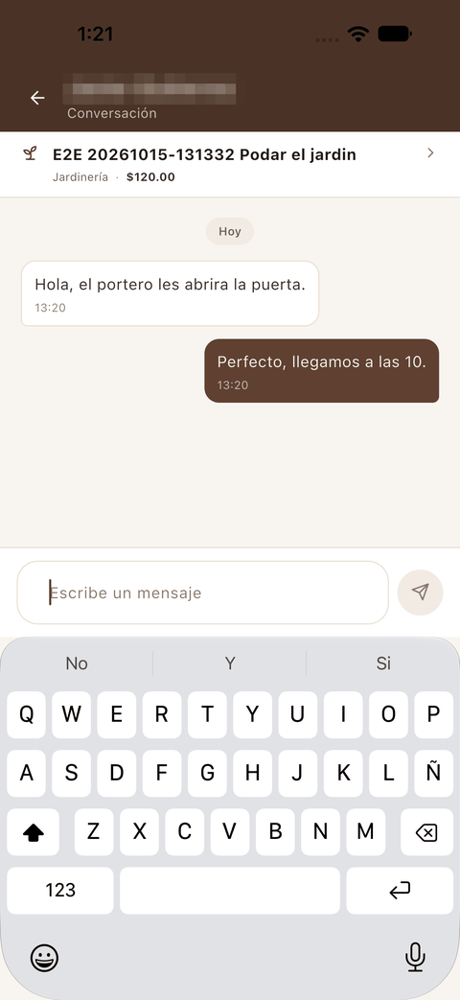

1. **Cabecera**: el nombre del residente (difuminado en la captura).
2. **Franja superior**: el trabajo y el precio acordado.
3. **Mensajes**: los del residente a la izquierda y los tuyos a la derecha.

**Cómo utilizarla**

1. Toca **Escribe un mensaje** y escribe.
2. Pulsa el botón de enviar. El mensaje aparece en la conversación con la hora.
