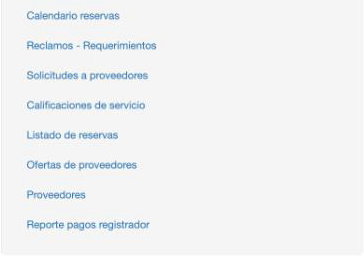
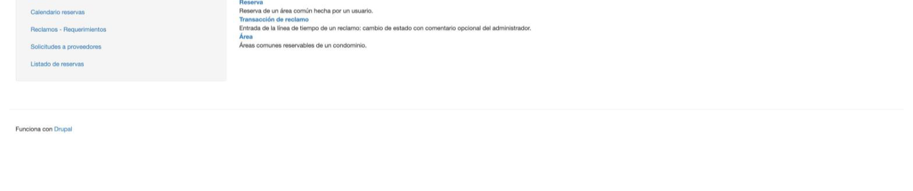
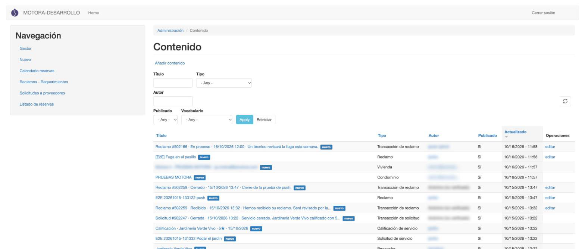
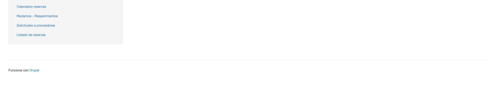

[Índice](../USER_GUIDE.md) · [Siguiente: Pagos →](02_pagos.md)

# 1. Entrar y moverse por el back office

## Iniciar sesión

**¿Para qué sirve?**
Para entrar al sitio de administración con tu usuario de backend o de administrador edificio.

**Cómo acceder**
Abre en el navegador la dirección del sitio de CrespCord y entra con tu usuario y contraseña.

**Consideraciones**

- Es el mismo sitio web de siempre. Lo que cambia según tu rol es el menú **Navegación** de la izquierda.
- Si eres administrador edificio y, nada más entrar, el sistema te saca de la sesión, pide a la administración que revise tu cuenta: tu rol necesita una configuración que se hace a mano en cada servidor.

## Menú de backend

**¿Para qué sirve?**
Reúne los accesos a todas las pantallas. Las de este manual están al final del menú **Navegación**.

**Interfaz**

| Enlace | Qué abre | Capítulo |
|---|---|---|
| **Calendario reservas** | Las reservas en un calendario por mes o por semana. | [Reservas](04_reservas.md#calendario-de-reservas) |
| **Reclamos - Requerimientos** | El listado de reclamos. | [Reclamos](03_reclamos.md) |
| **Solicitudes a proveedores** | Los servicios que piden los residentes. | [Servicios](05_servicios.md) |
| **Calificaciones de servicio** | Las estrellas que dejan los residentes a los proveedores. | [Servicios](05_servicios.md#calificaciones-de-servicio) |
| **Listado de reservas** | Las reservas en forma de tabla. | [Reservas](04_reservas.md) |
| **Ofertas de proveedores** | Los presupuestos enviados por los proveedores. | [Servicios](05_servicios.md#ofertas-de-proveedores) |
| **Proveedores** | El directorio de proveedores. | [Servicios](05_servicios.md#proveedores) |
| **Reporte pagos registrador** | El reporte de pagos con filtro por canal (app, WhatsApp, back office). | [Pagos](02_pagos.md) |

**Consideraciones**

- No confundas **Reporte pagos registrador** (el de este manual, al final del menú) con **Reporte Pagos** (más arriba): son pantallas distintas.

## Menú de administrador edificio

**¿Para qué sirve?**
El administrador edificio tiene un menú corto, solo con lo que puede usar.

**Interfaz**

1. **Gestor**: la lista de contenido de tus condominios (ver abajo).
2. **Nuevo**: para crear contenido. Solo ofrece lo que tu rol puede crear: **Boletin**, **Reclamo**, **Reserva**, **Transacción de reclamo** y **Área**.
3. **Calendario reservas**, **Reclamos - Requerimientos**, **Solicitudes a proveedores** y **Listado de reservas**: las mismas pantallas que usa backend, pero filtradas a tus condominios.

## Gestor (lista de contenido)

**¿Para qué sirve?**
Para buscar cualquier contenido de tus condominios y abrirlo o editarlo.

**Cómo acceder**
Menú **Navegación** → **Gestor**.

**Interfaz**

1. **Filtros**: Título, Tipo, Autor, Publicado y Vocabulario. Pulsa **Apply** para aplicarlos y **Reiniciar** para quitarlos.
2. **Tabla**: los contenidos más recientes primero, con su tipo, autor, si está publicado y la fecha de la última actualización.
3. **editar**: aparece solo en lo que tu rol puede modificar (por ejemplo, reclamos y sus transacciones). Lo demás (viviendas, condominios, solicitudes de servicio…) solo se puede ver.

## Acceso denegado

Si abres una pantalla que no corresponde a tu rol (por ejemplo, un administrador edificio que entra al reporte de pagos con un enlace), verás este aviso:

No es un error del sistema: esa pantalla no está disponible para tu rol. Vuelve con cualquier enlace del menú.

**Consideraciones**

- El administrador edificio **no puede borrar** nada. Para retirar una reserva se cancela, y para lo demás hay que pedirlo a la administración. Ver también [Boletines](06_boletines.md).
