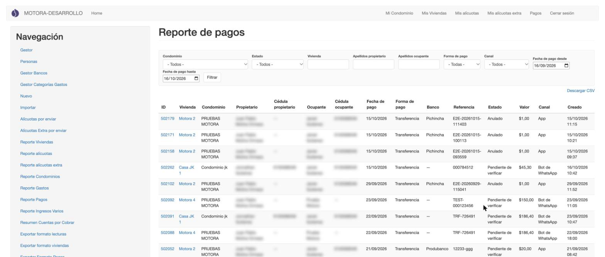
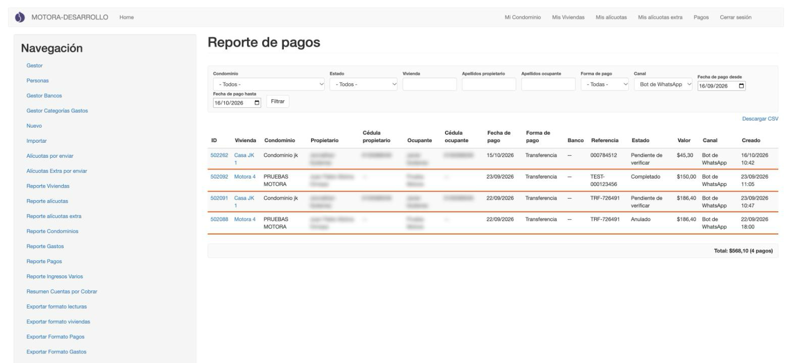
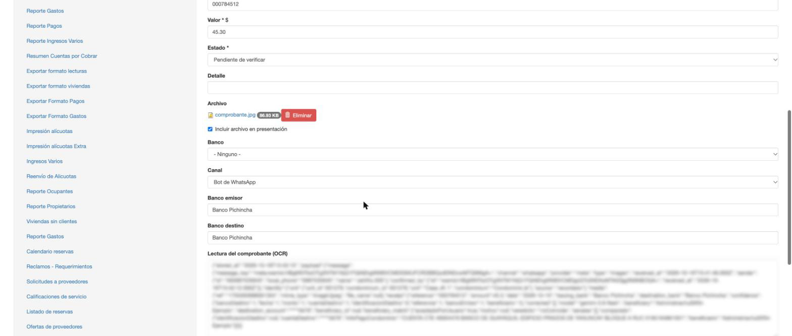
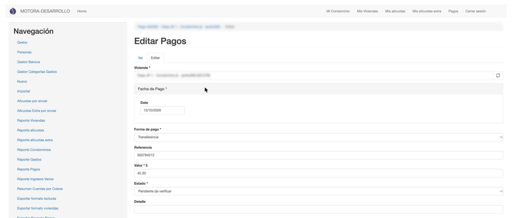
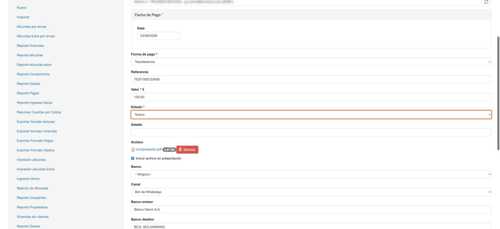
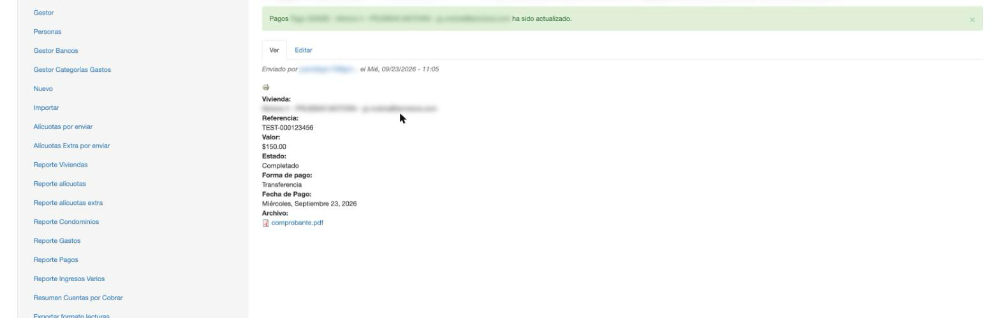
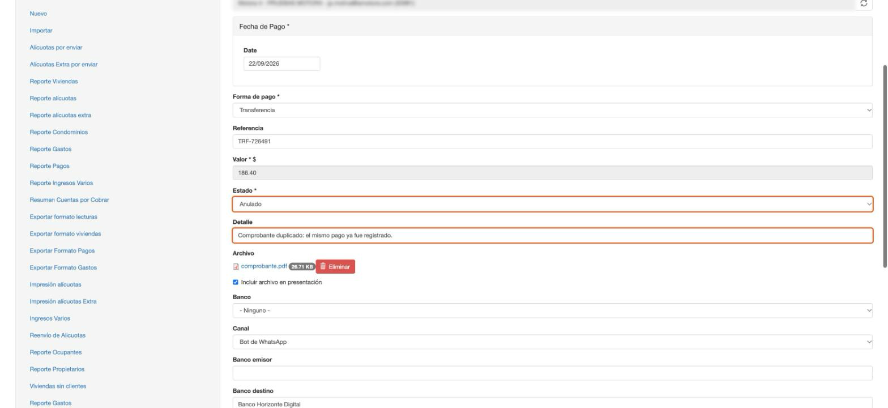

[← Entrar y moverse](01_acceso_y_menu.md) · [Índice](../USER_GUIDE.md) · [Siguiente: Reclamos →](03_reclamos.md)

# 2. Pagos

> Este capítulo es **solo para backend**. El administrador edificio no tiene acceso a los pagos.

Los residentes registran pagos desde la app o enviando el comprobante al asistente de WhatsApp. Esos pagos llegan como **Pendiente de verificar** y la administración los revisa aquí.

## Reporte de pagos

**¿Para qué sirve?**
Para ver todos los pagos registrados, filtrarlos y encontrar los que están pendientes de revisar.

**Cómo acceder**
Menú **Navegación** → **Reporte pagos registrador**.

**Interfaz**

1. **Filtros**:
   - **Condominio** y **Estado**: *Nuevo*, *Completado*, *Anulado* o *Pendiente de verificar*.
   - **Vivienda**, **Apellidos propietario** y **Apellidos ocupante**: se escriben a mano.
   - **Forma de pago**: Depósito, Efectivo, Cheque, Transferencia, PayPhone o Tarjeta.
   - **Canal**: por dónde llegó el pago (*App*, *Bot de WhatsApp* o *Back office*).
   - **Fecha de pago desde / hasta**. Al abrir la pantalla vienen puestos los últimos 30 días.
2. **Filtrar**: aplica los filtros.
3. **Descargar CSV**: descarga en un archivo los pagos que cumplen los filtros, para abrirlos en Excel (ver [El archivo CSV](#el-archivo-csv)).
4. **Tabla**: un pago por fila, con el número de registro (**ID**), la vivienda, el condominio, el propietario y el ocupante con sus cédulas, la fecha y forma de pago, el banco, la referencia, el **Estado**, el **Valor**, el **Canal** y la fecha de creación.
5. **ID**: abre el pago para revisarlo (ver [Verificar un pago](#verificar-un-pago)).

**Cómo utilizarla**

1. Elige los filtros que necesites. Por ejemplo, para ver lo que falta revisar: **Estado** → *Pendiente de verificar*.
2. Pulsa **Filtrar**.
3. Pulsa el **ID** de un pago para abrirlo.

**Consideraciones**

- La tabla muestra 20 pagos por página.
- Debajo de la tabla aparece el **Total** de los pagos filtrados. El total **incluye los anulados**. Si quieres sumar solo lo cobrado, filtra por **Estado**.
- Este reporte solo sirve para consultar. Los pagos se cambian desde su propia pantalla.

## El archivo CSV

**¿Para qué sirve?**
Para llevar a Excel (u otra hoja de cálculo) los pagos del reporte, por ejemplo para cuadrar con el banco.

**Cómo utilizarla**

1. En **Reporte pagos registrador**, aplica los filtros que quieras y pulsa **Filtrar**.
2. Pulsa **Descargar CSV**.

**Resultado**

Se descarga un archivo con **los mismos pagos que muestra la pantalla con esos filtros**, todos en un solo archivo (no se divide en páginas de 20). Trae las columnas de la tabla y dos más: **Banco emisor** y **Banco destino**, útiles para los pagos de WhatsApp.

**Consideraciones**

- El archivo está separado por **comas** y los valores usan **punto** decimal (por ejemplo, *150.00*). Si Excel lo abre todo en una sola columna, impórtalo desde **Datos → Desde texto/CSV** e indica *coma* como separador.

## Pagos que llegan por WhatsApp

**¿Para qué sirve?**
Para encontrar los pagos que los residentes enviaron al asistente de WhatsApp y comprobar que coinciden con el comprobante.

**Cómo llega un pago desde WhatsApp**

El residente envía el comprobante, el asistente lo lee y, cuando el residente confirma, le da un **número de registro**:

Ese **número de registro** es el **ID** del pago en el back office. En este ejemplo, el pago *502262* es el primero de la tabla de abajo. El pago queda **pendiente de verificación** hasta que la administración lo revise.

**Cómo encontrarlos**

En **Reporte pagos registrador**, elige **Canal** → *Bot de WhatsApp* y pulsa **Filtrar**.

En esta captura, los pagos *502092* y *502088* (resaltados) ya se revisaron: uno se aprobó y quedó **Completado**, y el otro se **Anuló**. Los demás siguen **Pendientes de verificar**.

**Qué trae un pago de WhatsApp**

Al abrir el pago, además de los datos normales, verás:

1. **Archivo**: el comprobante que envió el residente. Púlsalo para abrirlo y compararlo con los datos.
2. **Banco**: queda vacío.
3. **Canal**: *Bot de WhatsApp*.
4. **Banco emisor** y **Banco destino**: los bancos que el asistente leyó en el comprobante.
5. **Lectura del comprobante (OCR)**: el texto técnico de lo que leyó el asistente. Solo sirve para revisar un caso dudoso; no hace falta tocarlo.

**Consideraciones**

- Revisa siempre la **Referencia** y el **Valor** contra el comprobante adjunto: el asistente los lee de la imagen.
- Puede haber dos pagos con la misma referencia si el residente envió el mismo comprobante dos veces. Anula el que sobre (ver [Anular un pago](#anular-un-pago)).

## Verificar un pago

**¿Para qué sirve?**
Para aprobar un pago que llegó como **Pendiente de verificar**, de cualquier canal.

**Cómo acceder**
En **Reporte pagos registrador**, pulsa el **ID** del pago.

**Interfaz**

1. **Vivienda**, **Fecha de Pago**, **Forma de pago**, **Referencia** y **Valor**: los datos del pago.
2. **Estado**: el estado actual del pago. Es el campo que vas a cambiar.
3. **Detalle**: un comentario libre. Al anular, aquí se escribe el motivo.

**Cómo utilizarla**

1. Abre el comprobante (**Archivo**) y compara la referencia, el valor y la fecha.
2. Si todo coincide, cambia **Estado** a **Nuevo**.

   

3. Pulsa **Guardar** al final del formulario.

**Resultado**

Aparece el aviso *«… ha sido actualizado»* y el pago queda en estado **Completado**: el propio sistema lo pasa de *Nuevo* a *Completado* al guardar.

En el reporte de pagos, ese pago ya aparece como **Completado**.

**Consideraciones**

- Elige **Nuevo**, no *Completado*. Al guardar en *Nuevo* el sistema aplica el pago y lo completa él solo.

## Anular un pago

**¿Para qué sirve?**
Para descartar un pago que no corresponde: un comprobante duplicado, un importe que no llegó a la cuenta, etc.

**Cómo utilizarla**

1. Abre el pago desde el reporte.
2. Cambia **Estado** a **Anulado**.
3. En **Detalle**, escribe el motivo.

   

4. Pulsa **Guardar**.

**Resultado**

Aparece el aviso *«… ha sido actualizado»* y el pago queda **Anulado**. En el reporte de pagos aparece con ese estado.

**Consideraciones**

- Anula solo pagos que todavía **no** estén aprobados.
- El pago anulado sigue apareciendo en el reporte y entra en el **Total** si no filtras por estado.
