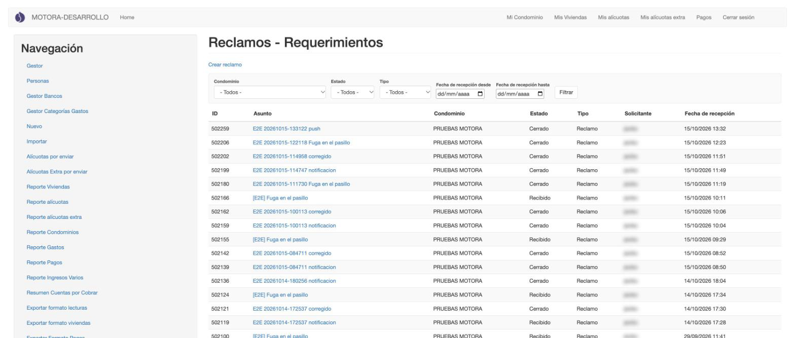
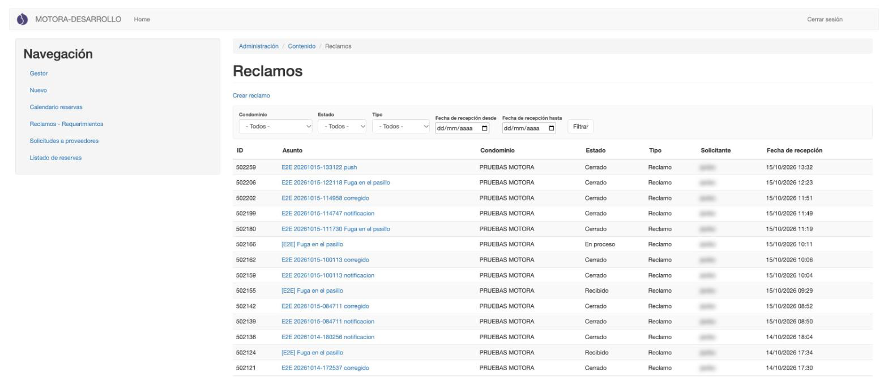
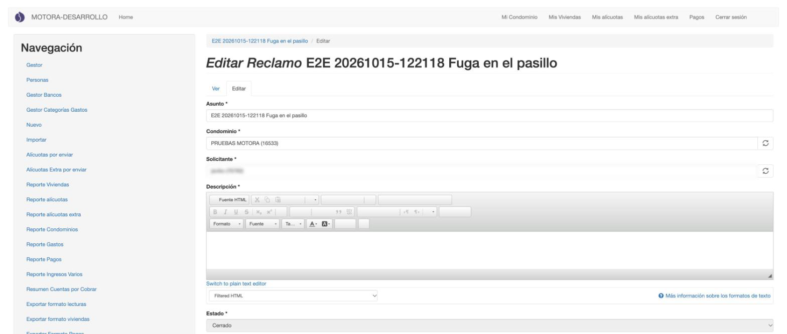
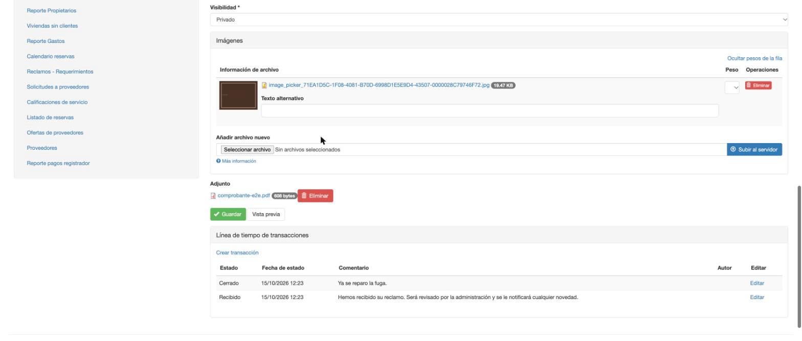
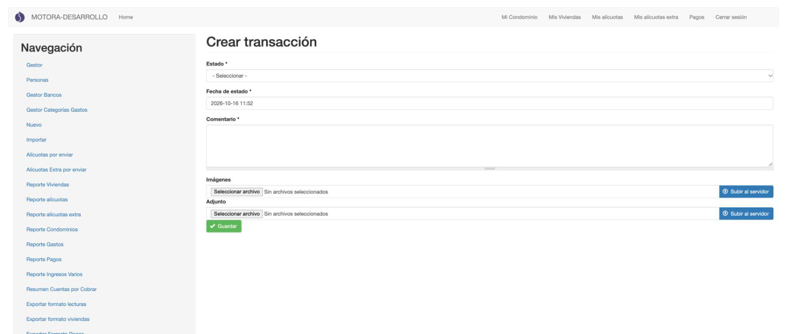
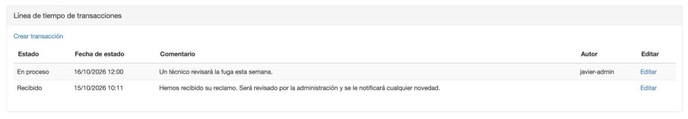
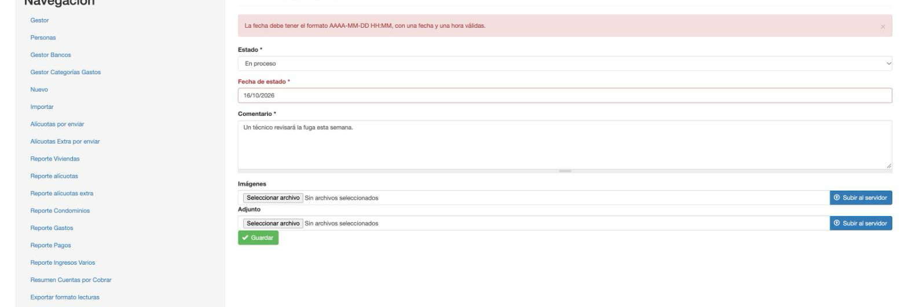

[← Pagos](02_pagos.md) · [Índice](../USER_GUIDE.md) · [Siguiente: Reservas →](04_reservas.md)

# 3. Reclamos y requerimientos

Los residentes envían reclamos y requerimientos desde la app. Aquí la administración los revisa y les da seguimiento. Cada cambio de estado se registra como una **transacción**, que el residente ve en la línea de tiempo de su reclamo.

> **Backend** ve los reclamos de todos los condominios. **Administrador edificio** ve y gestiona solo los de sus condominios.

## Listado de reclamos

**¿Para qué sirve?**
Para ver los reclamos recibidos, filtrarlos y abrir uno para atenderlo.

**Cómo acceder**
Menú **Navegación** → **Reclamos - Requerimientos**.

**Interfaz**

1. **Crear reclamo**: para registrar un reclamo en nombre de un residente (por ejemplo, uno que llegó por teléfono).
2. **Filtros**:
   - **Condominio**.
   - **Estado**: Recibido, En proceso, Resuelto o Cerrado.
   - **Tipo**: Reclamo o Requerimiento.
   - **Fecha de recepción desde / hasta**.

   Pulsa **Filtrar** para aplicarlos.
3. **Tabla**: ID, **Asunto**, Condominio, Estado, Tipo, Solicitante y Fecha de recepción.
4. **Asunto**: abre el reclamo para atenderlo.

Así lo ve un administrador edificio: el filtro **Condominio** solo ofrece sus condominios.

## Atender un reclamo

**¿Para qué sirve?**
Para revisar los datos del reclamo y ver su historial.

**Cómo acceder**
En el listado, pulsa el **Asunto** del reclamo.

**Interfaz**

1. **Asunto**, **Condominio**, **Solicitante** y **Descripción**: lo que envió el residente.
2. **Estado**: aparece en gris y **no se puede cambiar aquí**. El estado cambia creando una transacción (ver abajo).
3. Más abajo están **Tipo**, **Fecha de recepción**, **Visibilidad** (*Privado* o *Público*), las **Imágenes** y el **Adjunto** que envió el residente.

Al final del formulario está la **Línea de tiempo de transacciones**:

1. **Guardar**: guarda los cambios de los campos de arriba.
2. **Crear transacción**: para cambiar el estado del reclamo.
3. **Tabla**: cada cambio de estado, con la fecha, el comentario y quién lo hizo. La primera fila (*Recibido*) la crea el sistema solo, en cuanto llega el reclamo.
4. **Editar**: para corregir una transacción.

## Cambiar el estado (crear una transacción)

**¿Para qué sirve?**
Para avanzar el reclamo (*En proceso*, *Resuelto*, *Cerrado*) y dejar un comentario al residente.

**Cómo acceder**
Abre el reclamo y, en **Línea de tiempo de transacciones**, pulsa **Crear transacción**. El administrador edificio también lo encuentra en **Nuevo** → **Transacción de reclamo**.

**Interfaz**

1. **Estado**: el nuevo estado (Recibido, En proceso, Resuelto o Cerrado).
2. **Fecha de estado**: viene con la fecha y la hora actuales. Respeta el formato **AAAA-MM-DD HH:MM** (por ejemplo, *2026-10-16 12:00*).
3. **Comentario**: lo que quieres contar al residente. Es obligatorio.
4. **Imágenes** y **Adjunto**: opcionales, por ejemplo una foto de la reparación.

**Cómo utilizarla**

1. Elige el nuevo **Estado**.
2. Deja la **Fecha de estado** como viene o escríbela con el formato indicado.
3. Escribe el **Comentario**.
4. Si quieres, adjunta imágenes o un archivo con **Seleccionar archivo** y **Subir al servidor**.
5. Pulsa **Guardar**.

**Resultado**

Vuelves al formulario del reclamo. La nueva transacción aparece la primera en la línea de tiempo, con tu usuario como **Autor**, y el **Estado** del reclamo cambia al que elegiste.

En el listado de reclamos, el reclamo aparece con su nuevo estado.

**Consideraciones**

- Si la fecha no tiene el formato correcto, el formulario no se guarda y muestra este error:

  

  *«La fecha debe tener el formato AAAA-MM-DD HH:MM, con una fecha y una hora válidas.»* Corrige la fecha (por ejemplo, *2026-10-16 12:00* en vez de *16/10/2026*) y pulsa **Guardar** otra vez.
- Estado, Fecha de estado y Comentario son obligatorios.
