[← Reclamos](03_reclamos.md) · [Índice](../USER_GUIDE.md) · [Siguiente: Servicios →](05_servicios.md)

# 4. Reservas, calendario y áreas comunes

Los residentes reservan las áreas comunes (asadero, piscina, gimnasio…) desde la app. Aquí se consultan esas reservas y, si eres administrador edificio, también se crean reservas y áreas.

> **Backend** ve las reservas de todos los condominios. **Administrador edificio** ve solo las de sus condominios.

## Listado de reservas

**¿Para qué sirve?**
Para buscar reservas en forma de tabla: por condominio, por área, por estado o por fechas.

**Cómo acceder**
Menú **Navegación** → **Listado de reservas**.

**Interfaz**

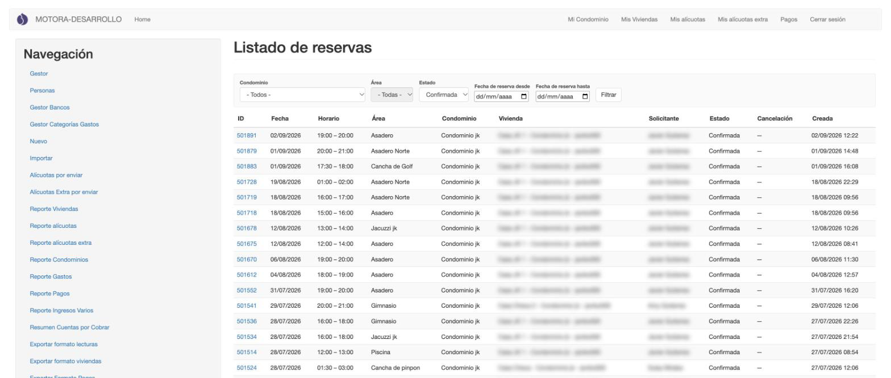

1. **Filtros**:
   - **Condominio**.
   - **Área**: se activa al elegir un condominio.
   - **Estado**: *Confirmada* o *Cancelada*.
   - **Fecha de reserva desde / hasta**.

   Pulsa **Filtrar** para aplicarlos.
2. **Tabla**: ID, Fecha, Horario, Área, Condominio, Vivienda, Solicitante y Estado.
3. **Cancelación**: en una reserva cancelada indica quién la canceló (*Usuario* o *Admin*) y el motivo.
4. **Creada**: cuándo se hizo la reserva.
5. **ID**: abre la reserva.

**Consideraciones**

- Esta pantalla solo sirve para consultar. Para cancelar una reserva, ábrela (ver [Cancelar una reserva](#cancelar-una-reserva)).

## Calendario de reservas

**¿Para qué sirve?**
Para ver de un vistazo qué áreas están ocupadas cada día.

**Cómo acceder**
Menú **Navegación** → **Calendario reservas**.

**Interfaz**

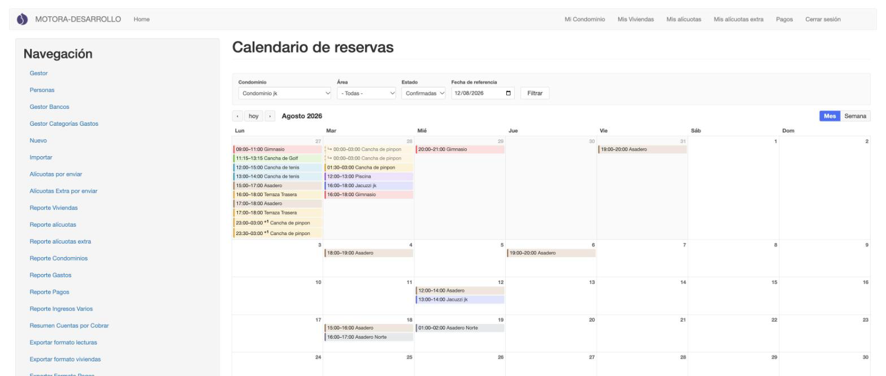

1. **Filtros**:
   - **Condominio**.
   - **Área**: muestra *«- Elige un condominio -»* hasta que eliges uno.
   - **Estado**: *Confirmadas*, *Canceladas* o *Todas*.
   - **Fecha de referencia**: el día que quieres ver.

   Pulsa **Filtrar** para aplicarlos.
2. **‹ hoy ›**: semana o mes anterior, vuelta a hoy y semana o mes siguiente.
3. **Mes / Semana**: cambia la vista.
4. **Reservas**: cada una con su horario y su área, en un color por área. Una reserva que termina al día siguiente lleva **+1** y, en el día siguiente, una flecha **↪**.

**Cómo utilizarla**

1. Elige el **Condominio** y, si quieres, el **Área**.
2. Pulsa **Filtrar**.
3. Muévete con **‹** y **›**, o cambia entre **Mes** y **Semana**.
4. Pulsa una reserva para ver su detalle:

   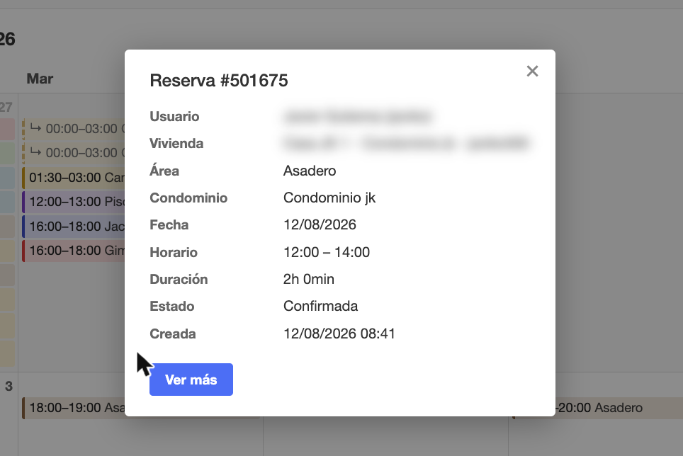

   Muestra el usuario, la vivienda, el área, el condominio, la fecha, el horario, la duración, el estado y cuándo se creó. **Ver más** abre la reserva completa en otra pestaña.

Así lo ve un administrador edificio en la vista **Semana**: el filtro **Condominio** solo ofrece sus condominios.

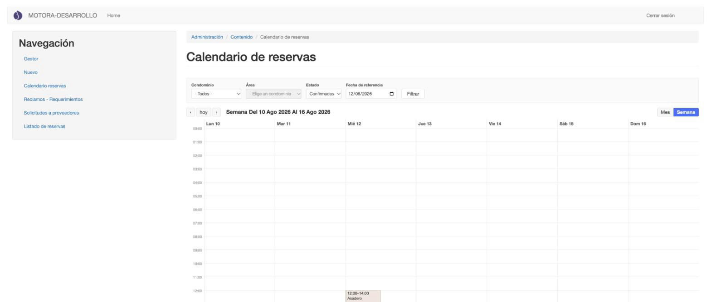

**Consideraciones**

- El calendario solo sirve para consultar: no se crean ni se cambian reservas desde aquí.

## Cancelar una reserva

**¿Para qué sirve?**
Para anular una reserva confirmada, por ejemplo si el área no estará disponible.

**Cómo acceder**
En **Listado de reservas**, pulsa el **ID** de la reserva. También desde el calendario, con **Ver más**.

**Interfaz**

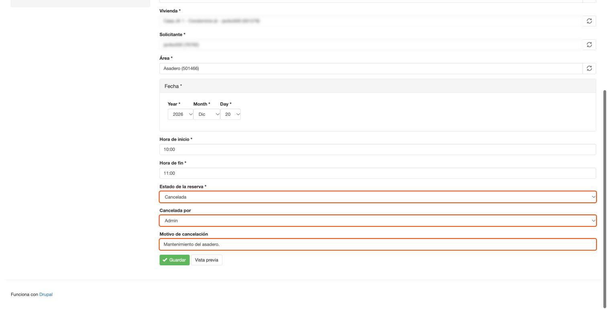

1. **Estado de la reserva**: *Confirmada* o *Cancelada*.
2. **Cancelada por**: *Usuario* o *Admin*.
3. **Motivo de cancelación**: texto libre.
4. **Guardar**.

**Cómo utilizarla**

1. Cambia **Estado de la reserva** a **Cancelada**.
2. En **Cancelada por**, elige **Admin**.
3. Escribe el **Motivo de cancelación**.
4. Pulsa **Guardar**.

**Resultado**

Aparece el aviso *«Reserva … ha sido actualizado»*. En **Listado de reservas** la reserva queda **Cancelada** y la columna **Cancelación** muestra quién la canceló y el motivo:

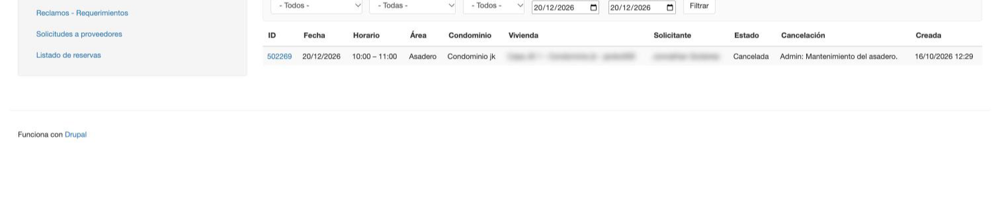

**Consideraciones**

- Cancela en lugar de borrar: la reserva cancelada queda en el historial con su motivo. El administrador edificio solo tiene los botones **Guardar** y **Vista previa**, sin **Eliminar**.

## Crear una reserva (administrador edificio)

**¿Para qué sirve?**
Para reservar un área en nombre de un residente.

**Cómo acceder**
Menú **Navegación** → **Nuevo** → **Reserva**.

**Interfaz**

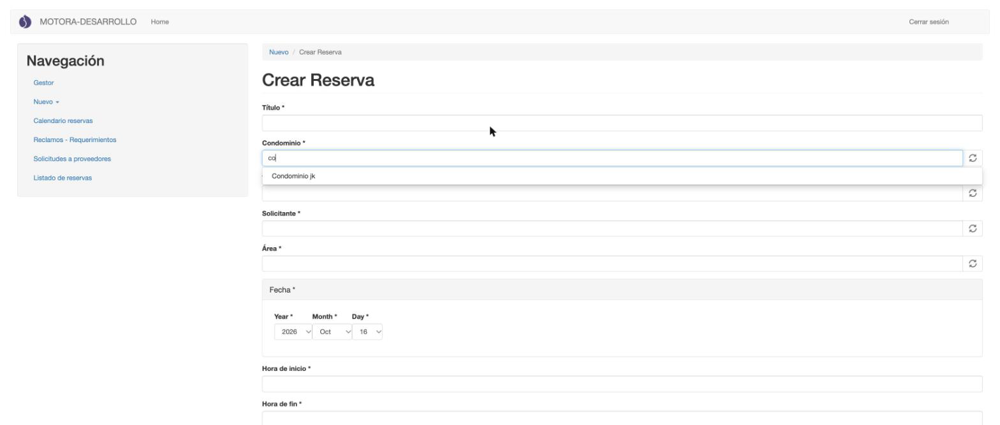

1. **Título**.
2. **Condominio**, **Vivienda**, **Solicitante** y **Área**: se rellenan escribiendo y eligiendo una sugerencia de la lista. Solo aparecen los de tus condominios. En la captura, al escribir *co* solo sale *Condominio jk*.
3. **Fecha**: año, mes y día.
4. **Hora de inicio** y **Hora de fin**: en formato **HH:MM** de 24 horas.
5. **Estado de la reserva**, **Cancelada por** y **Motivo de cancelación**: para una reserva nueva, deja *Confirmada*.

**Cómo utilizarla**

1. Escribe el **Título**.
2. En **Condominio**, **Vivienda**, **Solicitante** y **Área**, escribe unas letras y elige de la lista.
3. Elige la **Fecha** y escribe las horas (por ejemplo, *10:00* y *11:00*).

   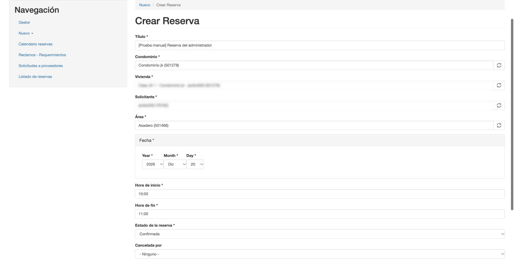

4. Pulsa **Guardar**.

**Resultado**

Aparece el aviso *«Reserva … se ha creado»* y se abre la reserva, en estado **Confirmada**. También aparece en **Listado de reservas** y en el calendario.

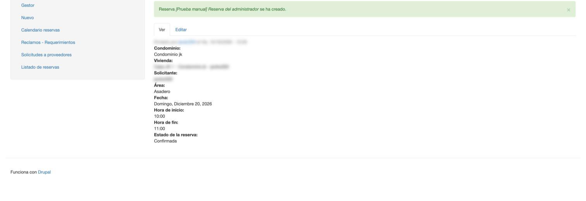

**Consideraciones**

- Si te equivocas, no la puedes borrar: cancélala (ver [Cancelar una reserva](#cancelar-una-reserva)).
- Las horas siguen la misma regla que en las áreas (ver abajo): *8:00* o *24:00* no son válidas.

## Crear un área común (administrador edificio)

**¿Para qué sirve?**
Para dar de alta un área reservable (piscina, asadero, cancha…) y fijar sus reglas de uso.

**Cómo acceder**
Menú **Navegación** → **Nuevo** → **Área**.

**Interfaz**

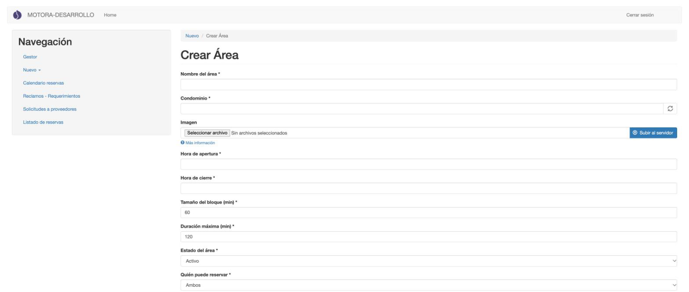

1. **Nombre del área** y **Condominio** (obligatorio, con autocompletado).
2. **Imagen**: PNG o JPG.
3. **Hora de apertura** y **Hora de cierre**: formato **HH:MM** de 24 horas.
4. **Tamaño del bloque (min)**: viene en 60. **Duración máxima (min)**: viene en 120.
5. **Estado del área**: *Activo*, *Cerrado* o *En Mantenimiento*.
6. **Quién puede reservar**: *Ambos*, *Propietario* o *Arrendatario*.
7. Más abajo están **Antelación mínima para cancelar (min)**, **Categoría del área**, **Instrucciones o notas** (el texto que la app muestra al residente antes de reservar) y **Reservas simultáneas permitidas**.

**Cómo utilizarla**

1. Rellena los campos obligatorios (marcados con \*).
2. Escribe las horas con dos cifras: **08:00**, no *8:00*.
3. Pulsa **Guardar**.

**Consideraciones**

- Si falta el condominio o una hora no tiene el formato correcto, el formulario no se guarda y muestra los errores arriba, con el campo marcado en rojo:

  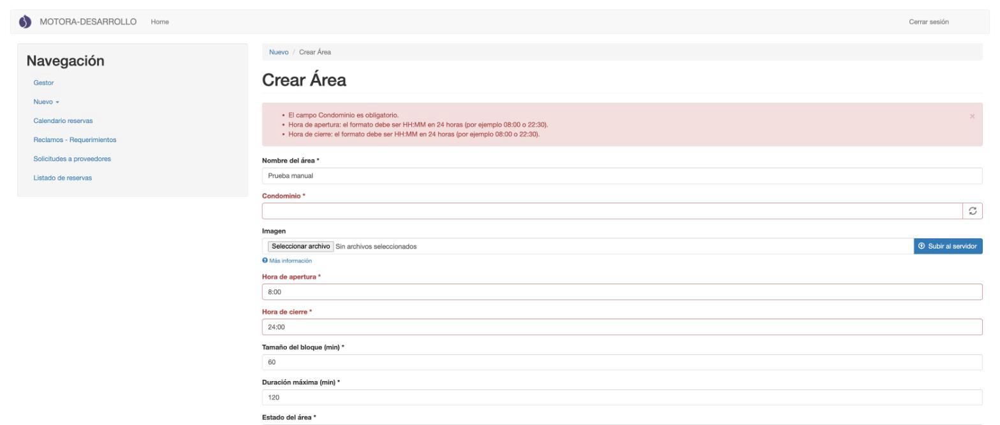

  - *«El campo Condominio es obligatorio.»*
  - *«Hora de apertura: el formato debe ser HH:MM en 24 horas (por ejemplo 08:00 o 22:30).»* (en la captura se escribió *8:00*).
  - *«Hora de cierre: …»* (en la captura se escribió *24:00*, que no se acepta).
