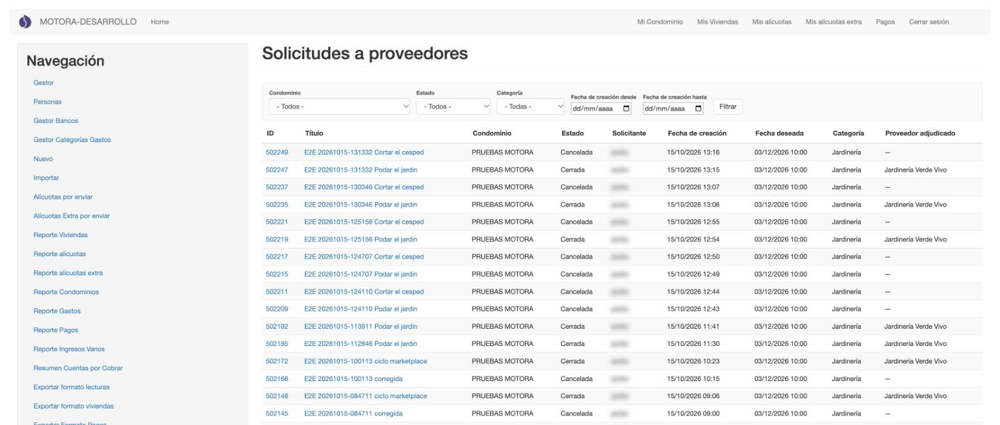
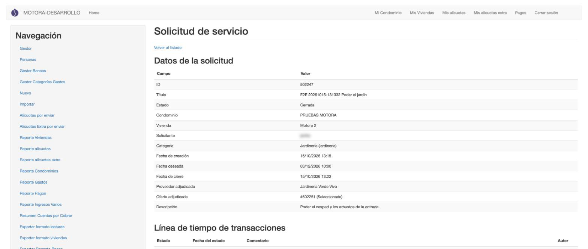
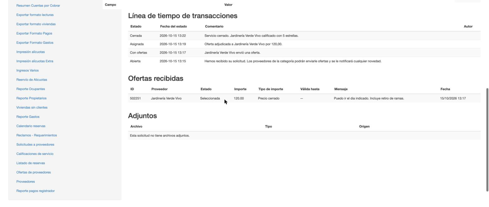
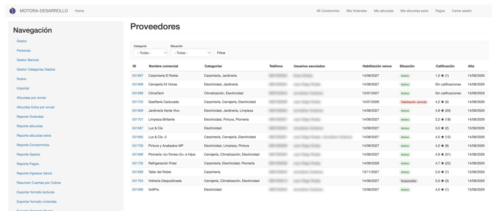
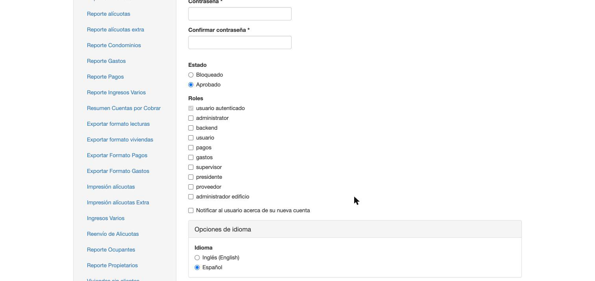
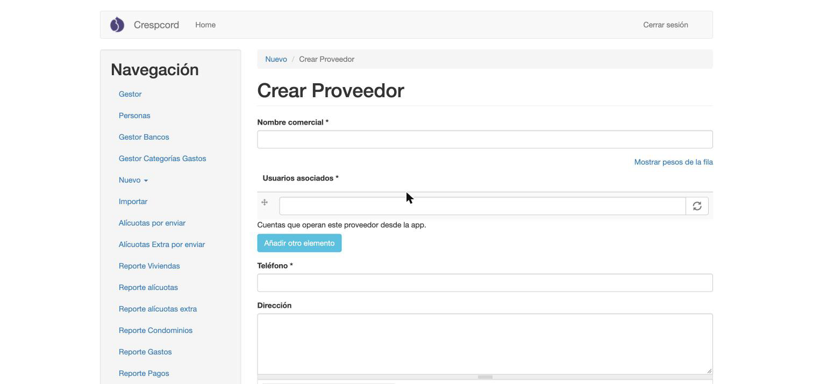
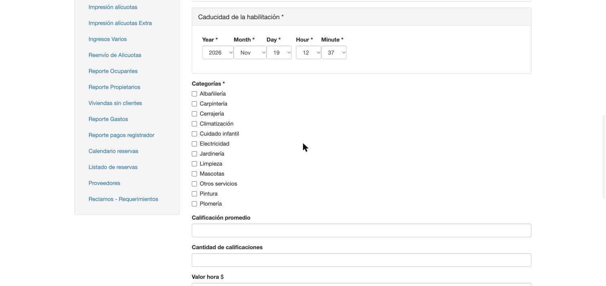
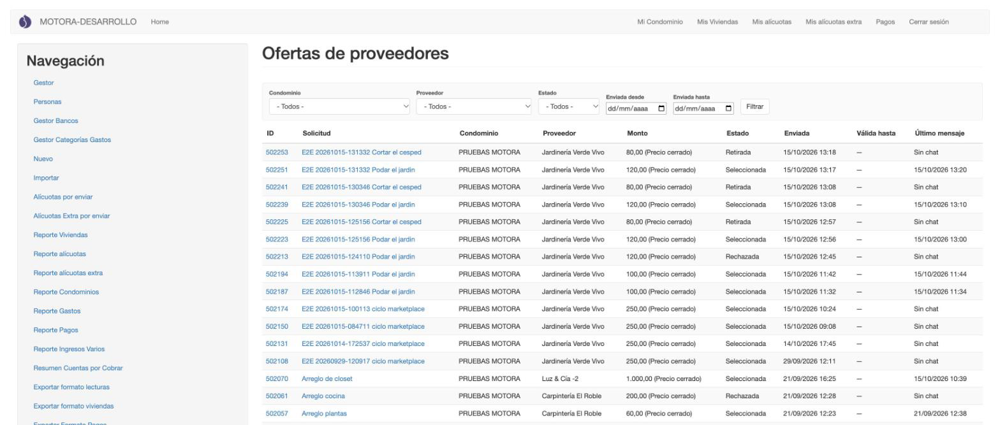
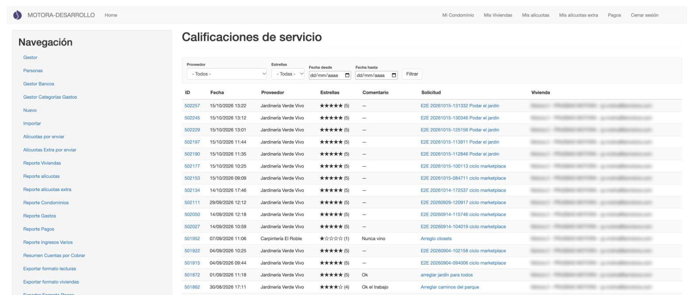

[← Reservas](04_reservas.md) · [Índice](../USER_GUIDE.md) · [Siguiente: Boletines →](06_boletines.md)

# 5. Servicios de proveedores

Desde la app, los residentes piden servicios para su hogar (jardinería, carpintería, limpieza…). Los proveedores envían ofertas, el residente elige una y, al terminar, califica al proveedor. Todo eso pasa en la app. Aquí la administración lo **supervisa**.

> **Backend** ve las cuatro pantallas de este capítulo. **Administrador edificio** solo ve [Solicitudes a proveedores](#solicitudes-a-proveedores), y solo las de sus condominios.

## Solicitudes a proveedores

**¿Para qué sirve?**
Para ver todas las solicitudes de servicio y en qué punto está cada una.

**Cómo acceder**
Menú **Navegación** → **Solicitudes a proveedores**.

**Interfaz**

1. **Filtros**:
   - **Condominio**.
   - **Estado**: Abierta, Proveedor directo, Con ofertas, Asignada, Cerrada o Cancelada.
   - **Categoría**.
   - **Fecha de creación desde / hasta**.

   Pulsa **Filtrar** para aplicarlos.
2. **Tabla**: ID, Título, Condominio, Estado, Solicitante, Fecha de creación, **Fecha deseada** (cuándo quiere el servicio el residente), Categoría y **Proveedor adjudicado** (vacío hasta que el residente elige una oferta).
3. **ID**: abre el detalle de supervisión.

**Consideraciones**

- El administrador edificio ve el mismo listado, limitado a sus condominios. Para él, el **Título** abre la solicitud solo para verla.

## Detalle de una solicitud

**¿Para qué sirve?**
Para revisar en una sola página todo lo que pasó con una solicitud: sus datos, su historial, las ofertas recibidas y los archivos.

**Cómo acceder**
En **Solicitudes a proveedores**, pulsa el **ID**.

**Interfaz**

1. **Volver al listado**.
2. **Datos de la solicitud**: título, estado, condominio, vivienda, solicitante, categoría, fechas, proveedor y oferta adjudicados, y la descripción del residente.

Más abajo:

3. **Línea de tiempo de transacciones**: cada cambio de estado, el más reciente arriba. Por ejemplo: *Abierta* → *Con ofertas* → *Asignada* → *Cerrada*.
4. **Ofertas recibidas**: cada oferta con su proveedor, estado (*Seleccionada*, *Rechazada*, *Retirada*…), importe, tipo de importe, validez, mensaje y fecha.
5. **Adjuntos**: los archivos de la solicitud. Si no hay, lo indica.

**Consideraciones**

- Esta página solo sirve para consultar: no tiene botones para cambiar nada. Los cambios los hacen el residente y el proveedor desde la app.

## Proveedores

> Solo backend.

**¿Para qué sirve?**
Para consultar el directorio de proveedores: qué servicios ofrecen, si su habilitación está vigente y qué calificación tienen.

**Cómo acceder**
Menú **Navegación** → **Proveedores**.

**Interfaz**

1. **Filtros**: **Categoría** y **Situación**.
2. **Tabla**: ID, Nombre comercial, Categorías, Teléfono, Usuarios asociados (las cuentas de usuario vinculadas al proveedor) y Habilitación vence.
3. **Situación**: *Activo* en verde, *Habilitación vencida* en rojo, *Suspendido* en gris.
4. **Calificación**: el promedio de estrellas y, entre paréntesis, cuántas calificaciones tiene. *Sin calificaciones* si aún no tiene.
5. **Alta**: cuándo se registró.

## Dar de alta un proveedor

> Solo backend.

**¿Para qué sirve?**
Para que una persona o empresa pueda recibir solicitudes y enviar ofertas desde la app. Hacen falta dos cosas: una **cuenta de usuario** con el rol **proveedor** y una **ficha de proveedor** vinculada a esa cuenta. Si falta cualquiera de las dos, la app no muestra el modo proveedor o lo muestra vacío.

**Cómo acceder**

- Cuenta de usuario: menú **Navegación** → **Personas** → **Añadir usuario**.
- Ficha de proveedor: menú **Navegación** → **Nuevo** → **Proveedor**.

**Interfaz**

**Cómo utilizarla**

*Paso 1. La cuenta de usuario*

Si la persona ya usa la app como residente, no crees otra cuenta: abre la suya en **Personas**, pulsa **editar**, marca el rol **proveedor** y pulsa **Guardar**. Una misma cuenta sirve para los dos modos.

Si es una persona nueva:

1. Entra en **Personas** → **Añadir usuario**.
2. Escribe el **Nombre de usuario**, la **Dirección de correo electrónico** y la **Contraseña** dos veces. Completa también **Nombre**, **Apellidos**, **Telefono** y **Cedula**.
3. Deja el **Estado** en *Aprobado*.
4. En **Roles**, marca **proveedor**.
5. Si quieres que reciba un correo con sus datos de acceso, marca **Notificar al usuario acerca de su nueva cuenta**.
6. Pulsa **Crear nueva cuenta**.

*Paso 2. La ficha del proveedor*

1. Entra en **Nuevo** → **Proveedor**. Se abre **Crear Proveedor**.
2. Completa los campos obligatorios:
   - **Nombre comercial**: el nombre que verán los residentes.
   - **Usuarios asociados**: escribe el nombre de la cuenta del paso 1 y elígela de la lista. Con **Añadir otro elemento** puedes vincular más cuentas si el proveedor tiene varias personas.
   - **Teléfono**.
   - **Descripción de servicios**: qué hace el proveedor.
   - **Caducidad de la habilitación**: año, mes, día, hora y minuto hasta los que el proveedor puede trabajar. **Viene rellenada con la fecha y hora de ahora: cámbiala**, o el proveedor quedará vencido en cuanto lo guardes.
   - **Categorías**: marca las que atiende. Solo verá las solicitudes de esas categorías.
3. Si los tienes, completa los opcionales: **Dirección**, **Valor hora**, **Etiquetas**, **Descripción corta** (una línea para la tarjeta de la app), **Galería** (hasta 10 fotos) y **Logo**. Para las fotos, elige el archivo y pulsa **Subir al servidor**.
4. Deja vacíos **Calificación promedio** y **Cantidad de calificaciones**: se llenan solos con las calificaciones de los residentes.
5. Pulsa **Guardar**.

**Resultado**
El proveedor aparece en **Navegación** → **Proveedores** con la situación *Activo* y la cuenta en **Usuarios asociados**. Cuando esa persona entra en la app, ve en Inicio la etiqueta **Viendo como Residente** y puede cambiar a **Proveedor**.

**Consideraciones**

- **Rol y ficha van juntos.** Una cuenta con el rol proveedor pero sin ficha vinculada no ve ninguna solicitud. Una cuenta vinculada a una ficha pero sin el rol no ve el modo proveedor.
- **Habilitación vencida**: al pasar la fecha de **Caducidad de la habilitación**, el proveedor deja de recibir solicitudes por sí solo y aparece en rojo en el directorio. Para renovarlo, edita la ficha y pon una fecha nueva.
- **Suspender a un proveedor** (*Suspendido* en el directorio) significa despublicar su ficha, y el formulario de backend no tiene esa opción. Pídelo a un administrador. Mientras tanto, puedes adelantar la **Caducidad de la habilitación** a la fecha de hoy para que deje de recibir solicitudes.
- **Etiquetas**: si escribes una etiqueta que no existe, se crea. Revisa que no exista ya con un nombre parecido («urgencias» y «urgencias 24h»).
- El **Logo** debe medir entre 200×200 y 1000×1000 píxeles, en png o jpg, hasta 5 MB.
- Cuando una persona deje de trabajar para el proveedor, quítale el rol **proveedor** y sácala de **Usuarios asociados**.

## Ofertas de proveedores

> Solo backend.

**¿Para qué sirve?**
Para revisar los presupuestos que envían los proveedores a las solicitudes de los residentes.

**Cómo acceder**
Menú **Navegación** → **Ofertas de proveedores**.

**Interfaz**

1. **Filtros**: Condominio, Proveedor, Estado y **Enviada desde / hasta**.
2. **Tabla**: ID, **Solicitud** (enlace a la solicitud), Condominio, Proveedor, **Monto** (con su tipo, por ejemplo *Precio cerrado*), **Estado** (*Seleccionada*, *Rechazada*, *Retirada*…), Enviada y Válida hasta.
3. **Último mensaje**: fecha del último mensaje del chat entre residente y proveedor, o *Sin chat*.

## Calificaciones de servicio

> Solo backend.

**¿Para qué sirve?**
Para leer las calificaciones que dejan los residentes al cerrar un servicio.

**Cómo acceder**
Menú **Navegación** → **Calificaciones de servicio**.

**Interfaz**

1. **Filtros**: Proveedor, **Estrellas** y Fecha desde / hasta.
2. **Tabla**: ID, Fecha, Proveedor, **Estrellas** (de 1 a 5) y **Comentario** del residente.
3. **Solicitud**: enlace a la solicitud calificada. En algunas filas aparece *Proveedor directo* en lugar del enlace.
4. **Vivienda**: quién calificó.

**Cómo utilizarla**

Para encontrar las malas experiencias, elige en **Estrellas** un número bajo y pulsa **Filtrar**.
