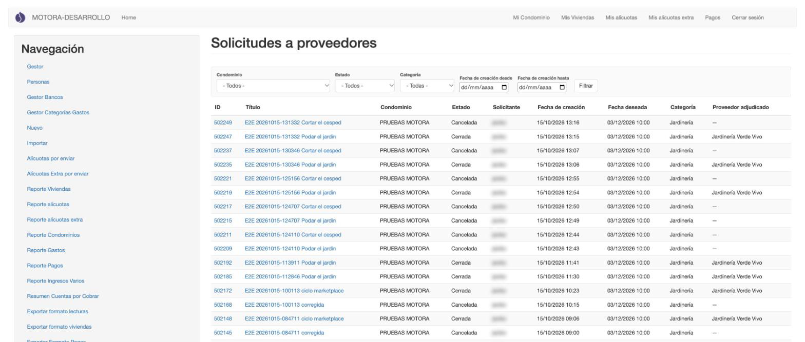
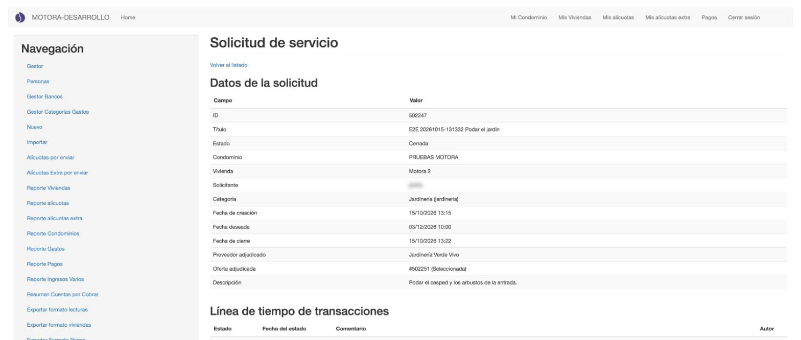
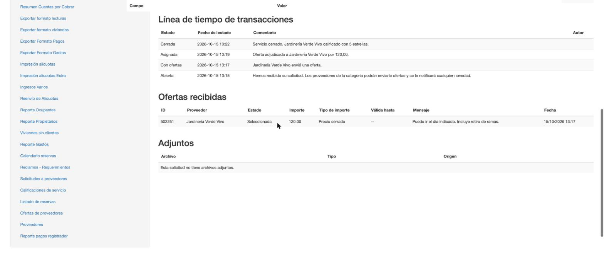
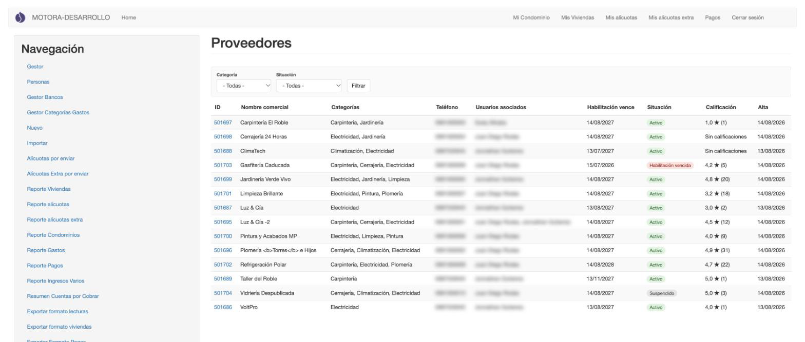
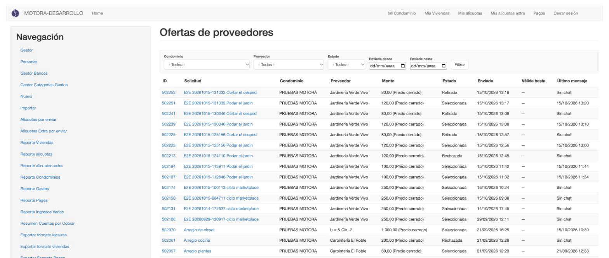
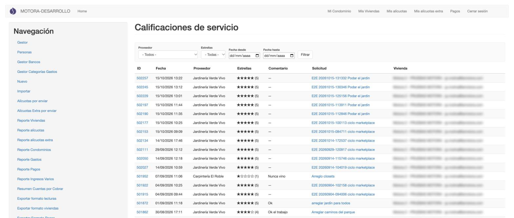

[← Reservas](04_reservas.md) · [Índice](../USER_GUIDE.md) · [Siguiente: Boletines →](06_boletines.md)

# 5. Servicios de proveedores

Desde la app, los residentes piden servicios para su hogar (jardinería, carpintería, limpieza…). Los proveedores envían ofertas, el residente elige una y, al terminar, califica al proveedor. Todo eso pasa en la app. Aquí la administración lo **supervisa**.

> **Backend** ve las cuatro pantallas de este capítulo. **Administrador edificio** solo ve [Solicitudes a proveedores](#solicitudes-a-proveedores), y solo las de sus condominios.

## Solicitudes a proveedores

**¿Para qué sirve?**
Para ver todas las solicitudes de servicio y en qué punto está cada una.

**Cómo acceder**
Menú **Navegación** → **Solicitudes a proveedores**.

**Interfaz**

1. **Filtros**:
   - **Condominio**.
   - **Estado**: Abierta, Proveedor directo, Con ofertas, Asignada, Cerrada o Cancelada.
   - **Categoría**.
   - **Fecha de creación desde / hasta**.

   Pulsa **Filtrar** para aplicarlos.
2. **Tabla**: ID, Título, Condominio, Estado, Solicitante, Fecha de creación, **Fecha deseada** (cuándo quiere el servicio el residente), Categoría y **Proveedor adjudicado** (vacío hasta que el residente elige una oferta).
3. **ID**: abre el detalle de supervisión.

**Consideraciones**

- El administrador edificio ve el mismo listado, limitado a sus condominios. Para él, el **Título** abre la solicitud solo para verla.

## Detalle de una solicitud

**¿Para qué sirve?**
Para revisar en una sola página todo lo que pasó con una solicitud: sus datos, su historial, las ofertas recibidas y los archivos.

**Cómo acceder**
En **Solicitudes a proveedores**, pulsa el **ID**.

**Interfaz**

1. **Volver al listado**.
2. **Datos de la solicitud**: título, estado, condominio, vivienda, solicitante, categoría, fechas, proveedor y oferta adjudicados, y la descripción del residente.

Más abajo:

3. **Línea de tiempo de transacciones**: cada cambio de estado, el más reciente arriba. Por ejemplo: *Abierta* → *Con ofertas* → *Asignada* → *Cerrada*.
4. **Ofertas recibidas**: cada oferta con su proveedor, estado (*Seleccionada*, *Rechazada*, *Retirada*…), importe, tipo de importe, validez, mensaje y fecha.
5. **Adjuntos**: los archivos de la solicitud. Si no hay, lo indica.

**Consideraciones**

- Esta página solo sirve para consultar: no tiene botones para cambiar nada. Los cambios los hacen el residente y el proveedor desde la app.

## Proveedores

> Solo backend.

**¿Para qué sirve?**
Para consultar el directorio de proveedores: qué servicios ofrecen, si su habilitación está vigente y qué calificación tienen.

**Cómo acceder**
Menú **Navegación** → **Proveedores**.

**Interfaz**

1. **Filtros**: **Categoría** y **Situación**.
2. **Tabla**: ID, Nombre comercial, Categorías, Teléfono, Usuarios asociados (las cuentas de usuario vinculadas al proveedor) y Habilitación vence.
3. **Situación**: *Activo* en verde, *Habilitación vencida* en rojo, *Suspendido* en gris.
4. **Calificación**: el promedio de estrellas y, entre paréntesis, cuántas calificaciones tiene. *Sin calificaciones* si aún no tiene.
5. **Alta**: cuándo se registró.

## Ofertas de proveedores

> Solo backend.

**¿Para qué sirve?**
Para revisar los presupuestos que envían los proveedores a las solicitudes de los residentes.

**Cómo acceder**
Menú **Navegación** → **Ofertas de proveedores**.

**Interfaz**

1. **Filtros**: Condominio, Proveedor, Estado y **Enviada desde / hasta**.
2. **Tabla**: ID, **Solicitud** (enlace a la solicitud), Condominio, Proveedor, **Monto** (con su tipo, por ejemplo *Precio cerrado*), **Estado** (*Seleccionada*, *Rechazada*, *Retirada*…), Enviada y Válida hasta.
3. **Último mensaje**: fecha del último mensaje del chat entre residente y proveedor, o *Sin chat*.

## Calificaciones de servicio

> Solo backend.

**¿Para qué sirve?**
Para leer las calificaciones que dejan los residentes al cerrar un servicio.

**Cómo acceder**
Menú **Navegación** → **Calificaciones de servicio**.

**Interfaz**

1. **Filtros**: Proveedor, **Estrellas** y Fecha desde / hasta.
2. **Tabla**: ID, Fecha, Proveedor, **Estrellas** (de 1 a 5) y **Comentario** del residente.
3. **Solicitud**: enlace a la solicitud calificada. En algunas filas aparece *Proveedor directo* en lugar del enlace.
4. **Vivienda**: quién calificó.

**Cómo utilizarla**

Para encontrar las malas experiencias, elige en **Estrellas** un número bajo y pulsa **Filtrar**.
