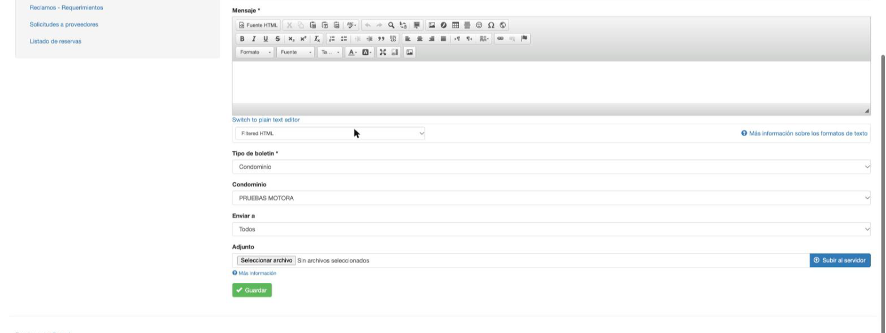
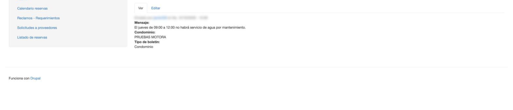
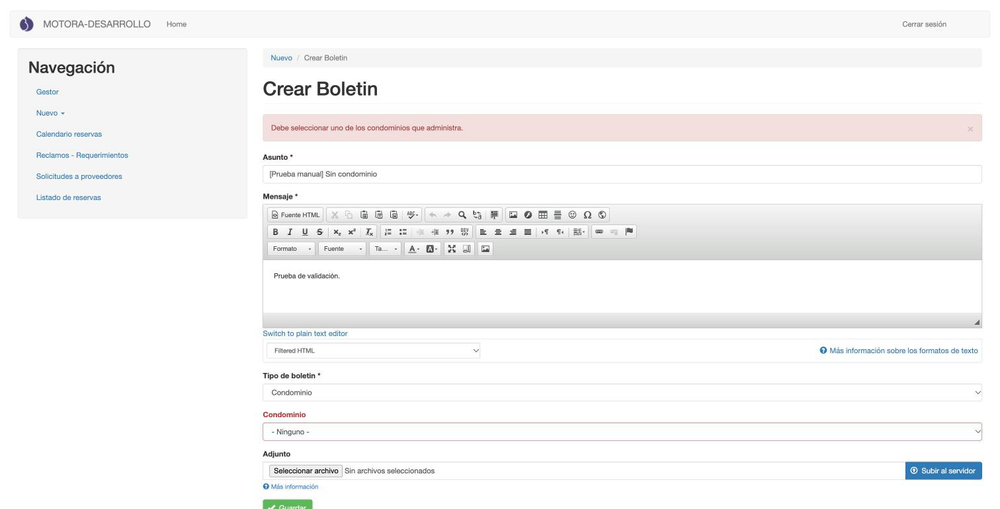
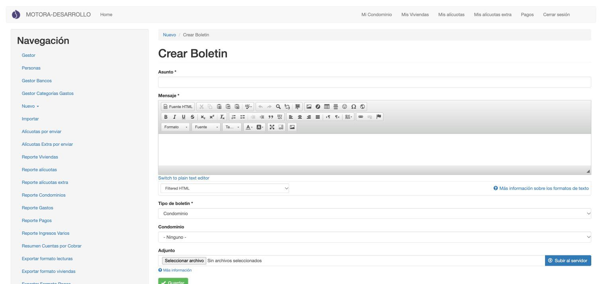

[← Servicios](05_servicios.md) · [Índice](../USER_GUIDE.md)

# 6. Boletines

Los boletines son los comunicados que los residentes leen en la app, en **Cuenta → Boletines**.

> Este capítulo se probó con los dos roles. Las diferencias de **backend** están al final, en [Boletines con el rol backend](#boletines-con-el-rol-backend).

## Crear un boletín

**¿Para qué sirve?**
Para enviar un comunicado a los residentes de uno de tus condominios: un corte de agua, una asamblea, un mantenimiento…

**Cómo acceder**
Menú **Navegación** → **Nuevo** → **Boletin**.

**Interfaz**

1. **Asunto**: el título que verán los residentes.
2. **Mensaje**: el texto. La barra permite negritas, listas, enlaces, etc.
3. **Tipo de boletin**: para el administrador edificio solo existe *Condominio*.
4. **Condominio**: solo ofrece tus condominios.
5. **Enviar a**: *Propietarios*, *Ocupantes* o *Todos*. Aparece al elegir el condominio.
6. **Adjunto**: un archivo opcional (por ejemplo, el acta en PDF).
7. **Guardar**.

**Cómo utilizarla**

1. Escribe el **Asunto** y el **Mensaje**.
2. Elige el **Condominio**.
3. En **Enviar a**, elige a quién va dirigido.
4. Si quieres, adjunta un archivo con **Seleccionar archivo** y **Subir al servidor**.
5. Pulsa **Guardar**.

**Resultado**

Aparece el aviso *«Boletin … se ha creado»* y se abre el boletín con su mensaje, condominio y tipo.

Para corregirlo después, usa la pestaña **Editar**.

**Consideraciones**

- **Revisa bien antes de guardar.** El formulario no tiene opción de borrador ni de despublicar para el administrador edificio, y el boletín queda publicado al guardar. Para retirar un boletín hay que pedirlo a la administración (backend).
- Elige siempre un **Condominio**. Si no eliges uno de tus condominios, el boletín no se guarda y aparece este error:

  

  *«Debe seleccionar uno de los condominios que administra.»*

## Boletines con el rol backend

El formulario es el mismo, con dos diferencias:

1. **Tipo de boletin** ofrece tres opciones: *General*, *Condominio* y *Personalizado*.
2. **Condominio** ofrece todos los condominios, no solo algunos.

Tampoco tiene opción de borrador: el boletín queda publicado al guardar.
