# Manual de uso · Registro de pagos de alícuotas por WhatsApp

Con este asistente de WhatsApp registras el pago de tu alícuota enviando el comprobante. No hace falta entrar a ninguna página ni llenar formularios.

## Índice

1. [Antes de empezar](#1-antes-de-empezar)
2. [Saludo e identificación de tu unidad](#2-saludo-e-identificación-de-tu-unidad)
3. [Si el bot no encuentra tu número](#3-si-el-bot-no-encuentra-tu-número)
4. [Enviar el comprobante](#4-enviar-el-comprobante)
5. [Completar datos que no se leyeron bien](#5-completar-datos-que-no-se-leyeron-bien)
6. [Aviso de cuenta o beneficiario distinto](#6-aviso-de-cuenta-o-beneficiario-distinto)
7. [Revisar el resumen y confirmar](#7-revisar-el-resumen-y-confirmar)
8. [Pago registrado](#8-pago-registrado)
9. [Palabras útiles: *cancelar* y *cambiar*](#9-palabras-útiles-cancelar-y-cambiar)
10. [Mensajes de error y qué hacer](#10-mensajes-de-error-y-qué-hacer)
11. [Preguntas frecuentes](#11-preguntas-frecuentes)

---

## 1. Antes de empezar

**¿Para qué sirve?**
El asistente lee tu comprobante de pago y lo registra en el sistema de la administración como **«Pendiente de verificación»**. Después, la administración lo revisa y lo aprueba.

**Lo que el asistente hace y lo que no**

| Sí | No |
|---|---|
| Registra el pago a partir de una foto, captura de pantalla o PDF del comprobante | Consulta saldos ni deudas |
| Te pregunta los datos que no pudo leer | Responde preguntas generales |
| Te da un número de registro | Aprueba el pago (eso lo hace la administración) |

**Qué necesitas**
- WhatsApp en el celular (o WhatsApp Web).
- El comprobante del pago: una **foto**, una **captura de pantalla** o un **PDF**.
- El número de WhatsApp de la administración guardado en tus contactos.

**Cómo acceder**
Abre WhatsApp, busca el contacto de la administración y escríbele cualquier mensaje (por ejemplo, *Hola*) o envía directamente el comprobante.

---

## 2. Saludo e identificación de tu unidad

**¿Para qué sirve?**
Antes de registrar un pago, el asistente confirma a qué unidad (departamento, casa o local) corresponde.

**Cómo acceder**
Escribe *Hola* o envía tu comprobante. El asistente responde según lo que sepa de tu número.

**Interfaz**

1. **Tu mensaje** (a la derecha, en verde).
2. **Unidad propuesta**: 🏢 el edificio o conjunto y 🏠 la unidad.
3. **Botones Sí / No** para confirmar.

Según tu número, el saludo puede ser uno de estos:

| Situación | Lo que dice el asistente |
|---|---|
| Tu número está registrado con **una** unidad | «Tengo este número registrado para: 🏢 … 🏠 … ¿Es correcto?» con botones **Sí / No** |
| Tu número está registrado con **varias** unidades | «Tienes varias unidades registradas. ¿De cuál es el pago? Responde con el *número*:» y una lista numerada (ver abajo) |
| Ya te identificaste antes en este chat | «La última vez te identificaste con: … ¿El pago es de esta unidad?» (imagen de arriba) |
| Tu número no está registrado | Te pregunta el nombre del edificio. Ver la [sección 3](#3-si-el-bot-no-encuentra-tu-número) |

**Cómo utilizarla**
1. Revisa el edificio y la unidad que aparecen.
2. Si son correctos, pulsa **Sí**.
3. Si no lo son, pulsa **No**: el asistente te pregunta el nombre de tu edificio ([sección 3](#3-si-el-bot-no-encuentra-tu-número)).
4. Si te muestra una lista, responde **solo con el número** de la opción (por ejemplo, `2`).

**Resultado**

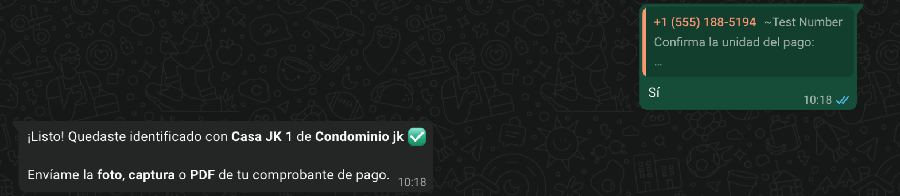

Al pulsar **Sí**, el asistente confirma la unidad y te pide la *foto*, *captura* o *PDF* del comprobante.

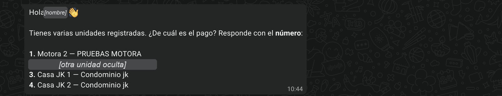

Si tu número tiene **varias unidades**, el asistente te saluda por tu nombre y muestra la lista. Responde con el número de la unidad del pago. Después te pide confirmarla, igual que en la [sección 3](#3-si-el-bot-no-encuentra-tu-número). En la imagen, el nombre y una unidad están ocultos.

**Consideraciones**
- Si respondes a una lista con algo que no es un número, el asistente dice: «No entendí tu respuesta. Responde solo con el *número* de la lista.»
- **Puedes enviar el comprobante directamente, sin saludar.** El asistente lo guarda, te pide confirmar la unidad y lo procesa en cuanto confirmas.

  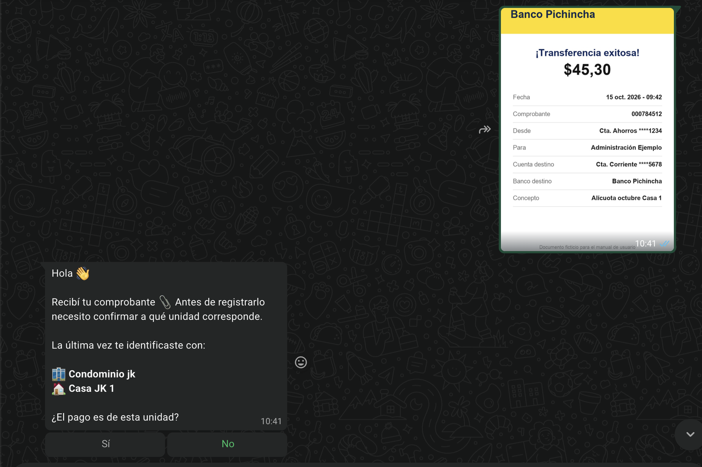

  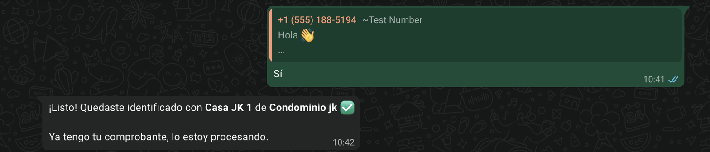

---

## 3. Si el bot no encuentra tu número

**¿Para qué sirve?**
Sirve para ubicar tu unidad aunque tu celular no esté registrado en el sistema de la administración.

**Cómo acceder**
Aparece sola cuando tu número no está registrado, o cuando pulsas **No** en la confirmación de unidad.

**Interfaz**

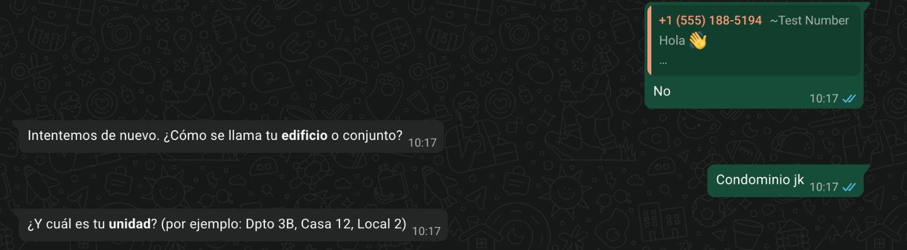

1. Pulsaste **No** en la unidad propuesta.
2. El asistente pregunta el **edificio** o conjunto.
3. Después pregunta la **unidad**, con ejemplos de cómo escribirla.

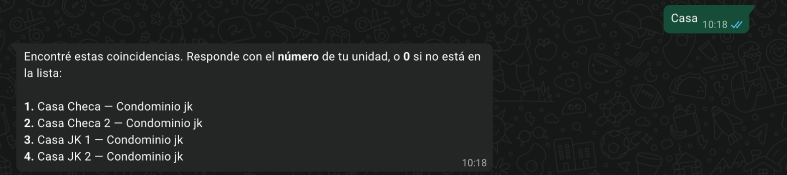

Si hay varias unidades parecidas, aparece una **lista numerada**. Responde solo con el número (en el ejemplo, `3`).

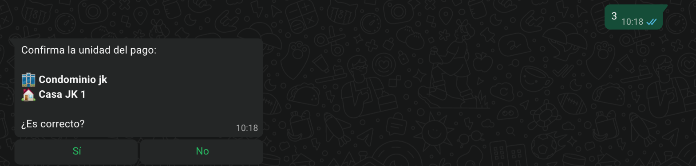

Al elegir un número, el asistente pide confirmar la unidad con **Sí / No**.

**Cómo utilizarla**
1. El asistente pregunta: «¿Cómo se llama tu *edificio* o conjunto?». Escribe el nombre (por ejemplo, *Torres del Parque*).
2. Luego pregunta: «¿Y cuál es tu *unidad*? (por ejemplo: Dpto 3B, Casa 12, Local 2)». Escríbela.
3. El asistente busca y responde de una de estas formas:
   - **Una sola coincidencia**: «Encontré esta unidad: … ¿Es la tuya?» con botones **Sí / No**.
   - **Varias coincidencias**: una lista numerada. Responde con el número de tu unidad, o con **0** si no está en la lista.
   - **Ninguna coincidencia**: «No encontré ninguna unidad con esos datos.» y vuelve a preguntar el edificio.
4. Confirma con **Sí**.

**Resultado**
Quedas identificado y el asistente te pide el comprobante. Además, recuerda tu unidad para la próxima vez («La última vez te identificaste con…»).

**Consideraciones**
- Si escribes muy poco (por ejemplo, una sola letra), te pide: «Escríbelo un poco más completo, por favor.»
- Después de **3 intentos** sin encontrar la unidad, el asistente termina la conversación y te pide contactar a la administración para que actualicen tus datos. La administración recibe un aviso para ayudarte.

  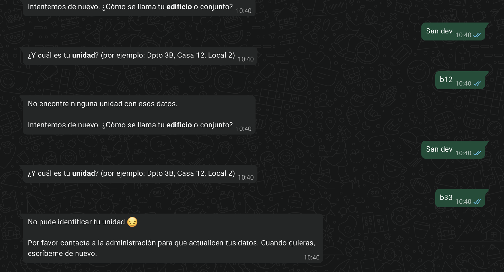

---

## 4. Enviar el comprobante

**¿Para qué sirve?**
Aquí envías el comprobante para que el asistente lea los datos del pago.

**Cómo acceder**
Una vez identificado, o en cualquier momento de la conversación.

**Interfaz** (WhatsApp Web)

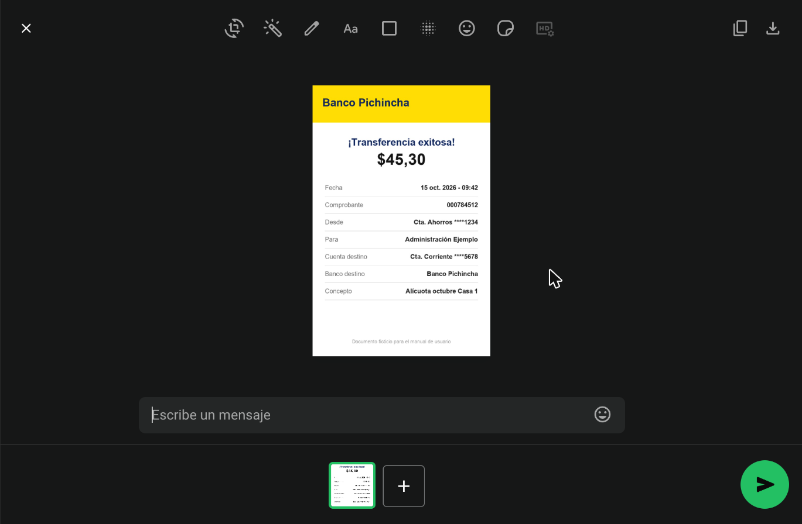

1. **Vista previa** del comprobante: revisa que se lea bien.
2. **Escribe un mensaje**: opcional, no hace falta escribir nada.
3. **Botón verde de enviar** (abajo a la derecha).

**Cómo utilizarla**
1. En el chat, pulsa el clip 📎 (o el **+** en iPhone).
2. Elige **Fotos** (o **Galería**) para una foto o captura, o **Documento** para un PDF.
3. Selecciona el comprobante y envíalo.
4. Espera unos segundos mientras el asistente lo lee.

**Formatos aceptados**

| Aceptado | No aceptado |
|---|---|
| Foto (JPG) | Audios y notas de voz |
| Captura de pantalla (PNG o JPG) | Stickers, videos, ubicaciones |
| PDF | Word, Excel u otros archivos |

**Consejos para una buena foto**
- Que se vean **completos** el monto, la fecha, el número de comprobante y el banco.
- Sin reflejos ni sombras, y enfocada.
- Si el banco te da un PDF o una captura de la app, mejor envía eso que una foto de la pantalla.

**Consideraciones**

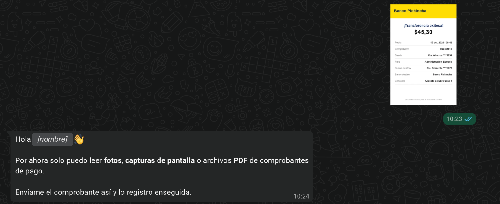

- Envía el comprobante desde **Fotos y videos** o **Documento**, **no como sticker**. En la imagen, el comprobante se envió por error desde «Nuevo sticker» y el asistente responde que solo lee fotos, capturas o PDF. Lo mismo pasa con audios, videos o ubicaciones.
- Si envías un archivo con un formato que no se puede leer, como Excel o Word, el asistente te pide la foto, captura o PDF.

  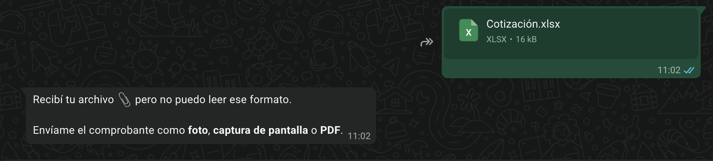
- Si el archivo es muy pesado (más de unos 4 MB), el asistente te pide uno más liviano. Una foto o captura de pantalla suele bastar.

  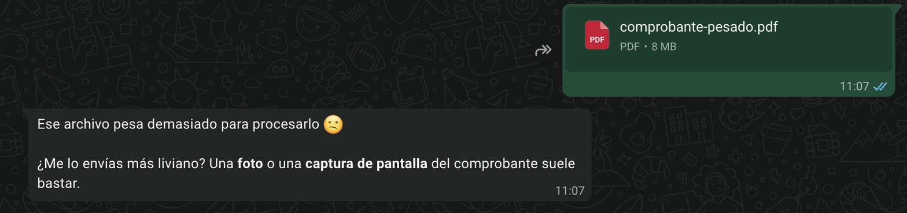
- Si la imagen no es un comprobante o no se lee, el asistente te pide otra foto o el PDF completo.

  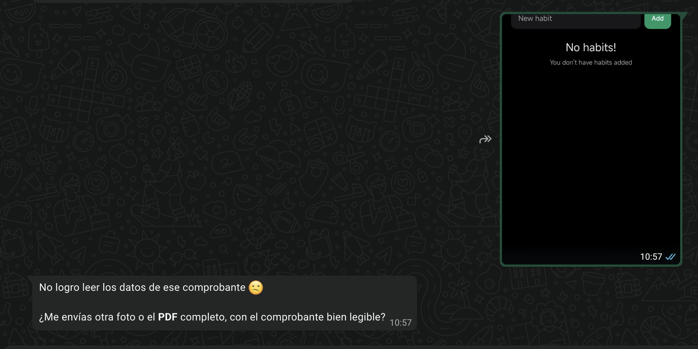

---

## 5. Completar datos que no se leyeron bien

**¿Para qué sirve?**
Si el asistente no está seguro de algún dato del comprobante, te lo pregunta para no registrar un valor equivocado.

**Cómo acceder**
Aparece sola después de enviar el comprobante, solo si hace falta.

**Interfaz**

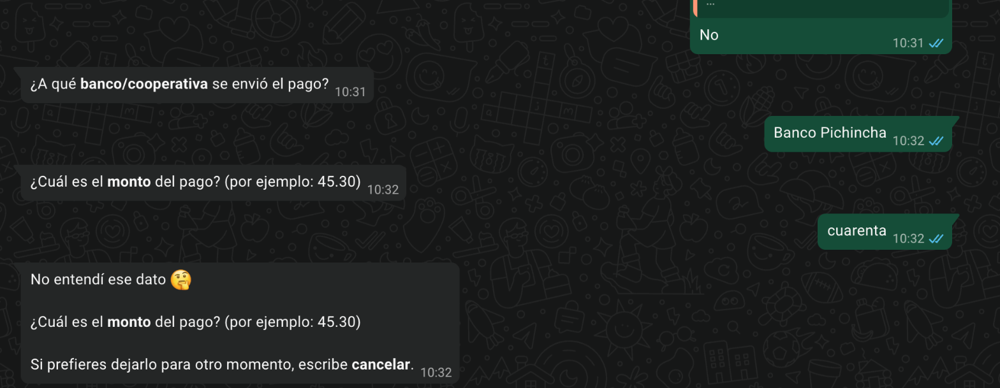

1. El asistente pregunta **un dato a la vez**, con un ejemplo del formato.
2. Si la respuesta no se entiende (aquí, «cuarenta» escrito en letras), responde **«No entendí ese dato 🤔»**, repite la pregunta y recuerda que puedes escribir *cancelar*.

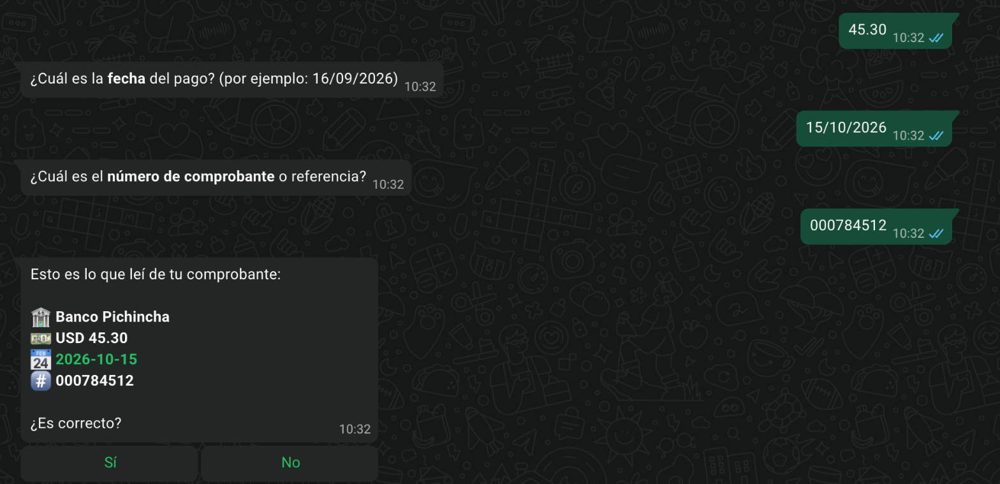

3. Cuando respondes todos los datos, vuelve a mostrar el **resumen** con lo que escribiste.

**Cómo utilizarla**
Responde cada pregunta con el dato tal como aparece en tu comprobante. El asistente pregunta un dato a la vez:

| Pregunta | Ejemplo de respuesta |
|---|---|
| «¿A qué *banco/cooperativa* se envió el pago?» | `Banco Pichincha` |
| «¿Cuál es el *monto* del pago? (por ejemplo: 45.30)» | `45.30` |
| «¿Cuál es la *fecha* del pago? (por ejemplo: 16/09/2026)» | `16/09/2026` |
| «¿Cuál es el *número de comprobante* o referencia?» | `000784512` |

**Consideraciones**
- Escribe el monto con números (`45.30`) y la fecha como día/mes/año (`15/10/2026`).

---

## 6. Aviso de cuenta o beneficiario distinto

**¿Para qué sirve?**
Te avisa si el comprobante parece de un pago hecho a otra persona o cuenta, por ejemplo cuando envías por error el comprobante de otro pago.

**Cómo acceder**
Aparece sola, solo si el beneficiario o la cuenta del comprobante no coinciden con los datos de pago de tu edificio.

**Interfaz** (en la imagen, los datos de pago del condominio están ocultos)

1. **A nombre de quién** figura el comprobante.
2. **Cuenta donde tu edificio recibe las alícuotas** (oculta en la imagen).
3. Botones **Sí / No**.

**Cómo utilizarla**
1. Lee el aviso. Muestra la cuenta donde tu edificio recibe las alícuotas.
2. Compárala con tu comprobante.
3. Si el comprobante es el correcto, pulsa **Sí** («¿Lo registro de todos modos?»). Si te equivocaste de comprobante, pulsa **No**.

**Resultado**
- Con **Sí**, sigues al resumen ([sección 7](#7-revisar-el-resumen-y-confirmar)).
- Con **No**: «Perfecto, no lo registro 👍 Cuando tengas a mano el comprobante del pago de la alícuota, envíamelo por aquí.»

---

## 7. Revisar el resumen y confirmar

**¿Para qué sirve?**
Antes de registrar el pago, el asistente te muestra lo que leyó para que lo confirmes.

**Cómo acceder**
Aparece después de enviar el comprobante y de responder las preguntas, si las hubo.

**Interfaz**

El mensaje muestra:
1. 🏦 **Banco o cooperativa** al que se envió el pago.
2. 💵 **Monto**.
3. 📅 **Fecha** del pago.
4. #️⃣ **Número de comprobante** o referencia.
5. Botones **Sí / No**.

**Cómo utilizarla**
1. Compara cada dato con tu comprobante.
2. Si todo está bien, pulsa **Sí**.
3. Si algo está mal, pulsa **No**: el asistente te pregunta los cuatro datos uno por uno ([sección 5](#5-completar-datos-que-no-se-leyeron-bien)) y vuelve a mostrar el resumen.

---

## 8. Pago registrado

**¿Para qué sirve?**
Confirma que tu pago quedó registrado.

**Interfaz**

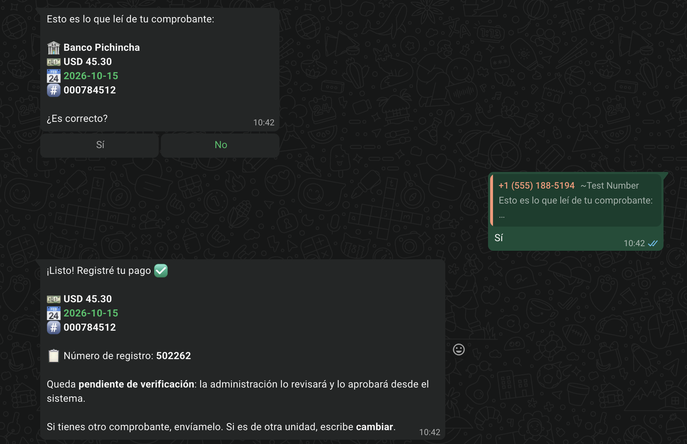

1. Pulsaste **Sí** en el resumen.
2. **Datos registrados**: monto, fecha y referencia.
3. **Número de registro**.
4. **Estado**: pendiente de verificación.
5. **Qué hacer después**: enviar otro comprobante o escribir *cambiar*.

**Resultado**
El asistente responde «¡Listo! Registré tu pago ✅» con:
- 💵 monto, 📅 fecha y #️⃣ referencia,
- 📋 **Número de registro**. Guárdalo por si necesitas consultar con la administración.

El pago queda **pendiente de verificación**: la administración lo revisa y lo aprueba desde el sistema.

**Consideraciones**
- **¿Tienes otro comprobante?** Envíalo ahí mismo. Si es de otra unidad, escribe primero *cambiar* ([sección 9](#9-palabras-útiles-cancelar-y-cambiar)).
- **Si envías el mismo comprobante dos veces**, no se duplica: el asistente avisa que ya estaba registrado y muestra la referencia.

  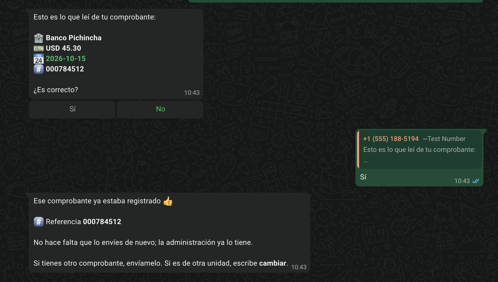

---

## 9. Palabras útiles: *cancelar* y *cambiar*

Escríbelas como un mensaje normal, en cualquier momento.

| Palabra | Qué hace | Respuesta |
|---|---|---|
| **cancelar** (o **salir**) | Termina la conversación actual. El comprobante que estaba a medias no se registra. | «Listo, cancelé la conversación. Escríbeme cuando quieras para empezar de nuevo.» |
| **cambiar** | Cambia la unidad a la que se registra el pago, cuando ya estás identificado. | Muestra tus unidades registradas o, si no tienes varias, pregunta «¿De qué *edificio* o conjunto es el pago?» |

**Interfaz**

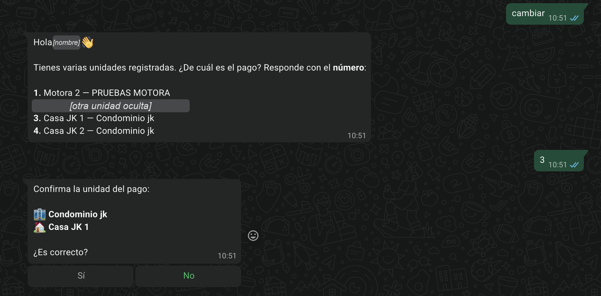

Con *cambiar*, el asistente muestra tus unidades. Respondes con el número y confirmas la nueva unidad con **Sí / No**. El nombre y una unidad están ocultos en la imagen.

*cancelar* funciona en cualquier paso. En la prueba se escribió con el resumen en pantalla, y el pago no se registró.

**Consideraciones**
- Si dejas la conversación sin responder más de **30 minutos**, se reinicia. Al escribir de nuevo, el asistente te saluda y te propone la última unidad con la que te identificaste.

  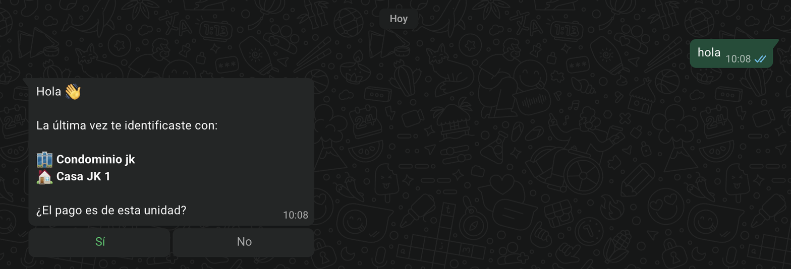

---

## 10. Mensajes de error y qué hacer

| Mensaje | Qué significa | Qué hacer |
|---|---|---|
| «En este momento no puedo consultar el sistema de la administración 😔» | El sistema de la administración no responde. | Inténtalo de nuevo en unos minutos. |
| «No pude procesar tu comprobante en este momento 😔 … tu comprobante sigue guardado.» (con botón **Reintentar**) | Falló la lectura automática. | Pulsa **Reintentar** o espera unos minutos. No hace falta reenviar el archivo. |
| «Después de varios intentos no logro leer el comprobante 😔» | El comprobante no se pudo leer tras varios intentos. | Envíalo directamente a la administración o prueba con otra foto o un PDF. |
| «No pude registrar tu pago en este momento 😔 Tu comprobante sigue guardado.» | Fallo pasajero al registrar. | Inténtalo de nuevo en unos minutos. |
| «No pude registrar tu pago 😔 Hay un dato que el sistema no aceptó…» | El sistema rechazó algún dato. | Contacta a la administración para que lo registren. |
| «Por ahora solo puedo leer *fotos*, *capturas de pantalla* o archivos *PDF*…» | Enviaste un audio, sticker u otro tipo de mensaje. | Envía el comprobante como foto, captura o PDF. |

---

## 11. Preguntas frecuentes

**¿El pago queda aprobado al instante?**
No. Queda *pendiente de verificación* hasta que la administración lo revise.

**¿Puedo registrar pagos de varias unidades?**
Sí. Después de registrar uno, escribe *cambiar* y elige la otra unidad.

**¿Puedo consultar mi saldo o lo que debo?**
No. El asistente solo registra comprobantes. Para otras consultas, contacta a la administración.

**¿Qué pasa si me equivoqué de comprobante?**
Si todavía no confirmaste el resumen, pulsa **No** o escribe *cancelar*. Si ya se registró, avisa a la administración con el número de registro.
